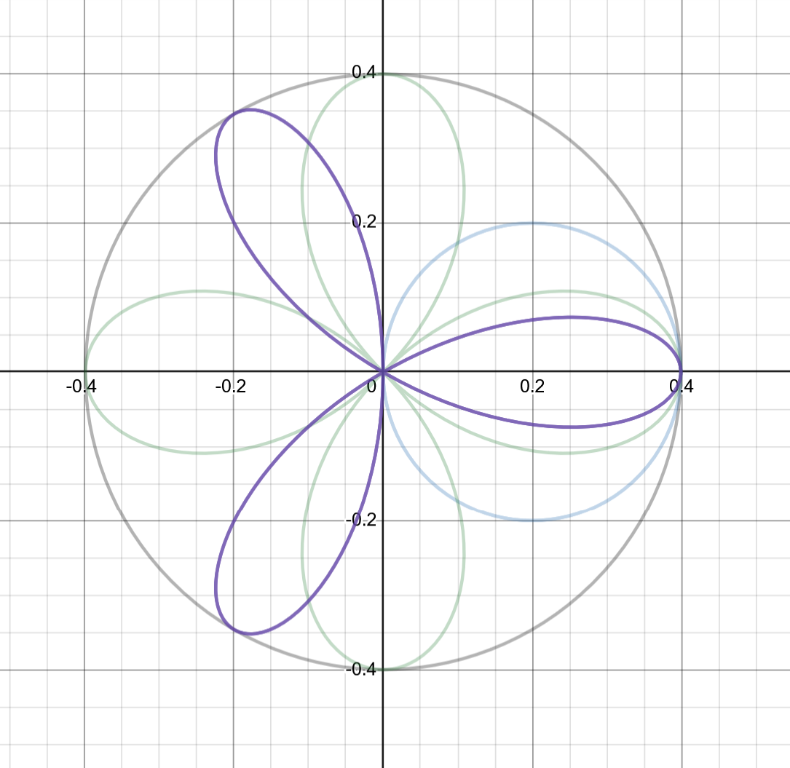
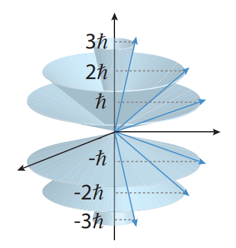
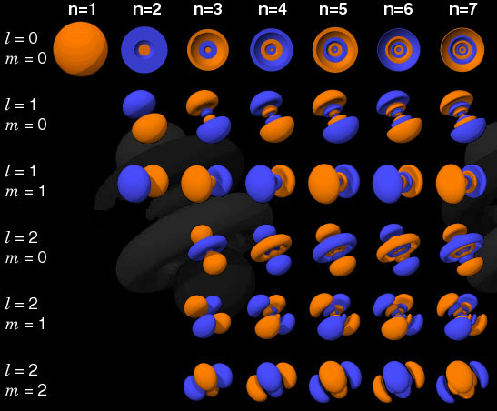

+++
title = "In-Depth Quantum Mechanics, Part II"
date = 2025-09-01
+++

We continue our exploration of quantum mechanics in detail in this second part of our series on quantum mechanics. Here, we'll cover the quantum harmonic oscillator, spin, quantization of angular momentum, the hydrogen atom, the special properties of fermions and bosons, and more!

<!-- more -->

> ### Chapter guide for Quantum Mechanics
> 
> - [Part 1](@/quantum-mechanics/index.md) covers the basic ideas of quantum mechanics and its fundamental formalism.
> - [Part 2](@/quantum-mechanics/part-2.md) covers applications of quantum mechanics as well as more advanced quantum-mechanical systems. **You are reading this part right now.**
> - [Part 3](@/quantum-mechanics/part-3.md) covers approximation methods in quantum mechanics, as well as applications to a variety of systems.
> - [Part 4](@/quantum-mechanics/part-4.md) covers advanced topics in quantum mechanics, including relativistic quantum mechanics, second quantization, and quantum field theory.

## Introduction to intrinsic spins

To start off, let's get (back) into quantum mechanics by examining the quantum phenomenon of **spin** (more accurately termed _intrinsic spin_, although it is common to just call it "spin" for short).

Intrinsic spin is one of the most important and most fundamentally _quantum_ phenomena, which cannot be explained in classical terms. It refers to the fact that there is a mysterious form of angular momentum that is a fundamental property of subatomic particles, like protons and electrons. This means that certain quantum particles *behave* like tiny spinning magnets, just like classical rotating charged spheres. A full explanation of what spin _is_ in a physical sense, however, is very difficult, since it is so far from any sort of everyday intuition that trying to explain it in terms of concepts of rotation that are familiar to us would be a gross oversimplification.

Historically, spin was accidentally discovered by the **Stern-Gerlach experiment**, first proposed by German physicist [Otto Stern](https://en.wikipedia.org/wiki/Otto_Stern) and then experimentally conducted by [Walther Gerlach](https://en.wikipedia.org/wiki/Walther_Gerlach). 

> **Note:** Despite its name, spin *does not correspond* to the concept of "spinning" particles. The quantum notion of particles - which have no well-defined volume and are essentially zero-dimensional points - means that the very idea of "spinning" quite nonsensical. Even if quantum particles could spin, theoretical calculations quickly show that they would spin faster than the speed of light, which of course is unphysical. In essence, the name "spin" was coined as a historical accident and unfortunately has stuck around to confuse every generation of physicists afterwards.

For particles like electrons (which are called _spin-1/2_ particles for complicated reasons), there are *precisely* two basis states of the spin operators, which are usually called "spin-up" and "spin down" and notated with $|\uparrow \rangle$ and $\langle \downarrow|$ respectively. Thus, we can write out the state-vector of a **spin-1/2 system** as:


|\Psi\rangle = \alpha |\uparrow\rangle + \beta |\downarrow\rangle


Where $\alpha, \beta$ are the probability amplitudes of measuring the spin-up and spin-down states. Note that the two spin states are orthonormal (that is, $\langle \uparrow|\downarrow\rangle = 0$ and $\langle \uparrow|\uparrow\rangle = \langle \downarrow|\downarrow\rangle = 1$. The **spin operator** $\mathbf{\hat S} = (\hat S_x, \hat S_y, \hat S_z)^T$, which we have already seen, have a very important *physical* meaning: they give the **spin angular momentum** of a spin-1/2 particle. Specifically, they predict that all spin-1/2 particles have an additional angular momentum associated with their intrinsic spin, called the _spin angular momentum_. This is usually represented by $\mathbf{S} = (S_x, S_y, S_z)$, which is a vector of the spin angular momentum of the particle in each coordinate direction.

To accommodate this decidedly non-classical behavior, physicists invented a new operator $\mathbf{\hat S}$, the **spin operator**. The spin operator also has components, which are given by $\mathbf{\hat S} = (\hat S_x, \hat S_y, \hat S_z)$. This gives us three eigenvalue equations, one each for each component of the spin operator:


\begin{align*}
\hat S_x|\psi\rangle = S_x|\psi\rangle \\
\hat S_y|\psi\rangle = S_y|\psi\rangle \\
\hat S_z|\psi\rangle = S_z|\psi\rangle
\end{align*}


This tells us that $S_x, S_y, S_z$ are the **eigenvalues** of the spin operators along the $x$, $y$, and $z$ axes (respectively). A remarkable result that defies all classical intuition is that these eigenvalues are constrained to only one of two values: $\hbar/2$ or $-\hbar/2$. That is to say:


S_x = \pm \dfrac{\hbar}{2}, \quad S_y = \pm \dfrac{\hbar}{2}, \quad S_z = \pm \dfrac{\hbar}{2}


> **Note:** We will rarely refer to the spin operator $\mathbf{\hat S}$ and usually just discuss its components $\hat S_x, \hat S_y, \hat S_z$. Thus, if we say "spin operator along $x$" we mean $\hat S_x$, not $\mathbf{\hat S}$.

Meanwhile, the _direction_ of the spin angular momentum depends on the specific eigenstate. For instance, the **spin-up eigenstate** of the $\hat S_z$ operator tells us that the particle's spin angular momentum points along $+z$. Similarly, the **spin-down eigenstate** of the $\hat S_z$ operator tells us that the particle's spin angular momentum points along $-z$. It is important to note that the direction of the spin angular momentum vector has _no correspondence_ with a particle's actual orientation. It *only* tells us information about where the particle's *spin angular momentum* points and is (usually) only relevant for understanding a particle's interaction with magnetic fields.

> **Note:** It is often the case that we just say "spin" as opposed to "spin angular momentum", although technically the latter is the correct terminology. However, in the interest of simplicity, we will call both "spin" wherever convenient.

To make things more concrete, the spin operators in the matrix representation are given by:


\begin{align*}
\hat S_x = \frac{\hbar}{2} \sigma_x, \quad \sigma_x &= \begin{pmatrix} 0 & 1 \\ 1 & 0 \end{pmatrix} \\
\hat S_y = \frac{\hbar}{2} \sigma_y, \quad \sigma_y &= \begin{pmatrix} 0 & -i \\ i & 0 \end{pmatrix} \\
\hat S_z = \frac{\hbar}{2} \sigma_z, \quad \sigma_z &= \begin{pmatrix} 1 & 0 \\ 0 & -1 \end{pmatrix}
\end{align*}


> **Note:** $\sigma_x, \sigma_y, \sigma_z$ are the **Pauli matrices**, which have eigenvalues $\pm 1$. Since the spin operators are just the Pauli matrices multiplied by a factor of $\hbar/2$, the eigenvalues of the all three spin operators are just a factor of $\hbar/2$ multiplied by the eigenvalues of the Pauli matrices (which are $\pm 1$). It is also useful to note that all three have **determinant** of $-1$ and **zero trace**. Other information can be found on its [wikipedia page](https://en.wikipedia.org/wiki/Pauli_matrices)

Meanwhile, the eigenstates of the spin operators are called **spinors** (or [eigenspinors](https://en.wikipedia.org/wiki/Eigenspinor)). They are often written as $|\uparrow_x\rangle$ and $|\downarrow_x \rangle$ to indicate whether they are spin-up or spin down eigenstates (indicated by the direction of the arrows), which corresponds directly to what direction the spin angular momentum points towards ($x$, $y$, or $z$).

> **Note:** Another common notation is to use $|+\rangle_x, |-\rangle_x$ for spin-up and spin-down states respectively, though this can clutter things up so we'll avoid it.

The explicit forms of the spinors associated with the spin operators $\hat S_x, \hat S_y, \hat S_z$ are given by:


\begin{align*}
|\uparrow_x\rangle &= \dfrac{1}{\sqrt{2}}\begin{pmatrix} 1 \\ 1 \end{pmatrix}, \quad
|\downarrow_x\rangle = \dfrac{1}{\sqrt{2}}\begin{pmatrix} 1 \\ -1 \end{pmatrix} \\
|\uparrow_y\rangle &= \dfrac{1}{\sqrt{2}}\begin{pmatrix} 1 \\ i \end{pmatrix}, \quad
|\downarrow_y\rangle = \dfrac{1}{\sqrt{2}}\begin{pmatrix} 1 \\ -i \end{pmatrix} \\
|\uparrow_z\rangle &= \begin{pmatrix} 1 \\ 0 \end{pmatrix},\quad\qquad 
|\downarrow_z\rangle = \begin{pmatrix} 0 \\ 1 \end{pmatrix} \\
\end{align*}


For calculations, it is frequently useful to reference certain identities of the Pauli matrices and spin operators. For instance, a very useful one is that:


\sigma_x^2 = \sigma_y^2 = \sigma_z^2 = \hat I


Where $\hat I$ is the identity matrix. The spin operators and Pauli matrices also satisfy the below commutation relations:


\begin{align*}
[\sigma_x, \sigma_y] &= 2i\sigma_z \\
[\sigma_j, \sigma_k] &= 2i\varepsilon_{jkl}\sigma_l \\
[\hat S_x, \hat S_y] &= i\hbar \hat S_z \\
[\hat S_y, \hat S_z] &= i\hbar S_x \\
[\hat S_z, \hat S_x] &= i\hbar \hat S_y
\end{align*}


In addition, some other useful identities are:


\begin{gather*}
\sigma_j \sigma_k + \sigma_k \sigma_j = 2\delta_{jk} \\
[\hat S^2, \hat S_x] = [\hat S^2, \hat S_y] = [\hat S^2, \hat S_z] = 0
\end{gather*}


Where $\hat S^2 = \mathbf{\hat S}\cdot\mathbf{\hat S}$ is the squared spin operator, which will be *very* important when we discuss more types of angular momentum in quantum mechanics. Finally, we have the all-important **Pauli identity**:


\sigma_i \sigma_j = \delta_{ij} + i\varepsilon_{ijk}\sigma_k, \quad i,j \in (x, y, z)


Where $\delta_{ij}$ (as we've seen before) is the Kronecker delta, defined as:


\delta_{ij} = \begin{cases}
1 & i = j \\
0 & i \neq j
\end{cases}


And $\varepsilon_{ijk}$ is called the [Levi-Civita symbol](en.wikipedia.org/wiki/Levi-Civita_symbol) (or _Levi-Civita tensor_), and is given by:


\varepsilon_{ijk}=
\begin{cases}+1&{\text{if }}(i,j,k){\text{ is }}(1,2,3),(2,3,1),{\text{ or }}(3,1,2),\\-1&{\text{if }}(i,j,k){\text{ is }}(3,2,1),(1,3,2),{\text{ or }}(2,1,3),\\\;\;\,0&{\text{if }}i=j,{\text{ or }}j=k,{\text{ or }}k=i
\end{cases}


> **Note:** A very useful property of the Levi-Civita symbol is that it can be used to define the cross product of two vectors $\mathbf{A} \times \mathbf{B}$ via (\mathbf{A} \times \mathbf{B})_i = \varepsilon_{ijk} A_i B_j. There is also the so-called [permutation definition](https://en.wikipedia.org/wiki/Levi-Civita_symbol#Three_dimensions) of the Levi-Civita symbol, although we will not cover that here.

While the eigenstates of the $\hat S_x, \hat S_y, \hat S_z$ operators are distinct, it is possible to express eigenstates in one particular spin basis as a superposition of eigenstates in another spin basis. For instance, the eigenstates of the $\hat S_x$ operator can be written in terms of the eigenstates of the $\hat S_z$ operator:


\begin{align*}
|\uparrow_x\rangle &= \frac{1}{\sqrt{2}} \left(|\uparrow_z\rangle + |\downarrow_z\rangle\right) \\ 
|\downarrow_x\rangle &= \frac{1}{\sqrt{2}} \left(|\uparrow_z\rangle - |\downarrow_z\rangle \right)
\end{align*}


Likewise, the eigenstates of the $\hat S_y$ operator can be written in terms of the eigenstates of the $\hat S_z$ operator:


\begin{align*}
|\uparrow_y\rangle &= \frac{1}{\sqrt{2}} \left(|\uparrow_z\rangle + i |\downarrow_z\rangle\right) \\ |\downarrow_y\rangle &= \frac{1}{\sqrt{2}} \left(|\uparrow_z\rangle - i |\downarrow_z\rangle\right)
\end{align*}


> **Historical note:** Interestingly, Wolfgang Pauli, for which the Pauli matrices are named, did not initially even like matrices (or linear algebra for that matter) being there in quantum mechanics! He once said of Schrödinger (to Max Born), _"Yes, I know you are fond of tedious and complicated formalism. You are only going to spoil Heisenberg's physical idea by your futile mathematics"_. Funnily enough, he would eventually be most remembered for the his contribution to matrix mechanics and in describing spin, something he had once furiously railed against! (See the [first comment on this Physics SE answer](https://hsm.stackexchange.com/a/17997)).

### Spin and the Stern-Gerlach experiment

The fact that the spin operator tells us that spin-1/2 particles have *additional* angular momentum not predicted by classical physics has a profound implication: it means that any two otherwise identical spin-1/2 particles (for instance, electrons) will behave *differently* in a magnetic field. The magnetic force exerted on a classical charged particle with [magnetic moment](https://en.wikipedia.org/wiki/Magnetic_moment) $\vec{\boldsymbol{\mu}}$ is given by $\mathbf{F}_B = -\nabla(\vec{\boldsymbol{\mu}} \cdot \mathbf{B})$, where $\mathbf{B}$ is the magnetic field, and $\vec{\boldsymbol{\mu}}$ is given by:


\vec{\boldsymbol{\mu}} = g\dfrac{q}{2m} \mathbf{S}, \quad g \approx 2


> **Note:** The **magnetic moment** $\vec{\boldsymbol{\mu}}$ is the vector that measures the orientation of the magnetic field associated with an electric charge. A *nonzero* magnetic moment causes a charge to *align* with (or against) an external magnetic field, an effect that can be measured very precisely and is used in a variety of applications.

Since two randomly-chosen electrons would most likely have (and in some cases, *must have*) different spins, they would have opposite magnetic moments, and thus be deflected in different ways due to the magnetic force. Unknowingly taking advantage of the phenomenon, Stern and Gerlach conducted an experiment (shown in the diagram below) that showed a beam of silver atoms would split into two in a magnetic field, experimentally confirming the prediction of spin from quantum theory. This, again, is because electrons with different spins are deflected in *opposite directions* by the magnetic field, leading to the beam splitting into two (one of spin-up electrons and one of spin-down electrons).

_A diagram of the Stern-Gerlach experiment. Source: [The Information Philosopher](https://www.informationphilosopher.com/solutions/experiments/stern_gerlach/)_

### Repeated measurements of spin

We saw previously that all three spin operators **don't commute** with each other; for instance, $[\hat S_x, \hat S_y] = i\hbar \hat S_z$. This is not just a mathematical peculiarity! In quantum mechanics, remember that any two operators that *do not commute* represent observables that **cannot be simultaneously measured to arbitrary precision**. In formal terms, the uncertainty principle tells us that for two non-commuting operators $\hat A, \hat B$, where $[\hat A, \hat B] = i\hat C$, then:


\Delta A \Delta B \geq \dfrac{|\langle \hat C\rangle|}{2}


For instance, in the case of the position and momentum operators (where $[\hat x, \hat p] = i\hbar$), this reduces to the famous **Heisenberg uncertainty principle**:


\Delta x \Delta p \geq \frac{\hbar}{2}


The consequence of the uncertainty principle is that if you measure one observable $A$ and then measure another observable $B$, if $\hat A, \hat B$ *do not commute*, then:

1. They cannot *both be measured simultaneously* to perfect accuracy, and
2. A measurement of one observable *tells you nothing* about the other observable

Let's break down what this means. Suppose you had an electron which initially is know to be spin-up along $z$. Mathematically, you know the precise value of the $\hat S_z$ operator (spin operator in the z direction): there is **100% probability** that the electron is in the spin-up state along the $z$ axis. What happens if you measure the electron's spin along $x$? Well, the electron is **equally likely** to be spin-up or spin-down along the $x$ axis because of rule (2). We already saw that $[\hat S_z, \hat S_x] \neq 0$ (that is, the spin operators along $z$ and $x$ *do not* commute), so knowing $S_z$ (the electron's spin along $z$) tells you nothing about $S_x$.

Now, what happens if you measure the electron's spin along $z$ again? "This is a pointless question!", you may say, "since I already measured the electron to be in the spin-up state along $z$, so it must certainly be in that same state!" However, things are not *quite* so simple. Remember that since the spin operators along $z$ and $x$ do not commute, measuring $S_x$ tells you nothing about $S_z$ (and vice-versa). This means that if you know $S_x$, you would not know *anything* about $S_z$ prior to measuring it. Since you had measured $S_x$, if you then choose to measure $S_z$, it would be a contradiction if the electron's spin along $z$ could also be precisely known to be in one state. Thus we are left with the profound and puzzling conclusion that upon measuring $S_z$ after $S_x$, the electron is again **equally likely** to be spin-up or spin-down along the $z$ axis. The previous information you had about the electron - namely, that it was in the spin-up state along $z$ - has now been erased!

### Larmor precession

If we think about a spinning top rotating on a table, it will rotate round and round in a circle tilted at an angle (until it inevitably falls). This phenomenon is known as **precession**, and is shown in the animation below:

_Source: [Wikimedia Commons](https://commons.wikimedia.org/wiki/File:Gyroscope_precession.gif)_

The reason why everyday precession happens is that the Earth's gravity produces a torque on the spinning top. But since it is also spinning, the top has *angular momentum* which resists the torque, leading to the gyroscope rotating at an angle. In physics, the gyroscope is said to _precess_. But angular momentum is not just found in the classical world: it is *also* found in the quantum world, and it leads to an effect called **Larmor precession**.

To understand Larmor precession, recall that we earlier noted that spin-1/2 particles have an *intrinsic angular momentum* that comes from their spin. We have notated this angular momentum as $\mathbf{S}$, as it is the **spin angular momentum**, and we know it must have a magnitude of $\pm \hbar/2$ along any axis (so long as it is a spin-1/2 particle). This angular momentum creates a magnetic moment $\vec{\boldsymbol{\mu}}$ associated with the particle, given by:


\vec{\boldsymbol{\mu}} = \gamma \mathbf{S}


Here, $\gamma$ is known as the **gyromagnetic ratio**, and it is a constant that can be calculated from the mass, charge, and other characteristics of the particle in question. From the magnetic moment, we can construct a Hamiltonian for a spin-1/2 particle placed in an applied magnetic field $\mathbf{B}$ with the spin operator $\mathbf{\hat S}$, given by:


\hat H = -\vec{\boldsymbol{\mu}} \cdot \mathbf{B} = -\gamma(\mathbf{\hat S} \cdot \mathbf{B})


It is usually easiest to consider a magnetic field aligned along the $z$-direction, and thus we have:


\hat H = -\gamma \hat S_z B_z


By solving for the eigenvalues and eigenstates of the Hamiltonian, we get two spin eigenstates, which are respectively given by:


|\uparrow_z\rangle = \begin{pmatrix} 1 \\ 0 \end{pmatrix},\quad 
|\downarrow_z\rangle = \begin{pmatrix} 0 \\ 1 \end{pmatrix}


Meanwhile, the energy eigenvalues are given by:


E_{\pm z} = \pm \frac{1}{2}\hbar \gamma B_z


This tells us that we have two distinct energy eigenstates: the first one with higher energy, and the second one with lower energy. The energy difference between the two energy levels can be written in terms of the **Larmor frequency** $\omega_0$ via:


\begin{align*}
\Delta E &= E_+ - E_- \\
&= \hbar \gamma B_z \\
&= \hbar \omega_0, \quad \omega_0 \equiv |\gamma B_z|
\end{align*}


Physically, when a magnetic field is applied, we say that the magnetic moments of a spin-1/2 particle **precess**, since they rotate (just like a gyroscope) to line up along or against the magnetic field. This type of precession is called **Larmor precession**, and it is very similar to the classical precession of a gyroscope, with some notable differences being that there is nothing physically "rotating" at an angle; rather, it is the *magnetic moment vector* that becomes tilted off-axis, which is why we term it as _precession_. 

_A diagram of Larmor precession. Source: [Wikimedia Commons](https://commons.wikimedia.org/wiki/File:Precession_in_magnetic_field.svg)_

Precise measurements of Larmor precession are essential in many areas of science, especially in **nuclear magnetic resonance (NMR) spectroscopy**, which is used in the medical sciences, as well as biotechnology and biochemistry. Additionally, many electronic devices (like hard disk storage) relies on exploiting the effects of spin, with an entire field of [spintronics]([https://en.wikipedia.org/wiki/Spintronics](https://en.wikipedia.org/wiki/Spintronics) devoted to research in this area. With so many observations proving the existence of spin, we know for certain that even if spin runs counter to our intuitions (pun intended!), it is nevertheless a very real aspect of the quantum world.

### Generalized two-level systems

We will close our introductory discussion of spin and the ways to analyze spin by quickly discussing the generalization of a spin-1/2 system: **two-level systems**. Two-level systems (that is, a quantum system with two degrees of freedom) are found throughout quantum mechanics. Since spin-1/2 particles can either be spin-up or spin-down, which are the only two possible states in a spin-1/2 system, it is the **prototypical two-level system**. However, it is by no means unique: there are other two-level systems out there, and they can often be modelled using the same tools. For instance, it is very common to see Hamiltonians of the form:


\hat H \propto \sigma_i


Where $\sigma_i \in [\sigma_x, \sigma_y, \sigma_z]$ is a Pauli matrix, and they obey: 


\begin{align*}
[\sigma_x, \sigma_y] =  \sigma_z \\
[\sigma_y, \sigma_z] =  \sigma_x \\
[\sigma_z, \sigma_x] =  \sigma_y
\end{align*}


### The Bloch sphere

A common generalization of the spin-1/2 system we have discussed at length is known as the **Bloch sphere**. The Bloch sphere is a formulation of a generalized two-level system with two states, which we notate as $|0\rangle$ and $|1\rangle$. Here, $|0\rangle$ is the ground state, so it is associated with a lower energy, whereas $|1\rangle$ is the excited state, so it is associated with a higher energy.

The Bloch sphere (illustrated in the diagram below) allows us to visualize the abstract space in which these states "live", much like the complex plane can be drawn as a 2D coordinate grid. The state space of the system is parametrized in spherical coordinates by the angles $(\theta, \phi)$ - it is important to note that these _aren't_ physical locations in space, but are rather located in the abstract Hilbert space of the two-state system.

{{ diagram(
  src="https://upload.wikimedia.org/wikipedia/commons/f/f0/Bloch_Sphere_representation.svg"
  desc="A visualization of the Bloch sphere"
) }}

_An illustration of the Bloch sphere. Source: [Wikipedia](https://en.wikipedia.org/wiki/File:Bloch_Sphere_representation.svg)_

On the Bloch sphere, $|0\rangle$ "lives" at the north pole of the Bloch sphere, and $|1\rangle$ "lives" at the south pole. Other states of the system lie somewhere between the two poles. The general state-vector of the system can thus be written as:


|\psi\rangle = \cos\left( \frac{\theta}{2} \right) |0\rangle + e^{i\phi} \sin\left( \frac{\theta}{2} \right) |1\rangle


Where $e^{i\phi}$ is the phase of the state-vector, and where the basis states are given by:


|0\rangle = 
\begin{pmatrix}
1 \\ 0
\end{pmatrix}, \quad
|1\rangle =
\begin{pmatrix}
0 \\ 1
\end{pmatrix}


> **Note:** in the standard convention, the $x$ axis represents the **real part** of the phase, whereas the $y$ axis represents the **imaginary part** of the phase.

In the case that the two-level system models a spin-1/2 particle (a very common but not universal case), then we have:


|\psi\rangle = \cos\left( \frac{\theta}{2} \right) |\uparrow\rangle + e^{i\phi} \sin\left( \frac{\theta}{2} \right) |\downarrow\rangle


> **Note:** the choice is mathematically-arbitrary, so it does not matter whether we call $|0\rangle$ the spin-up or spin-down state, as long as our choice is consistent. However, $|\uparrow\rangle$ is usually associated with $|0\rangle$ in physics and engineering, and likewise $|\downarrow\rangle$ is usually associated with $|1\rangle$.

Along the "equator" of the Bloch sphere, we have $\theta = \pi/2$, and thus the state-vector takes the simpler form:


|\psi\rangle = \frac{1}{\sqrt{ 2 }}\big(|0\rangle + e^{i\phi}|1\rangle\big)


Note that this corresponds to a state with 50% probability of measuring $|0\rangle$ and $|1\rangle$ since the complex phase factor has unit magnitude (you can check it for yourself by computing $P_0 = |\langle 0|\psi\rangle|^2$ and $P_1 = |\langle 1|\psi\rangle|^2$). However, the phase is still physically-relevant

#### Hamiltonian of a generalized two-level system

A very common basic Hamiltonian for a generalized two-level system is given by:


\hat{H} = \frac{\hbar \omega}{2} \sigma_{z}


The energy eigenvalues are then $E = \pm \frac{1}{2} \hbar \omega$, with an energy difference of $\Delta E = \hbar \omega$ between the ground state and the excited state. Thus, the general time-dependent state-vector of the system, valid for all $t$, is given by:


|\psi(t)\rangle = \cos\left( \frac{\theta}{2} \right) |0\rangle e^{-i \omega t/2} + e^{i\phi} \sin\left( \frac{\theta}{2} \right) |1\rangle e^{i \omega t/2}


This comes from tacking on a factor of $e^{-i E t/\hbar}$ to each of the eigenstates, and substituting in our known values of $E = \pm \frac{1}{2}\hbar\omega$. It is standard to factor out the phase factor of $e^{-i\omega t/2}$, giving us:


\begin{align*}
|\psi(t)\rangle &= e^{-i \omega t/2}\left[\cos\left( \frac{\theta}{2} \right) |0\rangle  + e^{i\phi} \sin\left( \frac{\theta}{2} \right) |1\rangle e^{i \omega t} \right] \\
&= e^{-i \omega t/2}\left[\cos\left( \frac{\theta}{2} \right) |0\rangle  + e^{i(\phi +  \omega t)} \sin\left( \frac{\theta}{2} \right) |1\rangle\right]
\end{align*}


Since the factor $e^{-i\omega t/2}$ is a phase factor, its magnitude is one, and thus it is not directly observable; thus, the physics of the system are identical if it is dropped. Defining $\phi_{r}(t) = \phi + \omega t$ as the **relative phase** of the system (since it is a phase that comes from the _difference_ in energy of the two states, which is a relative quantity), we can rewrite the state-vector as:


|\psi(t)\rangle = \cos\left( \frac{\theta}{2} \right) |0\rangle  + e^{i\phi_{r}(t)} \sin\left( \frac{\theta}{2} \right) |1\rangle


As long as the system is undisturbed and the Hamiltonian is time-independent, the relative phase $\phi_r$ changes by a *constant* rate $\omega$ (the **Larmor frequency**) as the state-vector precesses along the Bloch sphere - note this is independent of the $\theta$ coordinate! If we imagine the state-vector of the system to be represented by an arrow, the change in the relative phase can be visualized as the rotation of this "arrow" as it precesses (i.e. rotates) around the Bloch sphere.

> **Note:** For an application of the Bloch sphere in quantum optics, please see [these lecture notes](https://www.wbt.uni-rostock.de/storages/uni-rostock/Alle_MNF/Physik_Qms/Lehre_Scheel/quantenoptik/Quantenoptik-Vorlesung10.pdf).

### Conclusion to two-level systems

Two-level systems are the fundamental model behind a vast variety of quantum systems, including [qubits](https://qubit.guide) in quantum computing, [optically-pumped lasers](https://en.wikipedia.org/wiki/Rabi_cycle), and [molecular ions](https://web1.eng.famu.fsu.edu/~dommelen/quantum/style_a/hion.html), as well as playing an important role in understanding the emission and absorption of radiation at the quantum level. We will discuss more examples of them throughout this guide - stay tuned!

## The quantum harmonic oscillator

One of the simplest, but most important quantum systems is the **quantum harmonic oscillator**. At face value, it describes a particle in a harmonic potential well. To start, let us recall that the classical harmonic potential is given by:


V(x) = \dfrac{1}{2} kx^2 = \dfrac{1}{2} m\omega^2 x^2, \quad \omega \equiv \sqrt{k/m} 


The classical solutions to the (classical) harmonic oscillator are in terms of sinusoidal functions, which is why it is indeed called the *harmonic* oscillator. However, on a basic level, a harmonic potential is nothing more than a basic quadratic potential, one that we show in the below diagram:

{{ diagram(
	src="harmonic-potential.excalidraw.svg"
	desc="A plot of the harmonic potential, showing that it has an energy that is quadratic with the potential and symmetric about the x-axis"
) }}

In quantum mechanics, we retain the same form of the harmonic potential, except we perform the substitution $x \to \hat x$, where $\hat x$ is the position operator. Thus the Hamiltonian is given by:


\hat H = \dfrac{\hat p^2}{2m} + V(x) = \dfrac{\hat p^2}{2m} + \dfrac{1}{2} m\omega^2 \hat x^2


Note that we can also write this in the position representation (where $\hat x = x$ and $\hat p = -i\hbar \frac{d}{dx}$ in 1D) as:


\hat H = -\frac{\hbar^2}{2m} \dfrac{d^2}{dx^2} + \frac{1}{2} m \omega^2 x^2


The quantum harmonic oscillator is a very useful model in quantum mechanics, since it is one of the few problems that can be solved exactly. This *does not* mean it is trivial - the quantum harmonic oscillator finds numerous applications in molecular and atomic physics. The quantum harmonic oscillator can first be used as an approximation for a complicated potential. This is because the Taylor expansion of an *arbitrary* potential centered at $x = x_0$ is given by:


V(x) = V_0 + V'(x-x_0) + \dfrac{1}{2} V''(x-x_0)^2 + \dfrac{1}{6} V'''(x-x_0)^3 + \dots


Another application is to describe the interaction of a charged (quantum) particle with an *standing electromagnetic waves*, something we will discuss later. When an electromagnetic field is trapped in some cavity, it decomposes into a series of modes, whose wavelength can only come in quantized values:


\omega = \dfrac{2\pi c}{\lambda}, \quad \lambda = \dfrac{2L}{n}, \quad n = 1,2,3, \dots


Thus, any charged particle within such a cavity will interact with the standing waves of the electromagnetic field, leading to its energy levels being quantized. This is the origin of uniquely quantum phenomena such as the [Stark effect](https://en.wikipedia.org/wiki/Stark_effect), but we'll explain this in more detail later.

The third main application of the quantum harmonic oscillator is to describe the interaction of a particle with a quantized electromagnetic field, which is the realm of **quantum electrodynamics** and _second quantization_. While this can get complicated very quickly, the essence is to describe the quantized electromagnetic field as a series of coupled harmonic oscillators. We will cover this more at the very end of this guide.

To solve the quantum harmonic oscillator we begin with the same general methods as for essentially any quantum system - to write out the eigenvalue equation for the Hamiltonian:


\hat H|\psi\rangle = E|\psi\rangle


This is the starting point, and there are several different ways to proceed from here. For instance, we can solve the eigenvalue equation in the position basis by taking the inner product with a position basis ket:


\begin{gather*}
\langle x|\hat H|\psi\rangle = \langle x|E|\psi\rangle \\
\langle x|\hat H|\psi\rangle = E\langle x|\psi\rangle \\
\left\langle x \left|-\dfrac{\hbar^2}{2m}\dfrac{d^2}{dx^2} + \dfrac{1}{2} m\omega^2 \hat x^2\right|\psi\right\rangle = E\langle x|\psi\rangle \\
\Rightarrow -\dfrac{\hbar^2}{2m}\dfrac{d^2 \psi}{dx^2} + \dfrac{1}{2} m\omega^2 x^2 \psi(x) = E \psi(x)
\end{gather*}


This is a differential equation that can indeed be solved, although it is not very easy to solve. Indeed, a much better approach is to use the so-called _algebraic approach_, which originated with the physicist Paul Dirac, which we'll now discuss.

### The ladder operator approach

Dirac's key insight in solving the quantum harmonic oscillator is to "factor" the Hamiltonian by defining two new operators $\hat a$ and $\hat a^\dagger$, given by:


\begin{align*}
\hat a &= \dfrac{1}{\sqrt{2}}(\hat x'+ i\hat p') \\
\hat a^\dagger &= \dfrac{1}{\sqrt{2}}(\hat x' - i\hat p')
\end{align*}


Where $\hat x', \hat p'$ are related to the position and momentum operators $\hat x, \hat p$ as follows:


\hat x' = \sqrt{\dfrac{m\omega}{\hbar}} \hat x, \quad \hat p' = \dfrac{1}{\sqrt{m\hbar \omega}} \hat p


It is also useful to note that:


\begin{align*}
\hat x' &= \frac{1}{\sqrt{2}}(\hat a^\dagger + \hat a) \\ 
\hat p' &= \dfrac{i}{\sqrt{2}}(\hat a^\dagger - \hat a) \\
\end{align*}


$\hat a$ and $\hat a^\dagger$ are conventionally called the **ladder operators**. These two operators satisfy $[\hat a, \hat a^\dagger] = 1$, an important identity to keep in mind for later. While many steps avoid using this approach and write $\hat a$ and $\hat a^\dagger$ _purely_ in terms of $\hat x$ and $\hat p$, by defining our new operators $\hat x', \hat p'$ we can *non-dimensionalize* the problem, making it easier to solve. This is essentially the same thing as a change of variables in a classical mechanics problem, only here we're using operators, not classical functions.

> **Note:** While $\hat a$ and $\hat a^\dagger$ are indeed adjoints of each other, it is common to consider them essentially separate operators (for reasons we'll soon see). It is also common to use the notation $(\hat a_-, \hat a_+)$ instead of $(\hat a, \hat a^\dagger)$ (where $\hat a_- = \hat a$ and $\hat a_+ = \hat a^\dagger$) which is a completely equivalent notation.

Thus, with our operators $\hat x'$ and $\hat p'$, the Hamiltonian can be written as:


\hat H = \hbar \omega \hat H', \quad \hat H' = \dfrac{1}{2}(\hat x'^2 + \hat p'^2)


These operators allow us to simplify the Hamiltonian down greatly, since we find that:


\begin{align*}
\hbar \omega\left(\hat a^\dagger \hat a + \frac{1}{2}\right) &= \hbar \omega\left(\frac{1}{2}(\hat x' + i\hat p')(\hat x' - i\hat p') + \frac{1}{2}\right)\\
&= \dfrac{1}{2}\hbar \omega \left(\hat x'^2 - i\hat x' \hat p' + i\hat x' \hat p' + \hat p'^2 + 1\right) \\
&= \dfrac{1}{2}\hbar \omega(\hat x'^2 + \hat p'^2 + i[\hat x', \hat p'] + 1) \\
&= \dfrac{1}{2}\hbar \omega(\hat x'^2 + \hat p'^2 -1 + 1) \\
&= \hbar \omega H' \\
&= \hat H
\end{align*}


If one defines another new operator $\hat N$ (we will discuss what this means later), given by $\hat N = \hat a^\dagger \hat a$, then the Hamiltonian takes the form:


\hat H = \hbar \omega \left(\hat N + \dfrac{1}{2}\right)


> **Note:** Be careful of the order of the $\hat a$ and $\hat a^\dagger$ operators! This is because $\hat N = \hat a^\dagger \hat a$, but $\hat a^\dagger \hat a \neq \hat a \hat a^\dagger$ so $\hat N \neq \hat a \hat a^\dagger$! Indeed we find that $\hat a \hat a^\dagger = 1 + \hat N$, which can be derived from the commutation relation $[\hat a, \hat a^\dagger] = 1$.

The genius of using this operator-based "algebraic" approach to solving the quantum harmonic oscillator is that the $\hat a, \hat a^\dagger$ operators satisfy:


\hat a|\psi_0\rangle = 0, \quad \hat a^\dagger |\psi_0\rangle = |\psi_1\rangle


In fact, in the general case, we find that for the $n$-th eigenstate $|\psi_n\rangle$ we have:


\hat a|\psi_n\rangle = \sqrt{n}|\psi_{n - 1}\rangle, \quad \hat a^\dagger|\psi_n\rangle = \sqrt{n + 1}~|\psi_{n + 1}\rangle


It is common convention to indicate the $n$-th eigenstate of the quantum harmonic oscillator with $|n\rangle = |\psi_n\rangle$, in which case one may write the more elegant expression:


\hat a|n\rangle = \sqrt{n}~|n-1\rangle, \quad \hat a^\dagger|n\rangle = \sqrt{n+1}~|n + 1\rangle


Thus we again find that $\hat a|0\rangle = \hat a|\psi_0\rangle = 0$ and $\hat a^\dagger |0\rangle = \hat a|\psi_0\rangle = |\psi_1\rangle$. These are indeed the chief identities of the quantum harmonic oscillator, because if we substitute in the definitions of the $\hat a, \hat a^\dagger$ operators, we have:


\begin{align*}
\hat a^\dagger \hat a|n\rangle &= \hat a^\dagger(\sqrt{n}~|n+1\rangle) \\
&= \sqrt{n^2} |(n + 1) - 1\rangle \\
&= n|n\rangle
\end{align*}


But we already know that $\hat a^\dagger \hat a$ is just the $\hat N$ operator, so we therefore have:


\hat
N|n\rangle = n|n\rangle


In addition, we have:


\begin{align*}
\hat a^\dagger\hat a|n\rangle &= \hat N|n\rangle 
= n|n\rangle \\
\hat a \hat a^\dagger|n\rangle &= (\hat N + \hat I)|n\rangle 
= (n + 1)|n\rangle
\end{align*}


 The $\hat N$ operator is often called the **number operator** since it returns the index $n$ corresponding to the *nth* eigenstate. For instance, for the first eigenstate $|0\rangle$ (in more traditional notation, this can be written as $|\psi_0\rangle$, which is equivalent), $\hat N|0\rangle = 0$, which tells us that (as we expect) the first eigenstate is labelled with index $n = 0$. Likewise, for the eigenstate $|3\rangle$ then $\hat N|3\rangle = 3 |n\rangle$, which indeed returns its index $n = 3$. What makes it *particularly* special is how the number operator can be defined solely in terms of the $\hat a$ and $\hat a^\dagger$ operators, which is a very non-trivial result. Thus, if we substitute $\hat N|n\rangle = n|n\rangle$ into our Hamiltonian, we have:


\hat H|n\rangle = \hbar \omega \left(\hat N + \dfrac{1}{2}\right)|n\rangle = \underbrace{\hbar \omega \left(n + \dfrac{1}{2}\right)}_{E_n}|n\rangle


Where by comparison our expression with the Hamiltonian's eigenvalue equation $\hat H|n\rangle = E_n|n\rangle$, we find that:


E_n = \hbar \omega\left(n + \dfrac{1}{2}\right)


Thus, we have found the energy eigenvalues without needing to solve any differential equation, which is quite an enormous feat! Additionally, since the energies are only dependent on $n$, the energies are **non-degenerate**, meaning that each energy eigenvalue is associated with a *distinct* eigenstate. This is incredibly important because it's uncommon to encounter fully non-degenerate systems in quantum mechanics, where each eigenstate can be labelled by a single eigenvalue (think about our previous discussion of CSCOs).

In addition, we can also calculate the eigenstates in the position (or momentum) bases, so the algebraic formalism helps us get the wavefunctions too. To do so, let us recognize that if we take the $n = 0$ state (often called the _ground state_, and notated as $|0\rangle$), we have $\hat a |0\rangle = 0$. Keep this in mind! Now, recall that we *defined* our relevant operators to take the following forms:


\begin{align*}
\hat a &= \dfrac{1}{\sqrt{2}}(\hat x'+ i\hat p') \\
&= \sqrt{\dfrac{m\omega}{2\hbar}}\hat x + \frac{i}{\sqrt{2m\omega \hbar}}\hat p  \\
\hat a^\dagger &= \dfrac{1}{\sqrt{2}}(\hat x' - i\hat p') \\
&= \sqrt{\dfrac{m\omega}{2\hbar}}\hat x + \frac{i}{\sqrt{2m\omega \hbar}}\hat p
\end{align*}


Thus, the explicit forms of $\hat a$ and $\hat a^\dagger$ can be found in the position basis by substituting in $\hat x = x$ and $\hat p = -i\hbar \dfrac{d}{dx}$, giving us:


\begin{align*}
\hat a &= \sqrt{\frac{m\omega}{2\hbar}} \left(x + \frac{\hbar}{m\omega} \dfrac{d}{dx}\right) \\
\hat a^\dagger &= \sqrt{\frac{m\omega}{2\hbar}} \left(x - \frac{\hbar}{m\omega} \dfrac{d}{dx}\right)
\end{align*}


Now substituting these the explicit form of $\hat a$ in the position basis, we have:


\begin{gather*}
\hat a|0\rangle = 0 \\
\Rightarrow ~ \hat a\langle x|0\rangle = \hat a\psi_0(x)  = 0 \\
\Rightarrow ~ \left(x + \dfrac{\hbar}{m\omega}  \dfrac{d}{dx}\right)\psi_0(x) = 0
\end{gather*}


> **Note:** It is also possible to do this in the *momentum basis* but the calculations become much more hairy. See [this Physics StackExchange answer](https://physics.stackexchange.com/questions/632095/eigenstates-of-qm-harmonic-oscillator-in-momentum-space) if interested.

This gives us a differential equation to solve, albeit a much easier one that can be solved explicitly by the standard methods of solving 1st-order differential equations. The solution is a Gaussian function, and in particular:


\psi_0(x) = C e^{-m\omega x^2 / (2\hbar)}


And applying the normalization condition, the undetermined constant $C$ can be found to be $C = \left(\frac{m\omega}{\pi \hbar}\right)^{1/4}$, and thus we have:


\psi_0(x) = \left(\dfrac{m\omega}{\pi \hbar}\right)^{1/4} e^{-m\omega x^2 / (2\hbar)}


> **Note:** Since this is a Gaussian function, it is thus symmetric about $x = 0$, and thus we can infer that the expectation value of $\psi_0(x)$ (the quantum harmonic oscillator in its ground state) is $\langle x\rangle = 0$, which is *also* true for the classical harmonic oscillator.

We can then use the definition of the $\hat a^\dagger$ operator to find all of the wavefunctions for the higher-energy states, since:


\begin{gather*}
\hat a^\dagger|n\rangle = \sqrt{n + 1}~|n+1\rangle \\
\Rightarrow ~ \hat a^\dagger\langle x|n\rangle = \sqrt{n + 1}\langle x|n+1\rangle \\
\Rightarrow ~ \hat a^\dagger \psi_n(x) = (\sqrt{n + 1} )~\psi_{n + 1}(x)
\end{gather*}


Thus, we have:


\begin{align*}
\psi_{n + 1}(x) &= \dfrac{1}{\sqrt{n + 1}} \hat a^\dagger \psi_n(x) \\
&= \psi_{n + 1}(x)  \\ &= \ \sqrt{\frac{m\omega}{2(n+1)\hbar}} \left(x - \frac{\hbar}{m\omega} \dfrac{d}{dx}\right) \psi_n(x)
\end{align*}


This allows us to recursively construct all the eigenstates of the system. For instance, we have:


\begin{align*}
\psi_1(x) &= \dfrac{1}{\sqrt{0 + 1}}\hat a^\dagger \psi_0(x) \\
&= \ \sqrt{\frac{m\omega}{2\hbar}} \left(x - \frac{\hbar}{m\omega} \dfrac{d}{dx}\right) \left[\left(\frac{m\omega}{\pi \hbar}\right)^{1/4} e^{-m\omega x^2 / (2\hbar)}\right] \\
&= \left(\frac{m\omega}{\pi \hbar}\right)^{1/4} \sqrt{\frac{2m\omega}{\hbar}} \, x \, e^{-\frac{m\omega}{2\hbar}x^2} \\
&= \left(\dfrac{4m^3\omega^3}{\pi \hbar^3}\right)^{1/4} x e^{-m\omega x^2 / (2\hbar)}
\end{align*}


In general, we have:


\begin{gather*}
|n\rangle = \dfrac{(\hat a^\dagger)^n}{\sqrt{n!}}|0\rangle, \\
\psi_n(x) = \langle x|n\rangle = \sqrt{\frac{m\omega}{2\hbar n!}} \left(x - \frac{\hbar}{m\omega} \dfrac{d}{dx}\right)^n \psi_0(x)
\end{gather*}


In the same way, we can get $\psi_2$ from applying the $\hat a^\dagger$ operator on $\psi_1$, then get $\psi_3$ from $\psi_2$, then get $\psi_4$ from $\psi_3$, and so on and so forth. With some clever mathematics (that we won't show here), this recursive formula can be solved in closed-form to yield a *generalized* formula for the _nth_ eigenstate's wavefunction representation:


\psi_n(x) = \left(\dfrac{m\omega}{\pi \hbar}\right)^{1/4} \dfrac{1}{\sqrt{2^nn!}}H_n\left(\sqrt{\dfrac{m\omega}{\hbar}}x\right)\exp \left(-\dfrac{m\omega x^2}{2\hbar}\right)


Here, $H_n(x)$ is a **Hermite polynomial** of order $n$, defined as:


H_n(x) = (-1)^n e^{x^2} \frac{d^n}{dx^n} e^{-x^2}


Where the first three Hermite polynomials are given by:


\begin{align*}
H_0(x) &= 1 \\ H_1(x) &= 2x \\ H_2(x) &= 4x^2 - 2
\end{align*}


Using these definitions, we show a plot of the ground-state wavefunction $\psi_0(x)$ and several excited states' wavefunctions below:

_Source: [Wikimedia Commons](https://commons.wikimedia.org/wiki/File:HarmOsziFunktionen.png)_

We can also keep things abstract by noting that we can express any of the wavefunctions of each state $\psi_n(x)$ as $\psi_n(x) = \langle x|n\rangle$, where:


|n\rangle = \dfrac{(\hat a^\dagger)^n}{\sqrt{n!}}|0\rangle, \quad \psi_0(x) = \langle x|0\rangle


The ladder operator approach to the quantum harmonic oscillator is a powerful technique, one that carries over to relativistic quantum mechanics and allows us to skip solving the Schrödinger equation entirely. In addition, solving problems using operators alone will give us the tools to understand the **Heisenberg picture** of quantum mechanics that we'll soon see.

> **Note for the advanced reader:** The algebraic approach works mathematically because the eigenvalues of $\hat H$ are positive, and that the $\hat p^2$ operator is semi-positive definite. Additionally, the eigenspectrum (energy spectrum) of the system is discrete and **non-degenerate** (that is, all eigenstates have unique eigenvalues).

### Expectation values of the quantum harmonic oscillator

In any quantum system, it is very useful to find their expectation values, and the same is true for the quantum harmonic oscillator. In particular, we are interested in calculating $\langle x\rangle$ and $\langle p\rangle$, the expectation values of the position and momentum. To do so, we will follow [an approach from Brilliant wiki's authors](https://brilliant.org/wiki/quantum-harmonic-oscillator/). We start with the fact that:


\begin{align*}
\hat x' &= \frac{1}{\sqrt{2}}(\hat a^\dagger + \hat a) \\ 
\hat p' &= \dfrac{i}{\sqrt{2}}(\hat a^\dagger - \hat a) \\
\end{align*}


Now, we can express $\hat x'$ and $\hat p'$ in terms of $\hat x$ and $\hat p$ by simply rearranging the definitions of $\hat x'$ and $\hat p'$ from earlier:


\begin{align*}
\hat x' &= \sqrt{\dfrac{m\omega}{\hbar}} \hat x \\
\hat p' &= \dfrac{1}{\sqrt{m\hbar \omega}} \hat p \\
\end{align*}
\quad \Rightarrow \quad
\begin{align*}
\hat x &= \sqrt{\dfrac{\hbar}{m\omega}}\hat x' \\
\hat p &= \sqrt{m\hbar \omega}\, \hat p'
\end{align*}


Thus we have:


\begin{align*}
\hat x &= \sqrt{\frac{\hbar}{2 m \omega}} (a^{\dagger} + a)\\
\hat p &= i \sqrt{\dfrac{m \hbar \omega}{2}} (\hat{a}^{\dagger} - a)
\end{align*}


From here, we can easily calculate the expectation values of $x$ and $p$. We'll start with the expectation value of $x$:


\begin{align*}
\langle x \rangle &= \langle n|\hat x|n\rangle \\
&= \langle n| \sqrt{\frac{\hbar}{2 m \omega}} (\hat a^{\dagger} + \hat a)|n\rangle \\
&= \sqrt{\frac{\hbar}{2 m \omega}} \big[\langle n|\hat a^\dagger|n\rangle + \langle n|\hat a |n\rangle\big] \\ 
&= \sqrt{\frac{\hbar}{2 m \omega}} \big[\sqrt{n + 1} \langle n|n+1\rangle + \sqrt{n}\langle n|n-1\rangle] \\
& = 0
\end{align*}


Where we used our definitions $\hat a^\dagger = \sqrt{n + 1} |n+1\rangle$, $\hat a = \sqrt{n} |n-1\rangle$ and also utilized the fact that any two eigenstates are orthogonal, that is, $\langle n|m\rangle = \delta_{mn}$, so $\langle n|n+1\rangle$ and $\langle n|n-1\rangle$ are both automatically zero. We can do the same thing with the momentum operator:


\begin{align*}
\langle p \rangle &= \langle n|\hat p|n\rangle \\
&= \langle n| i \sqrt{\dfrac{m \hbar \omega}{2}} (\hat a^{\dagger} - \hat a)|n\rangle \\
&= i \sqrt{\dfrac{m \hbar \omega}{2}} \big[\langle n|\hat a^\dagger|n\rangle - \langle n|\hat a |n\rangle\big] \\ 
&= i \sqrt{\dfrac{m \hbar \omega}{2}} \big[\sqrt{n + 1} \langle n|n+1\rangle - \sqrt{n}\langle n|n-1\rangle] \\
& = 0
\end{align*}


> **Note:** The result that $\langle x\rangle = \langle p\rangle = 0$ only holds true for *single eigenstates*. It does *not* necessarily hold true in a *superposition* of states.

The same methods of calculation can be used to establish that:


\begin{align*}
\langle \hat x^2\rangle &= \dfrac{\hbar}{2m\omega}(2n + 1) \\
\langle \hat p^2 \rangle &= \dfrac{\hbar m\omega}{2}(2n + 1)
\end{align*}


From the formula for the uncertainty of an observable $\Delta A = \sqrt{\langle A^2\rangle - \langle A\rangle^2}$ this tells us that:


\Delta x \Delta p = \dfrac{\hbar}{2}(2n + 1)


Where for the ground state ($n = 0$) we have the **minimum uncertainty**:


\Delta x \Delta p = \dfrac{\hbar}{2}


### The quantum harmonic oscillator in higher dimensions

It is also possible to solve the quantum harmonic oscillator in higher dimensions. Indeed, consider the quantum harmonic oscillator along a 2D plane or a 3D box, where we can use Cartesian coordinates. Here, we do not actually need to do much more solving at all. The only difference is that rather than a single integer $n$, we need one integer $n$ for each coordinate. That is to say, for 2D we need two integers $n_x, n_y$, and for 3D we need three integers $n_x, n_y, n_z$ to describe all the eigenstates of the system. Therefore, the respective energy eigenvalues are:


\begin{align*}
E_{n_x, n_y}^{(2D)} &= \hbar \omega \left(n_x + n_y + \dfrac{1}{2}\right) \\
E_{n_x, n_y, n_z}^{(3D)} &= \hbar \omega \left(n_x + n_y + n_z + \dfrac{1}{2}\right)
\end{align*}


Note that this means that we have **degenerate** eigenenergies, losing one of the key distinguishing features of the 1D quantum harmonic oscillator. In addition, the excited-state wavefunctions are unfortunately much more complicated for the 2D and 3D cases; we will restrict our attention to just the ground-state wavefunction. In $K$ dimensions, the ground-state wavefunction is given by:


\psi_0(\mathbf{r}) = \left(\dfrac{m\omega}{\pi \hbar}\right)^{K/4} \exp\left(-\dfrac{m\omega}{2\hbar}r^2\right), \quad r = |\mathbf{r}|


Note that in 2D and 3D, we also have different cases, such as the quantum harmonic oscillator across a disk or in a spherical region. In these cases, the ground-state wavefunction exhibits polar and spherical symmetry respectively, so the general solutions are quite different from the 1D case. This is very important in nuclear and molecular physics, although we will not discuss it further here.

> **Note for the interested reader:** If you are interested in further applications of the quantum harmonic oscillator, it can be used to model diatomic molecules like $\ce{N2}$ or $\ce{O2}$ and describe atomic nuclei with the [nuclear shell model](https://en.wikipedia.org/wiki/Nuclear_shell_model), as well as serving an important role in *second quantization* of light - something we'll see more of later.

## Time evolution in quantum systems

In all areas of physics, we're often interested in how systems _evolve_. A system that depends on time is usually called a **dynamical system**, and at different points in time, the state of the system changes. Now, if we know that at some initial time $t_0$ a system is in a particular state $A$, and at some arbitrary later time $t$ is in another state $B$, the _time evolution_ of the system describes how the system "gets" from $A$ to $B$.

Consider a very simple example: a particle moving along a line. Its state is described by a single variable - position - which we describe with $x$. In physics, we would describe the motion of this particle with a function $x(t)$, which is a **trajectory**. This trajectory is the time evolution of the system, because from a certain initial time $t_0$, we can calculate the particle's position at any future time $t$ with $x(t)$.

In quantum mechanics, we also see quantum systems exhibit time evolution. For instance, the state-vector may have an initial state $|\psi(t_0)\rangle$ at time $t = t_0$, and at some future time $t$ have the final state $|\psi(t)\rangle$. The question is, how does that initial state become the final state? The answer to that question is the **time-evolution operator** $\hat U(t, t_0)$, which satisfies:


|\psi(t)\rangle = \hat U(t, t_0)|\psi(t_0)\rangle


That is to say, the time-evolution operator maps the system's state at an initial time $t_0$ to its future state at time $t$. But how does this all work? This is what we'll explore in this section.

### Unitary operators

Before we go more in-depth into the time-evolution operator, we need to introduce the idea of a **unitary operator**. An arbitrary unitary operator $\hat U$ (forget about the time-evolution operator for now) satisfies two *essential* properties:

1. $\hat U^{-1} = U^\dagger$, that is, its inverse is equal to its adjoint.
2. $\hat U \hat U^{-1} = \hat U^{-1} \hat U = 1$, that is, multiplying a unitary operator by its adjoint gives the identity matrix. Together with the first rule, this automatically means that $\hat U \hat U^\dagger = \hat U^\dagger \hat U = 1$.

> **Note on notation:** We will frequently use the shorthand $\hat I = 1$, where $\hat I$ is the identity matrix, when discussing operators, but remember that matrix multiplication always gives another matrix (and not the scalar number 1), so this is just a shorthand!

Note that unitary operator is *not necessarily Hermitian* - in fact, it usually isn't! So why do we care about a non-Hermitian operator when most of the operators we use in quantum mechanics are Hermitian? Well, if we act a unitary operator $\hat U$ on a (normalized) state-vector, we find that:


(\hat U |\psi\rangle)^\dagger(\hat U |\psi\rangle) = \langle \psi |\hat U^\dagger \hat U|\psi\rangle = \langle \psi|\psi\rangle = 1


This is the most important property of a unitary operator - it preserves the **normalization** of the state-vector! That is to say, acting $\hat U$ on $|\psi\rangle$ does _not_ change its normalization $\langle \psi|\psi\rangle = 1$.

### The unitary time-evolution operator

Now let's return back to the time-evolution operator. It is no accident that we denoted the time-evolution operator as $\hat U(t, t_0)$ and a unitary operator as $\hat U$. This is because the time-evolution operator **_is_ a unitary operator**. It is indeed common to call the time-evolution operator the _unitary time-evolution operator_ for this very reason! So from this point on, anytime you see $\hat U$, that means the time-evolution operator (unless otherwise stated).

Here is where the unitary nature of the time-evolution operator truly makes sense. This is because by knowing $\hat U \hat U^\dagger = \hat U^\dagger \hat U = 1$, and that $|\psi(t)\rangle = \hat U|\psi\rangle$, we also know that:


\langle \psi(t)|\psi(t)\rangle = \langle \psi(t_0)|\hat U^\dagger\hat U(t, 0)|\psi(t_0)\rangle = \langle \psi(t_0)|\psi(t_0)\rangle = 1


That is, if a state-vector $|\psi\rangle$ is normalized at $t = t_0$, it will *continue* to be normalized for all future times $t$, satisfying the **normalization condition**. This means that the time-evolution operator $\hat U$ automatically guarantees **conservation of probability** in a dynamical quantum system (a system that changes with time). Furthermore, we also add the requirement that the time-evolution operator must satisfy:


\hat U(t_0, t_0) = 1


This means that:


\hat U(t_0, t_0)|\psi(t_0)\rangle = |\psi(t_0)\rangle


Therefore operating $\hat U$ on the state-vector returns the system in its initial state at $t = t_0$. This makes sense because at the initial time $t_0$, the system hasn't had any time to evolve, so acting the time-evolution operator on it does nothing but tell you the initial state!

> **Note:** Another name for the unitary time-evolution operator is the **propagator**, which is common in advanced quantum mechanics. Later on in this guide, when we cover the **path integral formulation** of quantum mechanics, we'll speak of $\hat U$ as the propagator. Remember that whether we call $\hat U$ the unitary time-evolution operator or the propagator, we are referring to the same thing!

Now, we've spoken a lot about what the time-evolution operator $\hat U$ _does_, but how do we express it in explicit form? To be able to start, let's write out the Schrödinger equation in a special form. The most general form of the Schrödinger equation - at least, in the form we've generally seen - is given by:


i\hbar \dfrac{\partial}{\partial t}|\psi(t)\rangle = \hat H|\psi(t)\rangle


But since $|\psi(t)\rangle = \hat U|\psi\rangle$, this can *also* be written as:


i\hbar \dfrac{\partial}{\partial t}\hat U|\psi(t_0)\rangle = \hat H(\hat U|\psi(t_0)\rangle)


Since $|\psi(t_0)\rangle$ does not depend on time, we can factor it out from both sides, giving us:


i\hbar \dfrac{\partial}{\partial t} \hat U = \hat H \hat U


Which can be written more explicitly as:


i\hbar \dfrac{\partial}{\partial t} \hat U(t, t_0) = \hat H \hat U(t, t_0)


This is the **essential equation of motion** for the unitary operator. We'll now do something that may defy intuition but is actually mathematically sound. First, we'll temporarily drop the operator hats and not write out the explicit dependence on $t$ and $t_0$, giving us:


i\hbar \dfrac{\partial U}{\partial t} = HU


Now, dividing by $i\hbar$ from both sides gives us:


\dfrac{\partial U}{\partial t} = \frac{1}{i\hbar}HU = -\frac{i}{\hbar} HU


(Here we use the fact that $1/i = -i$, and $\dot U = \frac{\partial U}{\partial t}$). This now looks like a differential equation in the form $\dot U = -\frac{i}{\hbar} H U$! Solving this differential equation (using separation of variables) along with our known property $U(t_0) = 1$ gives us:


U = e^{-i H (t - t_0)/\hbar}


Now, we can restore the operator hats and we can write the most general form of the time evolution operator:


\hat U(t, t_0) = \exp\left(-\dfrac{i}{\hbar} \hat H (t - t_0)\right)


If we adopt the convention of choosing $t_0 = 0$, this gives us:


\hat U(t) = \exp\left(-\dfrac{i}{\hbar} \hat H t\right), \quad \hat U(t) \equiv \hat U(t, 0)


Perhaps you might be inclined to answer with "You're wrong! What in the world is the exponential function of a matrix??" The way of making sense of this is to recognize that the exponential function can be defined in terms of a **power series**:


e^X = \exp(X) = \sum_{n = 0}^\infty \dfrac{X^n}{n!}


Taking powers of a matrix is a perfectly acceptable operation, and therefore a term like $\hat H^n$ would raise no alarms, since $\hat H^n = \underbrace{\hat H \hat H \dots \hat H}_{n \text{ times}}$. This allows us to write $\hat U(t)$ in the form:


\begin{align*}
\hat U &= \sum_{n = 0}^\infty \frac{1}{n!}\left(-\dfrac{i}{\hbar} \hat H t\right) \\
&= 1 -\frac{i}{\hbar} \hat H t - \frac{1}{2\hbar^2} \hat H^2 t^2 + \dots
\end{align*}


Usually, applying this definition is quite cumbersome (summing infinite terms is hard!) but if we truncate the series to just a few terms, we can often find a good approximation to the full series. For instance, if we truncate the series to first-order, we have:


\hat U \approx 1 -\frac{i}{\hbar} \hat H t


Using this approximation can allow us to calculate the future state of a time-dependent quantum system with only knowledge of the Hamiltonian and the initial state. Of course, since we truncated the series, this calculation can yield only an approximate answer, but in some cases an approximate answer is enough. Thus, the time-evolution operator is the starting-point for **perturbative calculations** in quantum mechanics, where we can make successively more accurate approximations to the future state of a quantum system by invoking the time-evolution operator in series form, and taking only the first few terms.

### The Heisenberg picture

Introducing the time-evolution operator has an interesting consequence: it allows us to calculate the future state of any quantum system from a known initial state "frozen" in time. This is because the initial state of a quantum system has not had time to evolve yet, so it is *independent* of time. In fact, it is possible to dispense with time-dependence in calculations almost completely, because it turns out that there is *also* a way to calculate the measurable quantities of quantum systems at any future point in time without needing to explicitly calculate $|\psi(t)\rangle$. This approach is known as the **Heisenberg picture** in quantum mechanics.

Consider the position operator $\hat X$ (we will use an uppercase $X$ here for clarity). Normally, this is a time-independent operator, since we know it is defined by $\hat X|\psi_0\rangle = x|\psi_0\rangle$, where $|\psi_0\rangle$ is a stationary state and $x$ is a position eigenvalue: notice here that time does not appear *at all* as a variable. Taking the inner product of both sides with the bra $\langle \psi_0|$ gives us the *expectation value* of the position:


\langle \psi_0|\hat X |\psi_0\rangle = \langle \psi_0| x|\psi_0\rangle


Now, we want to find a _time-dependent_ version of the position operator, which we'll call $\hat x_H(t)$, which also satisfies an eigenvalue equation:


\hat X_H(t)|\psi(t)\rangle = x(t)|\psi(t)\rangle


Notice how our position eigenvalue is now time-dependent, because as the state of the system changes, the positions $x(t)$ also change. Our challenge will be able to write $\hat X_H(t)$ in terms of $\hat X$. How can we do so? Well, recall that $|\psi(t)\rangle = \hat U|\psi(t_0)\rangle$, and $|\psi(t_0)\rangle$ is the same thing as $|\psi_0\rangle$. Thus we can write:


\hat X_H(t)|\psi(t)\rangle = \hat X\hat U|\psi_0\rangle


Now, let us take its inner product with the bra $\langle \psi(t)|$, which gives us:


\langle \psi(t)|\hat X_H(t)|\psi(t)\rangle = \langle \psi(t) |x\hat U|\psi_0\rangle


We'll now use the identity that:


|\psi(t)\rangle = \hat U |\psi_0\rangle \quad \Leftrightarrow \quad |\psi_0\rangle  = \hat U^\dagger |\psi(t)\rangle


You can prove this rigorously, but it can be intuitively understood by recognizing that $\hat U^\dagger = \hat U^{-1}$, meaning that just as $\hat U$ evolves the system _forwards_ in time, $\hat U^\dagger$ evolves the system _backwards_ in time (the "inverse" direction in time). Hence acting $\hat U^\dagger$ on a system at some time $t$ returns it to its original state at some past time $t_0$. With the same result, we note that:


\langle \psi(t)|\hat X_H(t)|\psi(t)\rangle = \langle \psi(t) |x\hat U|\psi_0\rangle = \langle \psi_0|\hat U^\dagger x \hat U|\psi_0\rangle


Thus by pattern-matching we have:


\hat X_H(t) = \hat U^\dagger x \hat U = \hat U^\dagger \hat X \hat U


Notice that the latter result holds for all time $t$! We have indeed arrived at our expression for the time-dependent version of the position operator $\hat X_H(t)$:


\hat X_H(t) = \hat U^\dagger \hat X \hat U


It is also common to say that $\hat X_H$ is the position operator in the **Heisenberg picture**. Unlike the **Schrödinger picture** that we've gotten familiar working with, the Heisenberg picture uses *time-dependent operators* that operate on a constant state-vector $|\psi\rangle = |\psi_{0}\rangle$. It is _completely equivalent_ to the Schrödinger picture, but it is sometimes more useful, since we can dispense with calculating the state-vector's time evolution as long as we know the $\hat U$ operator, which can simplify (some) calculations. In the most general case, for any operator $\hat A$, its equivalent time-dependent version $\hat A_H$ in the Heisenberg picture is given by:


\hat A_H(t) = \hat U^\dagger \hat A \hat U


If we don't know $\hat U$, it is also possible to calculate $\hat A_H$ via the **Heisenberg equation of motion**, the analogue of the Schrödinger equation in the Heisenberg picture:


\dfrac{d}{dt} \hat{A}_{H}(t) = \frac{i}{\hbar}[\hat{H}, \hat{A}_{H}(t)]


A particularly powerful consequence of the Heisenberg picture is how easily it maps classical systems into a corresponding quantum system. For instance, the classical harmonic oscillator follows the equation of motion $\dfrac{d^2 x}{dt^2} + \omega^2 x = 0$, which has the (classical) solution:


\begin{align*}
x(t) &= a e^{-i\omega t} + a^* e^{i\omega t} \\
p(t) &= m \dfrac{dx}{dt} = b^*e^{-i\omega t} + be^{i\omega t}, \quad b =i\omega ma^*
\end{align*}


Where a, a^* here are some amplitude constants that can be specified by the initial conditions, and for generality, we assume that they can be complex-valued. Now, the Heisenberg picture tells us that if we want to find the corresponding quantum operators $\hat X_H(t), \hat p(t)$, all we have to do is to change our *constants* a, a^* to *operators* \hat a, \hat a^\dagger (same with b, b^*), giving us:


\begin{align*}
\hat X_H(t) &= \hat ae^{-i\omega t} + \hat a^\dagger e^{i\omega t} \\
\hat p(t) &= \hat be^{-i\omega t} + \hat b^\dagger e^{i\omega t}, \quad \hat b = i\omega m a^\dagger
\end{align*}


Indeed, we can then identify $\hat a, \hat a^\dagger$ as just the **ladder operators** we're already familiar with from studying the quantum harmonic oscillator! In addition, we can also show that $\hat x$ satisfies a *nearly identical* equation of motion as the classical case ($\frac{d^2 x}{dt^2} + \omega^2 x = 0$), with the exception that the position *function* $x$ is replaced by the *operator* $\hat X_{H}$:


\dfrac{d^2 \hat X_H(t)}{dt^2} + \omega^2 \hat X_H(t) = 0


Notice the elegance correspondence between the classical and quantum pictures. By doing very little work, we have *quantized* a classical system, taking a classical variable ($x(t)$, representing a particle's position) and turning it ("promoting it") into a quantum operator $\hat X_{H}(t)$, a process formally called **first quantization**. This method will be essential once we discuss **second quantization**, where we take *classical* field theories and use them to construct *quantum* field theories. But we've not gotten to there yet! We'll save a more in-depth discussion of second quantization for later.

> **Note for the advanced reader:** In second quantization, we essentially do the same thing as first quantization, but rather than quantizing the position (by taking the classical variable $x(t)$ and promoting it to an operator $\hat X_{H}$) we are interested in taking a classical field $\phi(x, t)$ and promoting it to an quantum field operator $\hat \phi$. Just as in first quantization, second-quantized fields follow the same equations of motion as their classical field analogues. In particular, the simplest type of quantum field (known as the _free scalar field_) obeys the equation $\partial^2_{t}\hat \phi - \nabla^2 \phi + m^2\phi = 0$, which is very similar to the harmonic oscillator equation of motion.

### The correspondence principle and the classical limit

As we have seen, the Heisenberg picture makes it easy to show the intricate connection between quantum mechanics and classical mechanics, which is also known as the **correspondence principle**. The correspondence principle is essential because it explains why we live in a world that can be so well-described by classical mechanics, even though we know that everything in the Universe is fundamentally quantum at the tiniest scales. A key part of the correspondence principle is **Ehrenfest's theorem**, which is straightforward to prove from the Heisenberg picture. We start by writing down the Heisenberg equation of motion (which we introduced earlier), given by:


\dfrac{d}{dt} \hat{A}_{H}(t) = \frac{i}{\hbar}[\hat{H}, \hat{A}_{H}(t)]


The Heisenberg equations of motion for the position and momentum operators $\hat X_{H}(t)$, $\hat P_{H}(t)$ are therefore:


\begin{align*}
\dfrac{d \hat X_H(t)}{dt} = \frac{i}{\hbar}[\hat{H}, \hat X_H(t)] \\
\dfrac{d \hat P_H(t)}{dt} = \frac{i}{\hbar}[\hat{H}, \hat P_H(t)]
\end{align*}


If we take the expectation values for each equation on both sides, we have:


\begin{align*}
\left\langle\dfrac{d \hat X_H(t)}{dt}\right\rangle = \frac{i}{\hbar}\langle[\hat{H}, \hat X_H(t)]\rangle   \\
\left\langle\dfrac{d \hat P_H(t)}{dt}\right\rangle = \frac{i}{\hbar}\langle[\hat{H}, \hat P_H(t)]\rangle
\end{align*}


Now making use of the fact that [\hat H, \hat X_{H}(t)] = -i\hbar \frac{\hat{P}_{H}}{m} and $[\hat H, \hat P_{H}(t)] = i\hbar \nabla V$ (we won't prove this, but you can show this yourself by calculating the commutators with $\hat H = \hat P^2/2m + V$) we have:


\begin{align*}
\left\langle\dfrac{d \hat X_H(t)}{dt}\right\rangle = \frac{\langle \hat{P}_{H}\rangle}{m}   \\
\left\langle\dfrac{d \hat P_H(t)}{dt}\right\rangle = \langle -\nabla V\rangle
\end{align*}


The first equation tells us that the *expectation value of the position* is equal to the *expectation value of the momentum*, divided by the mass. In the classical limit, this is *exactly* $\dot x = p/m$, which comes directly from the classical definition of the momentum $p = mv = m\dot x$! Meanwhile, the second equation tells us that the *expectation value of the momentum* is equal to $\langle -\nabla V\rangle$. This is (approximately) the same as Newton's second law $F = \frac{dp}{dt} = -\nabla V$. Thus, Ehrenfest's theorem says that at classical scales, quantum mechanics reduces to classical mechanics; this is why we don't observe any quantum phenomena in our everyday lives!

### The interaction picture

Using Heisenberg's approach to quantum mechanics is powerful, but it often comes at the cost of needing to compute a *lot* of operators. The physicist Paul Dirac looked at the Heisenberg picture, and decided that there was a *better way* that would simplify the calculations substantially, while preserving all of the physics of a quantum system. His equivalent approach is known as the **interaction picture**, although it is often also called the **Dirac picture** (obviously after him).

We will quickly go over the interaction picture for the sake of brevity. Essentially, it says that we can split a quantum system into two parts - a non-interacting part and an interacting part. When we say "non-interacting", we mean a hypothetical system that is completely isolated from the outside world and is essentially in a Universe of its own. To do this, we write the Hamiltonian of the system as the sum of a non-interacting Hamiltonian $\hat H_0$ and an interaction Hamiltonian $\hat W$:


\hat{H} = \hat{H}_{0} + \hat{W}


As with the Schrödinger picture, the state-vector of the system $|\psi(t)\rangle$ will depend on time. But here is where the interaction picture begins to differ from the Schrödinger picture. First, let us consider the time-evolution operator $\hat U_0(t, t_{0}) = e^{-i\hat H_0 (t-t_{0})/\hbar}$. Strictly-speaking, this time-evolution operator is only valid for the non-interacting part of the system, since it comes from $\hat H_0$, the non-interacting Hamiltonian. We will now define a *modified* state-vector $|\psi_I(t)\rangle$, which is related to the original state-vector of the system $|\psi(t)\rangle$ by:


|\psi_{I}(t)\rangle = \hat U_{0}^{\dagger} |\psi(t)\rangle = e^{i \hat{H}_{0} (t - t_{0})/\hbar} |\psi(t)\rangle


We can of course also invert this relation to write $|\psi(t)\rangle$ in terms of $|\psi_I\rangle$, as follows:


|\psi(t)\rangle = \hat U_{0} |\psi_{I}(t)\rangle = e^{-i \hat{H}_{0} (t - t_{0})/\hbar} |\psi_{I}(t)\rangle


We can write an arbitrary operator $\hat A$ in its **interaction picture representation**, which we will denote with $\hat A_I$, via:


\hat{A}_{I}(t) = \hat U_{0}^{\dagger} \hat{A} \hat U_{0} = e^{i \hat{H}_{0} (t - t_{0})/\hbar} \hat{A} e^{-i \hat{H}_{0} (t - t_{0})/\hbar}


In addition, an operator's representation in the interaction picture follows the equation of motion:


i\hbar\frac{d \hat{A}_{I}}{dt} = [\hat{A}_{I}, \hat{H}_{0}]


Our modified state-vector $|\psi_I(t)\rangle$ then satisfies the following equation of motion:


i\hbar \frac{d}{dt}|\psi_{I}(t)\rangle = \hat{W}_{I}|\psi_{I}(t)\rangle


Where $\hat W_I = \hat U_{0}^{\dagger} \hat{W} \hat U_{0}$ is the interaction picture representation of the interaction Hamiltonian $\hat W$. What this means is that using the interaction picture, we can *isolate* the interacting parts of the system from the non-interacting parts of the system - something that *isn't possible* to do in the Heisenberg or Schrödinger pictures! The interacting part of the system follow the equation of motion we already presented for $|\psi_I(t)\rangle$, whereas the non-interacting part satisfies the equation of motion for $\hat U_0$:


i\hbar \dfrac{\partial}{\partial t} \hat U_{0}(t, t_0) = \hat H_{0} \hat U_{0}(t, t_0)


Since these two equations of motion are completely decoupled from each other, we can solve for the interacting and non-interacting parts separately. Once we have successfully solved for $|\psi_I(t)\rangle$ and $\hat U_0$, the state-vector of the full system is just a unitary transformation away, since:


|\psi(t)\rangle = \hat U_{0} |\psi_{I}(t)\rangle


The interaction picture is powerful because it allows us to describe a quantum system that undergoes very complicated interactions *as if* those interactions were not present, and simply "layer" the interactions on top. This is an idea essential to solving very complicated quantum systems, especially once we get to the topic of **time-dependent perturbation theory** in quantum mechanics. As an added bonus, it turns out that under certain circumstances it is possible to write out an *exact series solution* to solve for the interacting part of a system. As long as we assume that interactions are reasonably "small", we can convert the equation of motion for the interacting part of the system into an integral equation:


\begin{gather*}
i\hbar \frac{d}{dt}|\psi_{I}(t)\rangle = \hat{W}_{I}|\psi_{I}(t)\rangle \\
\downarrow \\
|\psi_{I}(t) = |\psi_{I}(t_{0})\rangle + \frac{1}{i\hbar} \int_{t_{0}}^t dt' W_{I}(t')|\psi_{I}(t')\rangle
\end{gather*}


One can then write out a series solution that solves the integral equation, which is given by:


\begin{align*}
|\psi_{I}(t) = \bigg\{1 &+ \frac{1}{i\hbar} \int dt_{1} W_{I}(t_{1}) + \frac{1}{(i\hbar)^2}\int dt_{1} dt_{2}  W_{I}(t_{1})W_{I}(t_{2}) \\ 
&+ \dots + \frac{1}{(i\hbar)^n} \int dt_{1}dt_{2} \dots dt_{n} W_{I}(t_{1})W_{I}(t_{2}) \dots W_{I}(t_{n})\bigg\}|\psi_{I}(t_{0})\rangle
\end{align*}


This is the [Dyson series](https://en.wikipedia.org/wiki/Dyson_series). Right now, the Dyson series is unimportant to us, but it has a great deal of importance in analyzing **scattering**. We have already seen scattering-state solutions to the Schrödinger equation, like the case of the rectangular potential barrier. But quantum-mechanical scattering is far more broad, and the Dyson series provides us with a way to calculate very complex scattering interactions in a solvable way. In fact, this technique is so general that it is even used in quantum field theory!

### Summary of time evolution

We have seen that there are **three equivalent approaches** to understanding the time evolution of the quantum system: the Schrödinger picture, Heisenberg picture, and interaction (or Dirac) picture. In the Schrödinger picture, operators are time-independent but states are time-dependent; in the Heisenberg picture, operators are time-dependent but states are time-independent; and finally, in the interaction picture, both are time-dependent. Each of these approaches has their own strengths and weaknesses, and they are useful in different scenarios. The key idea is that *having* these different approaches to describing quantum systems gives us powerful tools to solve these systems, even if we don't have to use them all the time.

## Angular momentum

In quantum mechanics, we are often interested in **central potentials**, that is, potentials in the form $V = V(r)$. For instance, the hydrogen atom can be modelled by a **Coulomb potential** $V(r) \propto 1/r$, and a basic model of the atomic nucleus uses a **harmonic potential** $V(r) \propto r^2$.

> **Note:** In case it was unclear, in central potential problems, $r = \sqrt{x^2 + y^2 + z^2}$ is the radial coordinate.

Due to the symmetry of such problems, it is often convenient to use a radially-symmetric coordinate system, like polar coordinates (in 2D) or cylindrical/spherical coordinates (in 3D). This leads to an interesting result - the **conservation of angular momentum**. A rigorous explanation of why this is the case requires [Noether's theorem](https://en.wikipedia.org/wiki/Noether's_theorem), which is explained in more detail in the [classical mechanics guide](@/advanced-classical-mech/part-2.md). There are a few differences, however. For instance, while classical central potentials lead to **orbits** around the center-of-mass of a system, the idea of orbits is somewhat vague in quantum mechanics since the idea of probability waves "orbiting" doesn't really make sense. However, for ease of visualization (and also due to some [historical reasons](https://en.wikipedia.org/wiki/Bohr_model)), it is still common to say that central potential problems in quantum mechanics have "orbits", and thus we conventionally call this associated type of angular momentum the **orbital angular momentum**, denoted $\mathbf{L}$.

In addition, a classical spinning object also has angular momentum, and likewise a quantum particle also does - again, this is why we say that electrons (and other spin-1/2 particles) have **spin**, since they do have angular momentum in the form of _spin angular momentum_. Since we know the relationship between the magnetic moment $\boldsymbol{\mu}$ and the spin angular momentum $\mathbf{S}$ (it is proportional to a factor of $\gamma$, the gyromagnetic ratio), we can rearrange to find $\mathbf{S}$:


\boldsymbol{\mu} = \gamma \mathbf{S} \quad \Rightarrow \quad \mathbf{S} = \frac{\boldsymbol{\mu}}{\gamma}


It is important to recognize that spin angular momentum $\mathbf{S}$ is different from the orbital angular momentum $\mathbf{L}$. They, however, share one important similarity - they are both **conserved quantities**. This means they obey some similar behaviors. Additionally, the study of orbital angular momentum is extremely important for understanding some of the most important problems in quantum mechanics (including the hydrogen atom that we'll get to later), so it is essential that we examine it thoroughly.

### The orbital angular momentum operator

We've seen that there are generally two main types of angular momentum that are relevant in the quantum world: _spin_ angular momentum, and _orbital angular momentum_. Both also have respective operators - $\mathbf{\hat S}$ is the spin angular momentum operator (which we've already seen), as well as $\mathbf{\hat L}$ for the orbital angular momentum (which we'll see soon). The sum of these two operators $\hat{\mathbf{J}} = \mathbf{\hat L} + \mathbf{\hat S}$ is also an operator itself, and is usually called the *total angular momentum operator*. We'll see that spin, orbital, and total angular momentum operators share much in common, so it is straightforward to generalize the properties of one to all three.

But first, why do we care about angular momentum? Well, just as *linear* momentum becomes quantized in quantum mechanics and takes the form of the momentum operator, *angular* momentum also gets quantized in quantum mechanics. In the case of classical linear momentum $\mathbf{p}$, we saw that we needed to make the replacement $\mathbf{p} \to \hat{\mathbf{p}}$, where $\hat{\mathbf{p}}$ is the momentum operator, which is given by $-i\hbar \nabla$ (or equivalently $\frac{\hbar}{i} \nabla$ which is mathematically the same thing). The classical angular momentum is $\mathbf{L} = \mathbf{r} \times \mathbf{p}$, so a good guess (and indeed the right one!) is to replace $\mathbf{r}$ with the position operator and $\mathbf{p}$ with the momentum operator. This gives us the following expression for the angular momentum operator:


\hat{\mathbf{L}} = \hat{\mathbf{r}} \times \hat{\mathbf{p}} = \mathbf{r} \times (-i\hbar \nabla) = -i\hbar(\mathbf{r} \times \nabla)


The individual components of $\hat{\mathbf{L}} = (\hat{L}_{x}, \hat{L}_{y}, \hat{L}_{z})$ can therefore be obtained by computing the cross product, which gives the following expressions:


\begin{align*}
\hat{L}_{x} &= y \hat{p}_{z} - z \hat{p}_{y} \\
&=i \hbar\left(z \frac{\partial}{\partial y} -  y \frac{\partial}{\partial z}\right) \\
\hat{L}_{y} &= z \hat{p}_{x} - x \hat{p}_{z}\\
&= i\hbar\left( x \frac{\partial}{\partial z} - z \frac{\partial}{\partial x} \right) \\
\hat{L}_{z} &= x \hat{p}_{y} - y \hat{p}_{x} \\
&=i\hbar \left( y \frac{\partial}{\partial x} - x \frac{\partial}{\partial y} \right)
\end{align*}


> **Note:** Some texts use the pre-factor $\frac{\hbar}{i}$ instead of $-i\hbar$ (here the negative sign is "invisible" since we have absorbed it into the expressions). The result is the same since $-i\hbar = \frac{\hbar}{i}$.

To be precise, $\hat{\mathbf{L}}$, which we have been calling the "angular momentum operator", is more specifically the **orbital angular momentum operator**. This is because it is associated with particles that are in **rotational motion around an axis**, which we would classically associate with **orbits**. For some classical examples, Earth has orbital angular momentum due to its orbit around the Sun, and a child on a merry-go-round would also have orbital angular momentum due to their "orbit" around the center. Quantum examples would include an electron orbiting a nucleus or molecular rotations in diatomic (two-atom) molecules, which are effectively two atoms orbiting about their center of mass. Crucially, both the classical and quantum cases are associated with **central-force potentials**; that is, radially-symmetric potentials that can be written as $V(r)$, where $r$ is the radial coordinate. This lends itself to the natural association of orbital angular momentum with spherical coordinates. In spherical coordinates, the angular momentum operator takes the following form:


\begin{align*}
\hat{L}_{x} &= -i\hbar \left(-\sin \phi \frac{\partial}{\partial \theta} - \cos \phi \cot \theta \frac{\partial}{\partial \phi}\right) \\
\hat{L}_{y} &= -i\hbar \left( \cos \phi \frac{\partial}{\partial \theta} - \sin \phi \cot \theta \frac{\partial}{\partial \phi}\right) \\
\hat{L}_{z} &= -i\hbar \frac{\partial}{\partial \phi} \\
\end{align*}


> **Note:** One may use the conversions $x = r \sin \theta \cos \phi$, $y = r \sin \theta \sin \phi$, and $z = r \cos \theta$, alongside the chain rule $\dfrac{\partial}{\partial v_i} = \displaystyle \sum_i \dfrac{\partial u_i}{\partial v_i} \dfrac{\partial}{\partial u_i}$ to switch from Cartesian to spherical coordinates. Please see the [vector calculus guide](@/vector-and-advanced-calculus/index.md#curvilinear-coordinate-systems) if you need a refresher or guide to spherical coordinates.

Notice how $\hat L_z$ now takes a particularly simple form! In fact, it is so simple that we can easily solve for its eigenfunctions, which we will call $\Phi (\phi)$ for reasons that will become more clear later. The eigenvalue equation then reads:


\hat{L}_{z} \Phi = \lambda \Phi


Where $\lambda$ is an as-yet unknown eigenvalue of $\hat L_z$. Substituting in the specific form of $\hat L_z$, we obtain:


\hat{L}_{z} \Phi = -i\hbar \frac{\partial \Phi}{\partial \phi} = -i\hbar \frac{d\Phi}{d\phi} \implies -i\hbar \frac{d\Phi}{d \phi} = \lambda \Phi


Where we replaced the partial derivative with an ordinary derivative since $\Phi(\phi)$ is a function of only a single variable, $\phi$. This gives us a differential equation that we can now solve. But first, let's clean up the equation a bit by multiply by $i/\hbar$ on both sides, giving us:


\frac{d\Phi}{d\phi} = i \frac{\lambda}{\hbar} \Phi


The imaginary unit on the right-hand side of the equation suggests that we have a solution with complex exponentials. Let us assume the *ansatz* (guess solution) of $\Phi(\phi) = Ae^{i m \phi}$ where $A$ and $m$ are two arbitrary constants. This gives us:


\frac{d\Phi}{d\phi} = A im e^{i m \phi} = i \frac{\lambda}{\hbar} \Phi = i\frac{\lambda}{\hbar} A e^{im \phi}


By term-by-term comparison, we see that $Aim = Ai \lambda/\hbar$, which tells us that $m = \lambda/\hbar$, or equivalently, $\lambda = m \hbar$. We have found the eigenvalues of $\hat L_z$! However, there is still one more thing to do: we need to find what values that $m$ can take. To do so, we must impose boundary conditions. Since the orbital angular momentum is associated with *spherical symmetry*, it must be symmetric along $\phi$. We can capture this with a **periodic boundary condition**, given by:


\Phi(\phi + 2\pi) = \Phi(\phi)


Which tells us that the eigenfunctions must be periodic with a period of $2\pi$, corresponding to a full revolution of $2\pi$ radians (that is, 360 degrees). Substituting this boundary condition into $\Phi$, we get:


\Phi(\phi + 2\pi) = Ae^{im (\phi + 2\pi)} = \Phi(\phi) = Ae^{im\phi}


Now, note that we can write $e^{im (\phi + 2\pi)}$ as $e^{im\phi} e^{2\pi i m}$. Therefore, we have:


Ae^{im\phi} e^{2\pi i m} = Ae^{im\phi} \implies e^{2\pi i m} = 1


This condition is only possible if $m$ is an integer; that is, if $m = 0, \pm 1, \pm 2, \dots$ Hence, we now know the eigenvalues of $\hat L_z$ are:


\lambda = m \hbar = 0, \pm \hbar, \pm 2 \hbar, \pm 3\hbar, \dots


The case of $m = 0$ physically corresponds to a particle that is not rotating along the $z$ axis (it does *not* necessarily mean it has no orbital angular momentum!) Now, let's complete our calculation of the eigenfunctions $\Phi(\phi)$, which we have solved for, but have not yet normalized. Hence, we impose the normalization condition on $\Phi$:


\int_{0}^{2\pi} |\Phi(\phi)|^2 d\phi = A^2\int_{0}^{2\pi} e^{-im\phi} e^{im\phi} d\phi = 2\pi A^2 = 1 \implies A = \frac{1}{\sqrt{2\pi}}


Hence we have found that our normalization constant is $1/\sqrt{2\pi}$, so the eigenfunctions of $\hat L_z$ are:


\Phi_{m}(\phi) = \frac{1}{\sqrt{2\pi}} e^{i m \phi}, \quad m = 0, \pm 1, \pm 2, \pm 3, \dots


> **Note:** Technically, these are not the *only* eigenfunctions of $\hat L_z$ which is something we'll discuss in more detail later.

Where here we add the subscript $m$ to the eigenfunctions to indicate that they are dependent on $m$. A few of these eigenfunctions are depicted below (with the $m = 3$ eigenfunction in purple highlighted):

_Real part of the first four eigenfunctions of $\hat L_z$. Eigenfunctions are color-coded; grey is $m = 0$, blue is $m = 1$, green is $m = 2$, and purple is $m = 3$._

With some straightforward math, we have arrived at a *very important* conclusion: the orbital angular momentum along $z$ is **quantized**, with $m \hbar$ being its eigenvalues. This is the **quantization of angular momentum** in quantum mechanics, and a complete departure from classical mechanics!

> **Note for the curious reader:** Interestingly, in a 2D space (for instance, for a particle constrained to be on a plane), there would be only one angular momentum operator (that being $\hat{L}_z$). In general there are $\frac{N(N-1)}{2}$ angular momentum operators for an $N$-dimensional space. Having three angular momentum operators is a unique property of 3D space.

### Properties of the orbital angular momentum operator

As with the other quantum operators that have physical significance, the $\hat{\mathbf{L}}$ operator is Hermitian, since we know that guarantees it represents an observable (angular momentum) with real eigenvalues. Naturally, its component operators $\hat{L}_{x}, \hat{L}_{y}, \hat{L}_{z}$ — which represent components angular momentum along specific axes — also are Hermitian. What becomes stranger is that the three components of the angular momentum operator do not commute! In particular, they obey the following commutation relations with each other:


[\hat{L}_{x}, \hat{L}_{y}] = i\hbar \hat{L}_{z}, \quad [\hat{L}_{y}, \hat{L}_{z}] = i \hbar \hat{L}_{x}, \quad [\hat{L}_{z}, \hat{L}_{x}] = i \hbar \hat{L}_{y}


From the Heisenberg uncertainty principle, we know that non-commuting operators represent observables that *cannot both be measured to arbitrary precision*. This tells that if we were to measure the orbital angular momentum of a quantum particle along one axis, we would lose information about its orbital angular momentum along another axis. Hence, if we were to measure $L_z$, then $L_x$ and $L_y$ would be indeterminate!

> **Note:** Here, we use $L_x, L_y, L_z$ as a shorthand to denote the eigenvalues of the $\hat L_x, \hat L_y, \hat L_z$ operators, respectively, not the operators themselves (which will always be denoted with a little hat symbol!) Therefore, if we say "the values of $L_z$ are $m \hbar$" we are actually saying "the *eigenvalues of the $\hat L_z$ operator* are $m\hbar$".

Interestingly, another operator — the *squared orbital angular momentum operator* $\hat L^2 \equiv \hat{L}_{x}^2 + \hat{L}_{y}^2 + \hat{L}_{z}^2$ — does commute with $\hat L_z$. In fact, it commutes with all the orbital angular momentum operators! That is:


[\hat{L}_{x}, \hat{L}^2] = [\hat{L}_{y}, \hat{L}^2] = [\hat{L}_{z}, \hat{L}^2] = 0


> **Note:** This is sometimes written more tersely as $[\hat{\mathbf{L}}, \hat L^2] = 0$ to indicate it applies for all the components of the orbital angular momentum operator.

Therefore, we can measure $L^2$ with any one of $L_x, L_y, L_z$, but the choice is important: once we measure one of the three components, we immediately lose all information about the other two!

That is to say, we can always know the *magnitude* $|\mathbf{L}|$ of a quantum particle's angular momentum (which is just $\sqrt{L^2}$) but measuring more than one component is impossible. Consider, for instance, if we were to measure $L_z$. We know that the magnitude $|\mathbf{L}| = \sqrt{L_x^2 + L_y^2 + L_z^2}$ can always be known, but now that we have measured $L_z$, the other two components can be anything. We can illustrate this graphically as "cones" of (orbital) angular momentum, as below:

_Image credit: [LibreTexts, Introduction to Applied Nuclear Physics (Cappellaro)](https://phys.libretexts.org/Bookshelves/Nuclear_and_Particle_Physics/Introduction_to_Applied_Nuclear_Physics_%28Cappellaro%29/04%3A_Energy_Levels/4.02%3A_Quantum_Mechanics_in_3D_-_Angular_momentum)_

Each of the "cones" illustrates the range of possible $L_x$ and $L_y$ that corresponds to a specific value of $L_z$, which obey the implicit equation $\sqrt{L_x^2 + L_y^2 + L_z^2} = \text{constant}$ for different $L_z$ (which we know is given by $m \hbar$). The uncertainty in the values of $L_x$ and $L_y$ is indicated by the fact that the orbital angular momentum vector lies along a continuous 3D "surface" of possible values, but no one knows exactly where on the "cone" it is!

### Non-uniqueness of the orbital angular momentum operators

There is an important point we want to stress at this point, as it can easily be a point of confusion. In the prior derivation, we saw that $\hat L_z$ took on a particularly-simple form in spherical coordinates and then found the eigenstates of $\hat L_z$. This makes it appear like the $z$ axis somehow unique in the three $x, y, z$ coordinate axes. But there is **nothing particularly special** about the $z$ axis, since we can redefine our coordinate system such that (for instance) the $x$ axis becomes the $z$ axis and the $z$ axis becomes the $y$ axis. Quantum mechanics *doesn't* care about our choice of coordinates because they are a human creation, not a feature of the Universe. But it *does* tell us that **only one component of the orbital angular momentum can be measured at a time**, and this fact *is actually fundamental*. By convention, we choose this component to be the $z$-component, and hence it is associated with the $\hat L_z$ operator; but if we had rotated our coordinates, this component could be the $x$ component or $y$ component. What matters is not what we call the coordinates or operators, but the fact that the Universe forces us to choose one — and *only* one — component of orbital angular momentum to measure.

### The spherical harmonics

 Let's take a closer look at the $\hat L^2$ operator, and try to derive an expression for it in spherical coordinates, just like we did for $\hat L_x$, $\hat L_y$, and $\hat L_z$. If we plug in our expressions for $\hat L_x, \hat L_y, \hat L_z$ in spherical coordinates and do some algebraic simplifications, we get:


\begin{align*}
\hat{L}^{2} &= \hat{L}_x^2+\hat{L}_y^2+\hat{L}_z^2 \\ &= -\hbar^2\left[\frac{1}{\sin\theta}\frac{\partial}{\partial\theta}\left(\sin\theta\frac{\partial}{\partial\theta}\right)+\frac{1}{\sin^2\theta}\frac{\partial^2}{\partial\phi^2}\right]
\end{align*}


Just as we did for $\hat L_z$, let's also calculate the eigenfunctions and eigenvalues of $\hat L^2$. The eigenvalue equation for $\hat L^2$ would be as follows:


\hat{L}^2 Y(\theta, \phi) = \tilde{\lambda} Y(\theta, \phi)


Where $Y(\theta, \phi)$ is the eigenfunction (that we need to solve for) and $\tilde{\lambda}$ is the eigenvalue; the notation will make more sense later. If we explicitly plug in our expression for $\hat L^2$ into this eigenvalue equation, we get:


-\hbar^2\left[\frac{1}{\sin\theta}\frac{\partial}{\partial\theta}\left(\sin\theta\frac{\partial}{\partial\theta}\right)+\frac{1}{\sin^2\theta}\frac{\partial^2}{\partial\phi^2}\right] Y(\theta, \phi) = \tilde{\lambda} Y(\theta, \phi)


Good news: we have a differential equation now, which we can solve with the tools of calculus instead of needing to do abstract operator algebra. Bad news: it's a complicated *partial* differential equation (PDE), unlike the simple *ordinary* differential equation (ODE) we got from the eigenvalue equation of $\hat L_z$! And indeed, the PDE looks quite intimidating, with all of those partial derivatives and $\sin \theta$ terms! Luckily, there's one clever trick that we can use. To start, let's review a bit of vector calculus. Recall that the **Laplacian operator** $\nabla^2$ (also written $\Delta$) is given by:


\nabla^2 = \frac{\partial^2}{\partial x^2} + \frac{\partial^2}{\partial y^2} + \frac{\partial^2}{\partial z^2}


Now, if we write the Laplacian operator in spherical coordinates, we get this ugly mess:


\nabla^2 = {\frac {1}{r^{2}}}{\frac {\partial }{\partial r}}\left(r^{2}{\frac {\partial }{\partial r}}\right)+{\frac {1}{r^{2}\sin \theta }}{\frac {\partial }{\partial \theta }}\left(\sin \theta {\frac {\partial }{\partial \theta }}\right)+{\frac {1}{r^{2}\sin ^{2}\theta }}{\frac {\partial ^{2} }{\partial \phi ^{2}}}


But notice what happens if we take the special case of a **unit sphere** (a sphere of a radius of one). The unit sphere by definition has a constant radius, so all the derivatives in $r$ become zero, and upon substituting in $r = 1$ we get:


\nabla^2 = \frac{1}{\sin\theta}\frac{\partial}{\partial\theta}\left(\sin\theta\frac{\partial}{\partial\theta}\right)+\frac{1}{\sin^2\theta}\frac{\partial^2}{\partial\phi^2} \quad \text{(unit sphere)}


Let's compare this to our eigenvalue equation:


-\hbar^2\left[\frac{1}{\sin\theta}\frac{\partial}{\partial\theta}\left(\sin\theta\frac{\partial}{\partial\theta}\right)+\frac{1}{\sin^2\theta}\frac{\partial^2}{\partial\phi^2}\right] Y(\theta, \phi) = \tilde{\lambda} Y(\theta, \phi)


Notice how the Laplacian on the unit sphere is *exactly the same* as the quantity in the square brackets in our eigenvalue equation! Indeed, we can directly substitute it in, giving us:


-\hbar^2 \nabla^2 Y(\theta, \phi) = \tilde{\lambda} Y(\theta, \phi)


Or, with some quick simplifications and more compact notation:


\nabla^2 Y = -\frac{\tilde{\lambda}}{\hbar^2} Y


This gives us a much more elegant eigenvalue equation to work it, but we didn't do all this work to just make an equation look prettier. Instead, it's because this has the form of a well-known PDE: the **Helmholtz equation**, which takes the form $\nabla^2 u = -k^2 u$ for an arbitrary function $u(\mathbf{r})$. And the Helmholtz equation has well-known analytical solutions in the case of a unit sphere! The solutions are called **spherical harmonics**, and they are written as $Y^m_{\ell}(\theta, \phi)$ (the "harmonic" part of the name comes from the fact that they are [harmonic functions](https://en.wikipedia.org/wiki/Harmonic_function)). The spherical harmonics can be written as:


Y^m_{\ell}(\theta, \phi) = \Theta^{m}_\ell (\theta) \Phi_{m}(\phi)


Where $\Theta^m_\ell$ is an [associated Legendre polynomial](https://en.wikipedia.org/wiki/Associated_Legendre_polynomial) parametrized by two constants $(m, \ell)$ and $\Phi_m(\phi)$ is — surprise! — our eigenfunctions for the $\hat L_z$ operator! In hindsight, it is not surprising that the eigenfunctions for $\hat L_z$ would appear in our eigenfunctions, since we know that $\hat L^2$ is related to $\hat L_z$. Moreover, the known solution of the Helmholtz equation also tells us that:


k^2 = \ell(\ell + 1), \quad \ell = 0, 1, 2, 3, \dots


By comparing the form of the Helmholtz equation $\nabla^2 u = -k^2 u$ with our eigenvalue equation $\nabla^2 Y = -\frac{\tilde{\lambda}}{\hbar^2} Y$, we make the identification that $\tilde \lambda/\hbar^2 = k^2$. This gives us:


\tilde{\lambda} = \hbar^2 k^2 = \ell(\ell + 1)\hbar^2


These are the **eigenvalues of the $\hat L^2$ operator**! We have therefore obtained both the eigenfunctions (the spherical harmonics) and the eigenvalues of $\hat L^2$. A table of the first few eigenfunctions as well as their associated eigenvalues are given below:

| $m$ | $\ell$ | $\Theta^{m}_\ell (\theta)$                       | $\Phi_{m} (\phi)$                      | $Y^m_{\ell} (\theta , \phi)$                                   | $L_z$     | $L^2$      |
| --- | ------ | ------------------------------------------------ | -------------------------------------- | -------------------------------------------------------------- | --------- | ---------- |
| 0   | 0      | $\dfrac {1}{\sqrt {2}}$                          | $\dfrac {1}{\sqrt {2 \pi}}$            | $\dfrac {1}{\sqrt {4 \pi}}$                                    | 0         | 0          |
| 0   | 1      | $\sqrt {\dfrac {3}{2}}\cos \theta$               | $\dfrac {1}{\sqrt {2 \pi}}$            | $\sqrt {\dfrac {3}{4 \pi}}\cos \theta$                         | 0         | $2\hbar^2$ |
| 1   | 1      | $\sqrt {\dfrac {3}{4}}\sin \theta$               | $\dfrac {1}{\sqrt {2 \pi}}e^{i \phi}$  | $\sqrt {\dfrac {3}{8 \pi}}\sin \theta e^{i \phi}$              | $\hbar$   | $2\hbar^2$ |
| -1  | 1      | $\sqrt {\dfrac {3}{4}}\sin \theta$               | $\dfrac {1}{\sqrt {2 \pi}}e^{-i\phi}$  | $\sqrt {\dfrac {3}{8 \pi}}\sin \theta e^{-i \phi}$             | $-\hbar$  | $2\hbar^2$ |
| 0   | 2      | $\sqrt {\dfrac {5}{8}}(3\cos ^2 \theta - 1)$     | $\dfrac {1}{\sqrt {2 \pi}}$            | $\sqrt {\dfrac {5}{16\pi}}(3\cos ^2 \theta - 1)$               | 0         | $3\hbar^2$ |
| 1   | 2      | $\sqrt {\dfrac {15}{4}} \sin \theta \cos \theta$ | $\dfrac {1}{\sqrt {2 \pi}}e^{i \phi}$  | $\sqrt {\dfrac {15}{8\pi}} \sin \theta \cos \theta e^{i\phi}$  | $\hbar$   | $3\hbar^2$ |
| -1  | 2      | $\sqrt {\dfrac {15}{4}} \sin \theta \cos \theta$ | $\dfrac {1}{\sqrt {2 \pi}}e^{-i\phi}$  | $\sqrt {\dfrac {15}{8\pi}} \sin \theta \cos \theta e^{-i\phi}$ | $-\hbar$  | $3\hbar^2$ |
| 2   | 2      | $\sqrt {\dfrac {15}{16}} \sin ^2 \theta$         | $\dfrac {1}{\sqrt {2 \pi}}e^{2i\phi}$  | $\sqrt {\dfrac {15}{32\pi}} \sin ^2 \theta e^{2i\phi}$         | $2\hbar$  | $3\hbar^2$ |
| -2  | 2      | $\sqrt {\dfrac {15}{16}} \sin ^2 \theta$         | $\dfrac {1}{\sqrt {2 \pi}}e^{-2i\phi}$ | $\sqrt {\dfrac {15}{32\pi}} \sin ^2 \theta e^{-2i\phi}$        | $-2\hbar$ | $3\hbar^2$ |

_Table of spherical harmonics, adapted from [LibreTexts: Physical and Theoretical Chemistry Ch. 6.2](https://chem.libretexts.org/Bookshelves/Physical_and_Theoretical_Chemistry_Textbook_Maps/Physical_Chemistry_(LibreTexts)/06%3A_The_Hydrogen_Atom/6.02%3A_The_Wavefunctions_of_a_Rigid_Rotator_are_Called_Spherical_Harmonics_). Here, $L_z$ denotes the eigenvalue of the $\hat L_z$ operator, and $L^2$ denotes the eigenvalue of the $\hat L^2$ operator._

*Plots of some of the (real-valued) spherical harmonics; the plots are in the form $r = Y^m_\ell(\theta, \phi)$ where the radial displacement at a given point $(\theta, \phi)$ is given by the value of the spherical harmonic at that point. Source: [Wikipedia](https://commons.wikimedia.org/wiki/File:Spherical_Harmonics.png)*

Finally, we arrive at one important point that we glossed over previously, when we claimed that the eigenfunctions of $\hat L_z$ are $\Phi_m$. While it is indeed true that $\Phi_m$ are eigenfunctions of $\hat L_z$, the *more general eigenfunctions* of $\hat L_z$ are actually the **spherical harmonics**! This makes sense when you think about it, since the spherical harmonics are a product of $\Theta^{m}_\ell (\theta)$ (which purely depends on the polar coordinate $\theta$) and $\Phi_m$ (which purely depends on the azimuthal coordinate $\phi$). We know that eigenfunctions are not necessarily unique, since an eigenfunction multiplied by a constant is another eigenfunction. Here, since $\Theta^{m}_\ell (\theta)$ is *independent* of $\phi$ and the $\hat L_z$ operator is *only dependent* on (the derivative of) $\phi$, the polar part of the spherical harmonics effectively acts like a "constant"! Therefore, the spherical harmonics are also the eigenfunctions of $\hat L_z$. Thus, we may more correctly write our eigenvalue equations as thus:


\begin{align*}
\hat{L}^2 Y^m_{\ell}(\theta, \phi) &= \ell(\ell + 1) \hbar^2 Y^m_{\ell}(\theta, \phi) \\
\hat{L}_{z} Y^m_{\ell}(\theta, \phi) &= m\hbar Y^m_{\ell}(\theta, \phi)
\end{align*}


Or, in more abstract notation (note that sometimes you will see $m_\ell$ rather than just $m$):


\begin{align*}
\hat{L}^2 |\ell, m\rangle &= \ell(\ell + 1)\hbar^2 |\ell, m\rangle \\
\hat{L}_{z} |\ell, m\rangle &= m\hbar |\ell, m\rangle
\end{align*}


Where the spherical harmonics are now interpreted as the eigenstates of the $\hat L^2$ and $\hat L_z$ operators in the position basis:


Y^m_{\ell}(\theta, \phi) = \langle \mathbf{r}|\ell, m\rangle


This allows us to draw a profound statement: **$\hat L_z$ and $\hat L^2$ share the same eigenstates, and those eigenstates are the spherical harmonics**. This is significant because two operators that share the same eigenstates (in more formal language we'd say that they _share a common eigenbasis_) must commute with one another (hence explaining why $\hat L_z$ and $\hat L^2$ commute). And if two operators commute, then they can be measured simultaneously, which is why we can always measure the norm of the orbital angular momentum vector as well as its component on the $z$ axis at the same time!

> **Note for the advanced reader:** We could have simply solved the eigenvalue equation for $\hat L^2$ using the method of separation of variables to obtain the same result (which we implicitly used here). The mathematical justification is that position-space operators are separable if they have a complete, orthogonal basis. This is by definition required for all position-space operators in quantum mechanics, hence their eigenfunctions are separable.

### The ladder operators for orbital angular momentum

We derived the eigenfunctions and eigenvalues of $\hat L_z$ and $\hat L^2$ by solving their eigenvalue equations, which we solved in the position basis as differential equations. Of course, we took a shortcut for solving for the eigenvalues of $\hat L^2$ by casting its eigenvalue equation into the form of the Helmholtz equation and using its known solution (some would call this cheating!) but what we did ultimately relied on solving differential equations. It turns out, however, that there is an *alternative method* to derive the eigenvalues of the orbital angular momentum operators, using the same approach as the quantum harmonic oscillator. This is the method of **ladder operators**.

To begin, let us define two operators: the **raising operator** $\hat L_+$, and the **lowering operator** $\hat L_-$, which are respectively given by:


\begin{align*}
\hat L_{+} = \hat L_{x} + i \hat L_{y} \\ \hat L_{-} = \hat L_{x} - i \hat L_{y} 
\end{align*}


Equivalently, we have:


\begin{align*}
\hat L_x = \frac{1}{2}(\hat L_+ + \hat L_-) \\ \hat L_y = \frac{i}{2}(\hat{L}_{-} - \hat{L}_{+})
\end{align*}


In the position space representation, the raising and laddering operators take the respective forms (which can be found by substituting in the explicit expressions for $\hat L_x$ and $\hat L_y$):


\begin{align*}
L_\pm &= \hat{L}_{x} \pm i \hat{L}_{y} \\
&= i\hbar \left(\sin \phi \frac{\partial}{\partial \theta} + \cos \phi \cot \theta \frac{\partial}{\partial \phi}\right) \mp i\hbar \left( \cos \phi \frac{\partial}{\partial \theta} - \sin \phi \cot \theta \frac{\partial}{\partial \phi}\right) \\
&= \pm \hbar \left( \frac{\partial}{\partial \theta} \pm i \cot \theta \frac{\partial}{\partial \phi}\right)e^{\pm i\phi}
\end{align*}


The operators also obey the following *very important* commutation relations (which can be verified through direct, though tedious, calculation):


[\hat{L}_{z}, \hat{L}_{\pm}] = \pm \hbar \hat{L}_{\pm}, \quad [\hat{L}^2, \hat{L}_{\pm}] = 0


In addition, the operators also obey another useful identity (which again, we will not derive, but you can verify through direct calculation):


\hat{L}_{\pm} \hat{L}_{\mp} = \hat{L}^2 - \hat{L}_{z}^2 \mp i[\hat{L}_{x}, \hat{L}_{y}]


Which, if we substitute in the commutation relation $[\hat L_x, \hat L_y] = i\hbar \hat L_z$, gives us:


\hat{L}_{\pm} \hat{L}_{\mp} = \hat{L}^2 - \hat{L}_{z}^2 \pm \hbar\hat{L}_{z}


Now comes the important part. Let $\lambda$ denote the eigenvalue of $\hat L_z$ and let $\tilde{\lambda}$ denote the eigenvalue of $\hat L^2$. Since $\hat L_z$ and $\hat L^2$ commute, it is possible to find a set of eigenstates that are common to both of them, which we will call $Y$. Therefore, the eigenvalue equations we have are:


\begin{align*}
\hat{L}_{z} Y &= \lambda Y \\
\hat{L}^2 Y &= \tilde{\lambda} Y
\end{align*}


Given that we have claimed that $\hat L_+$ and $\hat L_-$ are ladder operators, consider what happens if we apply them to our eigenvalue equations above. First, let's start with $\hat L_z$:


\begin{align*}
\hat{L}_{+} (\hat{L}_{z} Y) &= \hat{L}_{+} \lambda Y = \lambda (\hat{L}_{+}Y) \\
\hat{L}_{-} (\hat{L}_{z} Y) &= \hat{L}_{-} \lambda Y = \lambda (\hat{L}_{-}Y) \\
\end{align*}


Therefore, we conclude that:


\hat{L}_{\pm} \hat{L}_{z} Y = \lambda L_{\pm} Y


Likewise, with $\hat L^2$, we have:


\begin{align*}
\hat{L}_{+} (\hat{L}^2 Y) &= \hat{L}_{+} \tilde{\lambda} Y = \tilde{\lambda} (\hat{L}_{+}Y) \\
\hat{L}_{-} (\hat{L}^2 Y) &= \hat{L}_{-} \tilde{\lambda} Y = \tilde{\lambda} (\hat{L}_{-}Y) \\
\end{align*}


Which gives us:


\hat{L}_{\pm} \hat{L}^2 Y = \tilde{\lambda} \hat{L}_{\pm} Y


Now, by expanding the commutation relation $[\hat{L}^2, \hat{L}_{\pm}] = 0$ and substituting in our above result, we get:


\begin{align*}
[\hat{L}^2, \hat{L}_{\pm}] Y &= \hat L^2 \hat L_\pm Y - \hat L_\pm \hat L^2 Y \\
&= \hat L^2 \hat L_\pm Y - \tilde{\lambda} \hat{L}_{\pm} Y \\
&= 0
\end{align*}


This tells us that $\hat L^2 (\hat L_\pm Y) = \tilde{\lambda} (\hat{L}_{\pm}Y)$, which will be useful later. In addition, by expanding the commutation relation $[\hat{L}_{z}, \hat{L}_{\pm}] = \pm \hbar \hat{L}_{\pm}$ and substituting in $\hat{L}_{\pm} \hat{L}_{z} Y = \lambda L_{\pm} Y$ (as derived earlier) we get:


\begin{align*}
[\hat{L}_{z}, \hat{L}_{\pm}] Y &= \hat{L}_{z} \hat{L}_{\pm} Y - L_{\pm} \hat{L}_{z} Y \\
&= \hat{L}_{z} \hat{L}_{\pm} Y - \lambda L_{\pm} Y \\
&= \pm \hbar \hat{L}_{\pm} Y
\end{align*}


Expanding this out and rearranging gives us:


\begin{gather*}
\hat{L}_{z} \hat{L}_{\pm} Y = \lambda L_{\pm} Y \pm \hbar \hat{L}_{\pm} Y \\
\implies \hat{L}_{z} (\hat{L}_{\pm} Y )= (\lambda \pm \hbar) \hat{L}_{\pm} Y
\end{gather*}


Therefore, the operators have the effect of increasing (or decreasing) the angular momentum $L_z$ by one unit of $\hbar$. This is like a "ladder" with each of the rungs of the ladder separated by a "space" of $\hbar$, hence the name of *ladder operators*. Since we know the "spaces" between the angular momentum ladder are increments of $\hbar$, then we would expect the eigenvalues to be integer multiples of $\hbar$ multiplied by some integer, which we'll call $m$. That is to say:


\hat{L}_{z} Y = m \hbar Y \implies \lambda = m\hbar


> **Note:** Going from the exact expression of $\hat{L}_{z} (\hat{L}_{\pm} Y )= (\lambda \pm \hbar) \hat{L}_{\pm} Y$ to saying "the eigenvalues of $\hat L_z$ are integer multiples of $\hbar$" is not *technically* mathematically-rigorous; if you'd like to prove it more rigorously it takes a few more steps of algebra.

Now, since no object can have infinite angular momentum, we also expect there to be a state of *maximum* orbital angular momentum, that is, where:


\hat{L}_{+} Y_{max} = 0


Where $Y_{max}$ represents the state of maximum orbital angular momentum. A way to think about it is that you cannot go higher than the highest "rung" on the angular momentum "ladder". The ladder is a finite one, so to speak! And it is precisely this finiteness that will prove to be *extremely useful* for us. To understand why, see what happens when we apply both $\hat L_z$ and $\hat L^2$ on $Y_{max}$. For $\hat L_z$, using the fact that $\hat{L}_{z} Y = m \hbar Y$, we get:


\hat{L}_{z} Y_{max} = m_{max}\hbar Y_{max}


This tells us that in the maximum orbital angular momentum state, there also is a maximum allowable value of $m$, which must be an integer (since $m$ is always an integer). Let us call this maximum integer $\ell$ such that $m_{max} = \ell$. Mathematically, we can therefore rewrite the above eigenvalue equation as:


\hat{L}_{z} Y_{max} = \ell \hbar Y_{max},\quad m \leq \ell


Now, let's see what happens when we act $\hat L^2$ on $Y_{max}$:


\begin{align*}
\hat{L}^2 Y_{max} &= (L_{-} L_{+} + \hat{L}_{z}^2 + \hbar \hat{L}_{z}) Y_{max} \\
&= \cancel{ L_{-} (L_{+} Y_{max}) }^0 + \hat{L}_{z}(\hat{L}_{z} Y_{max}) + \hbar \hat{L}_{z}Y_{max} \\
&= (\ell\hbar)^2 Y_{max} + (\ell\hbar^2) Y_{max} \\
&= (\ell^2 + \ell)\hbar^2 Y_{max} \\
&= \ell(\ell + 1) \hbar^2 Y_{max}
\end{align*}


Where we used the identity $L_{\pm} L_{\mp} = \hat{L}^2 - \hat{L}_{z}^2 \pm \hbar\hat{L}_{z}$ previously mentioned, which could be arranged to $\hat L^2 = L_{\pm} L_{\mp} + \hat{L}_{z}^2 \mp \hbar \hat{L}_{z}$. Thus, we have:


\hat{L}^2 Y = \ell(\ell + 1)\hbar^2 Y \implies \tilde{\lambda} = \ell(\ell + 1)\hbar^2


This result is exactly the same as what we derived from the differential equation approach, but we've done it without needing to solve a *single* differential equation! Note that $\hat{L}^2 Y = \ell(\ell + 1)\hbar^2 Y$ also implies that $\ell \geq 0$, since if $\ell$ is negative, then the squared angular momentum would be negative, and hence the norm of the angular momentum would be imaginary, which would be unphysical.

Now, just as there is a maximum orbital angular momentum, there must also be a *minimum* orbital angular momentum. After all, there is no such thing as "negative" orbital angular momentum (at least, its magnitude cannot be negative). One can fancifully think of this as the presence of a "bottom rung" on the orbital angular momentum "ladder". Once again, the ladder is finite! The state of minimal angular momentum $Y_{min}$ thus obeys:


\hat{L}_{-} Y_{min} = 0


Analogous to what we had before for $Y_{max}$, the eigenvalue equation for $\hat L_z$ becomes:


\hat{L}_{z} Y_{min} = m_{min}\hbar Y_{min}


Let us define another integer $\tilde{\ell}$ such that $m_{min} = \tilde{\ell}$ (just as we had $m_{max} = \ell$). Thus, the above equation becomes:


\hat{L}_{z} Y_{min} = \tilde{\ell}\hbar Y_{min}, \quad m \geq \tilde{\ell}


We can now fish out our identity $\hat L^2 = \hat{L}_{\pm} \hat{L}_{\mp} + \hat{L}_{z}^2 \mp \hbar \hat{L}_{z}$ once again, and act $\hat L^2$ on $Y_{min}$:


\begin{align*}
\hat{L}^2 Y_{min} &= (\hat{L}_{+} \hat{L}_{-} + \hat{L}_{z}^2 - \hbar \hat{L}_{z}) Y_{min} \\
&= \cancel{ \hat{L}_{+} (\hat{L}_{-}Y_{min}) }^0 + \hat{L}_{z} (\hat{L}_{z} Y_{min}) - \hbar (\hat{L}_{z} Y_{min}) \\
&= (\tilde{\ell}\hbar)^2 Y_{min} - \tilde{\ell}\hbar^2 Y_{min} \\
&= \tilde{\ell}(\tilde{\ell} - 1)\hbar^2 Y_{min}
\end{align*}


But we already find that the eigenvalues of $\hat L^2$ were $\ell(\ell + 1)\hbar^2$, so:


\ell(\ell + 1)\hbar^2 = \tilde{\ell}(\tilde{\ell} - 1)\hbar^2 \implies \tilde{\ell} = -\ell


Thus, our condition that $m \geq \tilde{\ell}$ therefore reduces to $m \geq -\ell$, and from before, we also know that $\ell \geq 0$. We have now thus derived the full set of possible integer values for $m$ and $\ell$:


\begin{align*}
\ell &= 0, 1, 2, 3, \dots \\
m &= -\ell, -|\ell + 1|, \dots, 0, \dots, |\ell - 1|, \ell
\end{align*}


### Summary of orbital angular momentum

As we've discussed, the (orbital) angular momentum operators are given by:

| Operator    | Eigenstates/eigenfunctions                                                                      | Eigenvalues                                                       |
| ----------- | ----------------------------------------------------------------------------------------------- | ----------------------------------------------------------------- |
| $\hat{L}^2$ | $\vert\ell, m\rangle$ (spherical harmonics)                                                     | $\hbar^2 \ell(\ell + 1)$ where $\ell = 0, 1, 2, \dots$            |
| $\hat L_x$  | $\sum_\ell \sum_m c_{\ell m} \vert \ell, m\rangle$ (linear combinations of spherical harmonics) | $\hbar^2 \ell(\ell + 1)$ where $\ell = 0, 1, 2, \dots$            |
| $\hat L_y$  | $\sum_\ell \sum_m c_{\ell m} \vert \ell, m\rangle$ (linear combinations of spherical harmonics) | $\hbar^2 \ell(\ell + 1)$ where $\ell = 0, 1, 2, \dots$            |
| $\hat L_z$  | $\vert\ell, m\rangle$ (spherical harmonics)                                                     | $m \hbar$ where $m = -\ell, (-\ell + 1), \dots, (\ell - 1), \ell$ |
| $\hat L_+$  | $\vert\ell, m + 1\rangle$ (technically not eigenstates)                                         | $\hbar\sqrt{\ell(\ell + 1) - m(m + 1)}$                           |
| $\hat L_-$  | $\vert\ell, m - 1\rangle$ (technically not eigenstates)                                         | $\hbar\sqrt{\ell(\ell + 1) - m(m - 1)}$                           |

> **Note:** Technically speaking, the ladder operators $\hat L_+$ and $\hat L_-$ do not *really* have eigenstates since they take one state and transform them to another, so calling them "eigenstates" is mathematically-correct (but hopefully provides some *physical* intuition).

Note that $\hat L_x$ and $\hat L_y$ have the *same* eigenvalues as $\hat L_z$, but have *different* eigenstates. The eigenstates of $\hat L_x$ and $\hat L_y$ are a linear combination of spherical harmonics, though there is not a general formula or general name for them. For more information, see [this Physics SE article](https://physics.stackexchange.com/questions/567906/can-we-solve-the-general-eigenfunction-of-l-x).

It is also useful to know the expectation values (average values) of the angular momentum operators. To start with, the expectation values of all three angular momentum operator components are zero:


\langle L_x\rangle = \langle L_y\rangle = 0, \quad  \langle L_z\rangle =  m \hbar


The first two follow from the uncertainty of the orbital angular momentum components (other than the $z$ component) because of the non-commutativity of the orbital angular momentum's component operators. However, just because the *average* of $\langle L_x\rangle$ and $\langle L_y\rangle$ is zero, that does not mean their *variance* (that is, $\langle L_x^2\rangle$ and $\langle L_y^2\rangle$) is also zero. Instead, they are respectively:


\begin{align*}
\langle L_x^2 \rangle &= \dfrac{\hbar^2}{2}\big[\ell(\ell + 1) - m^2 \big] \\
\langle L_y^2\rangle &= \dfrac{\hbar^2}{2}[\ell(\ell + 1) - m^2] \\
\langle L_z^2 \rangle &= (m \hbar)^2
\end{align*}


Finally, the expectation value of $L^2$ is given by:


\langle L^2\rangle = \ell(\ell + 1)\hbar^2


> **Note:** These expectation values only apply for *eigenstates* and do not in general apply for superpositions (linear combinations) of states.

## The hydrogen atom

Hydrogen is the most abundant element in the Universe. In stellar nebulas, it provides the raw material for stars to form. Within stars, the fusion of hydrogen atoms into helium generates immense heat and light, the same energy that ultimately powers all life on Earth. By reacting with oxygen, it forms liquid water, giving us our rivers, lakes, and oceans. In organic compounds, it bonds with oxygen, nitrogen, and carbon to form our proteins, amino acids, and DNA. It is not an exaggeration to say that without hydrogen, humanity could not exist.

Additionally, the hydrogen atom is a classical example of a quantum-mechanical system, well-known because it is one of the few quantum systems with an *exact* analytical solution yet still complex enough to describe a real-world system. In addition, it has great historical importance as one of the first systems successfully described by Schrödinger's wave mechanics, and while it in theory applies only for hydrogen (and a few other types of atoms with similar properties) it continues to form the basis of our modern understanding of atomic physics.

### The Bohr model

Before we solve the hydrogen atom using the Schrödinger equation and quantum mechanics, it is useful to briefly go over the older **Bohr model** of the hydrogen atom. The Bohr model was first derived by the physicist Niels Bohr and was the basis of the theoretical understanding of the hydrogen atom in the early 20th century. Although now outdated, it offers important insights into the hydrogen atom and predicts *some* of its behavior correctly.

_Bohr's model of the hydrogen atom, with a single proton and electron bound by electromagnetic forces. Source: [study.com](https://study.com/academy/lesson/what-is-hydrogen-formula-production-uses.html)_

The Bohr model is known as a *semiclassical model* because it is based primarily off classical mechanics, with the sole exception of one distinctly *quantum* postulate: the **quantization of angular momentum**. Historically, the quantization of angular momentum was derived to fix a major theoretical problem. Physicists initially assumed (incorrectly) that the hydrogen atom was similar to a miniature solar system, with a single negatively-charged electron orbiting a positively-charged atomic radius, held together by electromagnetic forces. However, classical electromagnetism predicts that accelerating charges emit electromagnetic radiation, which carry away energy. Since an orbiting electron would indeed be accelerating (as per Newton's second law), the electron would therefore lose energy due to electromagnetic radiation. However, while the solar system emits so little gravitational radiation that orbits remain stable for millions of years, the classical model of the hydrogen atom predicted that the electron would radiate electromagnetic energy so quickly that the electron would fall into the nucleus! (Clearly, if this was so, then we would all be dead and you would not be reading this guide right now.)

This theoretical inconsistency prompted Bohr to propose that electrons orbited at fixed **orbitals**, which are classical circular orbits with a fixed radius (the name has stuck around to this day despite the fact that we know electrons don't really orbit, at least not in the classical sense anyway). Electrons would be able to "jump" between orbitals if they absorbed (or emitted) energy. However, they could never be found *between* orbitals. Bohr's orbitals meant that electrons would be kept in stable orbits that wouldn't decay, solving the theoretical problem of the electron falling into the radius (and predicting correctly that humans are alive). Mathematically, his proposal required that angular momentum be **quantized** according to the following rule:


L = n \hbar, \quad n = 1, 2, 3, \dots


Where $L = L_{z}$ is the orbital angular momentum of the electron and $n$ is an integer called the **principal quantum number** (remember this, it will be very important later). As we now know, Bohr's proposal was indeed correct, since we know the eigenvalues of the $\hat L_z$ operator are indeed integer multiples of $\hbar$. However, it defied the classical physics, and there was no explanation for *why* quantization of angular momentum was the case, other than the fact that it offered an (albeit unsatisfying) answer for the stability of atoms, which would not come until Schrödinger's theory of the hydrogen atom in 1926.

On the basis of the quantization of angular momentum, Bohr set to work solving the problem of the hydrogen atom. He knew that the nucleus and electron were held together by electromagnetic forces, so he used the classical **Coulomb potential**:


V(r) = -\frac{Ze^2}{4\pi\varepsilon_{0}r}


Where $Z$ is the **nuclear charge** of the atom (equal to the atomic number; for the hydrogen atom, $Z = 1$), $e = \pu{1.60218 * 10^{-19} C}$ is the **elementary charge constant**, $\varepsilon_0 = \pu{8.85419 * 10^{-12} C^2 * s^2 * kg^{-1} \cdot m^{-3}}$ is the **permittivity of free space** (also known as the *electric constant*) and $r$ is the radial coordinate. This potential applies both classically and quantum-mechanically (it is the same potential as the one we'll use in the quantum Hamiltonian later), so Bohr was essentially correct on this count, although he did not (and could not) know it at the time.

> **Note:** Technically the Coulomb potential only applies to a nucleus that is completely stationary; we know now that the nucleus does *slightly* move, albeit much less than the electron, so the assumption of a stationary nucleus is indeed sound. Also, the Coulomb potential is no longer valid in the regime of highly-relativistic energies, where we must consider quantum-electrodynamical effects, but these are negligible for the hydrogen atom which can be described quite well without relativity.

The force corresponding to the Coulomb potential is the **Coulomb force**, and since force is the negative derivative of the potential, we have:


F = -\frac{dV}{dr} = -\frac{Ze^2}{4\pi \varepsilon_{0}r^2}


Since the system had radial symmetry, the Coulomb force must be equal to the centripetal force, which was given by $F_c = mv^2/r$. Thus, equating the two gives us:


\frac{m_{e} v^2}{r} = \left|-\frac{Ze^2}{4\pi \varepsilon_{0}r^2}\right|


Where $m_e = \pu{9.10938 * 10^{-31} kg}$ is the electron mass. Now, Bohr applied his quantization postulate to solve for the squared velocity $v^2$. Since angular momentum is given classically by $\mathbf{L} = \mathbf{r} \times \mathbf{p} = \mathbf{r} \times m\mathbf{v}$, the *magnitude* of the angular momentum $L = |\mathbf{L}|$ would be equal to $rmv$ (here the cross product is equal to the relative product because the velocity vector $\mathbf{v}$ is tangential to the electron's orbit while the radial position vector $\mathbf{r}$ is pointed towards the nucleus, hence they are perpendicular to each other and thus $|\mathbf{r} \times m\mathbf{v}| = \mathbf{r}m|\mathbf{v}| \sin \theta = rmv$). Combining with $L = n\hbar$ then gives us:


n \hbar = rmv \implies v^2 = \left(\frac{n\hbar}{mr} \right)^2


Substituting this into the centripetal force (and setting $m = m_e$) gives us:


\frac{m_{e}}{r} \left(\frac{n\hbar}{m_{e}r} \right)^2 = \frac{Ze^2}{4\pi \varepsilon_{0}r^2}


Thus, solving for $r$ gives us:


r = \frac{4\pi \varepsilon_{0}}{Ze^2} \frac{n^2 \hbar^2}{m_{e}}


Since the orbital radius depends on integer $n$, we can make this explicitly by writing $r = r_n$, where:


r_{n} = \frac{4\pi \varepsilon_{0}}{Ze^2} \frac{n^2 \hbar^2}{m_{e}}, \quad n = 1, 2, 3, \dots


Thus, Bohr came up with a result for the orbital radii $r_n$, which indeed matched experimental measurements. For the $n = 1$ orbital in hydrogen (called the **ground state** since it has the smallest orbital), the radius was:


r_{0} = \frac{4\pi \varepsilon_{0} \hbar^2}{m_{e}e^2} \equiv a_{0}


This quantity, denoted $a_0$ and with a value of approximately $\pu{5.29 * 10^{-11} m}$, is called the **Bohr radius** and is often synonymous with the atomic radius of hydrogen. Written in terms of the Bohr radius, the orbital radii take the form:


r_{n} = \frac{n^2 a_{0}}{Z}, \quad n = 1, 2, 3, \dots


Recalling that $r m v = n \hbar$, we can now solve for the speed $v$ of the electrons for the $n$-th orbital:


v_{n} = \frac{n\hbar}{mr_{n}} = \frac{\hbar Z}{n a_{0}m_{e}} = \frac{Z e^2}{4\pi \varepsilon_{0} n \hbar}, \quad m_{e} = 1, 2, 3, \dots


One may also express this in terms of the fine structure constant $\alpha$, defined as $\alpha = \frac{e^2}{4\pi \varepsilon_0 \hbar c}$ (which has a numerical value of around $\frac{1}{137}$), as:


v_{n} = \frac{Z \alpha c}{n} \approx \frac{Z}{137 n}c


In hydrogen's ground state, where $n = 1$, we have:


v_{0} \approx \frac{c}{137} \approx 0.007 c \approx 0.01 c


Hence, the electron in a hydrogen atom orbits close to 1% of the speed of light. This is a fortunate fact, because we now know that in certain atoms this is not the case. For example, in gold atoms, the electrons orbit at 58% the speed of light. The Bohr atom does not account for relativity and thus cannot accurately describe these relativistic electrons. Hence, Bohr's theory would not have succeeded to the extent it did if he had been studying gold atoms instead of hydrogen atoms!

Next, Bohr solved for the total energy of the hydrogen atom. As we know, the total mechanical energy is the sum of the kinetic and potential energies. Bohr used the [virial theorem](https://en.wikipedia.org/wiki/Virial_theorem), which states that for any central force potential in the form $V(r) = ar^m$ where $m$ is some power, the average value of the kinetic energy $\langle K\rangle$ and the average potential energy $\langle V\rangle$ are related by:


V(r) = a r^m \implies 2\langle K\rangle = m \langle V\rangle


By the conservation of energy, the total energy of a system held by a central force must therefore be in the form:


E = \langle K \rangle + \langle V\rangle = \frac{2}{m}\langle K\rangle + \langle K\rangle


For the Coulomb potential, we have $m = -1$, and hence:


E = \langle K\rangle + (-2\langle K\rangle) = -\langle K\rangle


Where the energy is negative because the system is in a stable *bound state* (meaning that energy must be *added to* the system to pull the electron and nucleus apart; specifically, around 13.6 electron-volts (abbreviated eV, where $\pu{1 eV} = \pu{1.60218 * 10^{-19} J}$), a number that will be important soon). Now substituting our expression for the speeds $v_n$ of the $n$-th orbital into the classical kinetic energy $K = \frac{1}{2} mv^2$, we obtain:


E = -\langle K\rangle = -\frac{1}{2}mv^2 = -\frac{Z^2 m_{e} e^4}{32\pi^2 \varepsilon_{0}^2 n^2 \hbar^2} = - \frac{Z^2 m_{e} \alpha^2 c^2}{2n^2}


We have found that the total energy depends on $n$, hence as per our prior conventions we write the energy of the $n$-th orbital as $E_n$, where:


E_{n} = -\frac{Z^2}{2n^2} m_{e}\alpha^2 c^2 \approx -Z^2\left( \frac{\pu{13.6 eV}}{n^2} \right), \quad n = 1, 2, 3, \dots


In the case of hydrogen, with $Z = 1$, we have:


E_{n} = -\frac{\pu{13.6 eV}}{n^2}, \quad n = 1, 2, 3, \dots


Bohr had found something extraordinary: each of the orbitals corresponded to *distinct* energy values with fixed $n$. Thus, atomic orbitals were not just specific orbits of fixed radii; they also corresponded to **energy levels** of fixed energy! Therefore, if an atom were to *transition* between higher and lower energy levels (which happens when the electron "falls" from a higher orbital to a lower one), by the conservation of energy, the energy difference must go *somewhere*. Einstein's then-new concept of the *photon*, particles of light, provided the answer to where that missing energy went: a photon is what carries the missing energy away! An atomic transition thus causes the **emission of light**! In fact, nearly all the light we see in the Universe (among which includes light from hydrogen gas clouds in space) comes from transitions between energy levels of atoms (as well as molecules and crystals). Light, previously understood as purely an *electromagnetic* phenomenon, was now inseparable from atomic and quantum physics.

_A diagram of an atom emitting a photon of energy $\Delta E = h\nu$ in the Bohr model. Source: [Wikipedia](https://commons.wikimedia.org/wiki/File:Bohr_atom_model.svg)_

Using the energy of a single photon $E = h\nu = hc/\lambda$ predicted by Max Planck (where $\nu$ is the frequency, $\lambda$ is the wavelength, and $c$ is the speed of light), Bohr could calculate the wavelength of light emitted by an atom. Specifically, by equating Planck's formula and his calculated energy levels, we have:


\frac{hc}{\lambda} = E_{f} - E_{i} = -(\pu{13.6 eV}) Z^2\left( \frac{1}{n_{f}^2} - \frac{1}{n_{i}^2} \right), \quad n_{f} < n_{i}


Where $E_f, E_i$ are the energies of the final and initial energy levels, $n_f$ is the final energy level's principal quantum number, and $n_i$ is the initial energy level's principal quantum number. Some straightforward rearrangement yields the famous **Rydberg formula**:


\frac{1}{\lambda} = -\frac{(\pu{13.6 eV})Z^2}{hc} \left( \frac{1}{n_{f}^2} - \frac{1}{n_{i}^2} \right), \quad n_{f} < n_{i}


Bohr predicted that each of these wavelengths would show up as distinct lines in the hydrogen spectrum, rather than the continuous spectrum, as would be predicted by classical mechanics. Indeed, this formula matched spectroscopic measurements of hydrogen's spectral lines extremely well, making it one of the major triumph's of Bohr's theory, and of early quantum theory in general.

_Hydrogen's spectral lines over different wavelengths. Source: [Wikipedia](https://en.wikipedia.org/wiki/File:Hydrogen_spectrum.svg)_

### The quantum mechanical model of the hydrogen atom

We will now go through the exact, quantum-mechanical model of the hydrogen atom. While our derivation will be primarily focused on hydrogen, the exact solution technically also applies to other types of atoms that have a single electron:

| Atomic species | Chemical symbol | Number of electrons | Number of protons |
| -------------- | --------------- | ------------------- | ----------------- |
| Helium ion     | $\ce{He^+}$     | 1                   | 2                 |
| Lithium ion    | $\ce{Li^{2+}}$  | 1                   | 3                 |
| Beryllium ion  | $\ce{Be^{3+}}$  | 1                   | 4                 |

Moreover, it also applies to all the *isotopes* of hydrogen as well as each of the above atoms (isotopes are atoms with the same number of protons and electrons but different numbers of neutrons); for instance, it applies to deuterium and tritium, which are isotopes with hydrogen with two and three neutrons, respectively. The exact solution also applies to so-called *exotic atoms* with a single electron, including the following:

- **Positronium**, an unstable bound state of an electron and a positron (the antimatter counterpart to an electron). It is of interest in theoretical physics since it uniquely has half the reduced mass of the hydrogen atom and thus its ground-state energy is $E_0 \approx -\pu{6.8 eV}$, half that of the hydrogen atom. It is also used in some particle physics experiments.
- **Muonium**, an unstable bound state of a muon (which behaves very similarly to an electron but with a much greater mass) and an antimuon. It finds uses in [muon spin spectroscopy](https://en.wikipedia.org/wiki/Muon_spin_spectroscopy)
- **Muonic hydrogen**, an unstable bound state of a proton with a muon (effectively a normal hydrogen atom with the electron replaced by a muon). The muon's greater mass means that the atomic radius of muonic hydrogen is $\frac{1}{186}$ that of normal hydrogen atom, allowing nuclear fusion reactions to happen even at room temperature, a phenomenon exploited in [muon-catalyzed fusion](https://en.wikipedia.org/wiki/Muon-catalyzed_fusion).
- **Muonic helium**, an unstable bound state of an alpha particle (helium atom nucleus) with an electron and muon. However, the muon's orbit is so close to the nucleus that, to a good approximation, muonic helium behaves like a single-electron atom

The exact solution for hydrogen-like atom is also an approximate description for atoms with a single *valence electron*, including all the alkaline metals (sodium, potassium, etc.) and ions of other metallic atoms. However, the approximation is imperfect due to the presence of other electrons within the atom (the so-called *quantum defect*).

#### The Hamiltonian of the hydrogen atom

To start, let us write down the Hamiltonian corresponding to the hydrogen atom. As we know from the Bohr model, the hydrogen atom is held together by electromagnetic forces, and in particular the Coulomb force. Thus, our Hamiltonian is given by:


\hat{H} = \frac{\hat{\mathbf{p}}^2}{2\mu} + V(r) = \frac{\hat{\mathbf{p}}^2}{2\mu} - \frac{Ze^2}{4\pi\varepsilon_{0}r}


Where $\hat{\mathbf{p}}^2$ is the 3-dimensional squared momentum and $\mu$ is the **reduced mass** of hydrogen, which is related to the proton mass $m_p$ and electron mass $m_e$ as:


\mu = \frac{m_{p}m_{e}}{m_{p} + m_{e}}


To a good approximation $\mu \approx m_e$ (accurate to within 0.5% of the actual value) within the hydrogen atom. We use the reduced mass because the center of mass of the electron-proton system is not technically in the middle of the nucleus; it is slightly offset from it, which is accounted for by the reduced mass.

Owing to the radial symmetry of the hydrogen atom it is most convenient to solve in **spherical coordinates**. There are (at least) two ways to proceed with this. The first way is to expand the Hamiltonian operator, which yields the following extremely-ugly expression:


\hat{H} =  -{\frac {\hbar ^{2}}{2m}}\left[{\frac {1}{r^{2}}}{\frac {\partial }{\partial r}}\left(r^{2}{\frac {\partial }{\partial r}}\right)+{\frac {1}{r^{2}\sin \theta }}{\frac {\partial }{\partial \theta }}\left(\sin \theta {\frac {\partial }{\partial \theta }}\right)+{\frac {1}{r^{2}\sin ^{2}\theta }}{\frac {\partial ^{2} }{\partial \phi ^{2}}}\right]-{\frac {e^{2}}{4\pi \varepsilon_{0}r}}


One can then treat the eigenvalue equation $\hat H \psi = E \psi$ as a partial differential equation which can be solved using separation of variables. This approach was the one used by Schrödinger and is still commonly-taught today, but it is (in my opinion at least) an inelegant method that makes you think you are learning math instead of quantum mechanics.

Instead, the derivation shown here will use a *different approach* that puts quantum mechanics front-and-center and reveals the intricate quantum theory behind the hydrogen atom. This approach uses an **operator-centric method** that allows us to solve most of the problem using operators that we already know. It is not only *simpler*, but also hopefully provides a *deeper intuition* into the quantum nature of the hydrogen atom.

To begin, we must split the kinetic energy term in the Hamiltonian into a radial part and an angular part. That is to say, we must express $\hat{\mathbf{p}}^2$ in terms of the radial momentum $\hat p_r$ and the angular momentum $\hat{\mathbf{L}}$ (or more precisely, the $\hat{L}^2$ operator). One can derive this by expanding the Laplacian in spherical coordinates and pattern-matching with the expression of the $\hat{L}^2$ (which we have already seen previously), but we will just give the answer here:


\frac{\hat{\mathbf{p}}^2}{2\mu} = \frac{\hat p_{r}^2}{2\mu} + \frac{\hat{L}^2}{2\mu r^2}


Where $\hat p_r$ and $\hat p_r^2$ are respectively given by:


\begin{align*}
\hat{p}_{r} &= -i\hbar\left( \frac{\partial}{\partial r} + \frac{1}{r} \right) \\
\hat{p}_{r}^2 &= -\frac{\hbar^2}{r^2} \frac{\partial}{\partial r} \left( r^2 \frac{\partial}{\partial r} \right)
\end{align*}


Thus, our Hamiltonian is given by:


\hat{H} = \frac{\hat p_{r}^2}{2\mu} + \frac{\hat{L}^2}{2\mu r^2} - \frac{Ze^2}{4\pi \varepsilon_{0}r}


The eigenvalue equation for the Hamiltonian is thus:


\hat{H}|\psi\rangle = \left( \frac{\hat p_{r}^2}{2\mu} + \frac{\hat{L}^2}{2\mu r^2} - \frac{Ze^2}{4\pi \varepsilon_{0}r} \right)|\psi\rangle = E|\psi \rangle


Now, we will assume that the Hamiltonian is separable, such that we may write the eigenstates of the Hamiltonian as a product of a radial part $|R\rangle$ that only depends on $r$ and an angular part $|\theta, \phi\rangle$ that only depends on $\theta$ and $\phi$. The eigenstates are then a product of the two parts:


|\psi\rangle = |R\rangle \otimes |\theta, \phi\rangle


(We are using the notation rather loosely here; the product is not technically a tensor product). Similarly, the total energy is a sum of the radial energy $E_{r}$ and angular energy $E_{\theta \phi} = \varepsilon_{\theta \phi} / r^2$ (where the reason we divide by $r^2$ will be evident later):


E = E_{r} + \frac{\varepsilon_{\theta \phi}}{r^2}


This gives us:


\left( \frac{\hat p_{r}^2}{2\mu} + \frac{\hat{L}^2}{2\mu r^2} - \frac{Ze^2}{4\pi \varepsilon_{0}r} \right)(|R\rangle \otimes |\theta, \phi\rangle) = \left(E_{r} + \frac{\varepsilon_{\theta \phi}}{r^2}\right)(|R\rangle \otimes |\theta, \phi\rangle)


Now multiplying by $r^2$ on all sides, we have:


\left( r^2\frac{\hat p_{r}^2}{2\mu} + \frac{\hat{L}^2}{2\mu} - \frac{Ze^2r}{4\pi \varepsilon_{0}} \right)(|R\rangle \otimes |\theta, \phi\rangle) = \left(r^2 E_{r} + \varepsilon_{\theta \phi}\right)(|R\rangle \otimes |\theta, \phi\rangle)


(See why we used the normalized angular energy $\varepsilon_{\theta \phi}/r^2$ rather than just $\varepsilon_{\theta \phi}$ earlier — this allows us to remove the $r^2$ in the $\hat L^2$ term and makes our life easier!) Expanding all the terms and organizing them gives us two eigenvalue equations:


\begin{align*}
\left( r^2\frac{\hat{p}_{r}^2}{2\mu} - \frac{Ze^2 r}{4\pi\varepsilon_{0}} \right) |R\rangle &= r^2 E_{r}|R\rangle \\
\frac{1}{2\mu} \hat{L}^2 |\theta, \phi\rangle &= \varepsilon_{\theta \phi}|\theta, \phi\rangle
\end{align*}


We will call the top equation the *radial eigenvalue equation* and the bottom equation the *angular eigenvalue equation* and will solve the two separately.

#### Solving the angular eigenvalue equation

The angular eigenvalue equation is straightforward to solve, since we already know the eigenvalues of $\hat L^2$, which are simply $\ell(\ell + 1)\hbar^2$. Thus we have:


2\mu\varepsilon_{\theta \phi} = \ell(\ell + 1) \hbar^2, \quad -\ell \leq m \leq \ell


We also know that the eigenstates of $\hat L^2$ are simply the spherical harmonics $Y^\ell_m(\theta, \phi)$! Hence, we can write the angular part with the new notation $|\ell, m\rangle$, since we know they depend on the quantum numbers $\ell$ and $m$:


|\theta, \phi\rangle = |\ell, m\rangle


#### Solving the radial eigenvalue equation

We can now tackle the radial part $|R\rangle$. It is convenient to switch from the operator representation to the functional representation by working in the position basis, where $\langle r|R\rangle = R(r)$ is a function of the radial coordinate. Hence, by multiplying all sides by the position bra-vector $\langle r|$ we have:


r^2\frac{\hat{p}_{r}^2}{2\mu} R(r) - \frac{Ze^2 r}{4\pi\varepsilon_{0}} R(r) = r^2 E_{r} R(r)


Now, substituting in the explicit form of $\hat{p}_{r}^2 = -\frac{\hbar^2}{r^2} \frac{\partial}{\partial r} \left( r^2 \frac{\partial}{\partial r} \right)$:


-\frac{\hbar^2}{2\mu} \frac{d}{d r} \left( r^2 \frac{d}{d r} \right) R(r) - \frac{Ze^2 r}{4\pi\varepsilon_{0}} R(r) = r^2 E_{r} R(r)


Where we have switched from partial derivatives to ordinary derivatives ($\frac{\partial}{\partial r} \to \frac{d}{dr}$) since $R(r)$ is only a function of $r$, so the partial derivatives reduce to ordinary derivatives. Now, recall that $E = E_{r} + \frac{\varepsilon_{\theta \phi}}{r^2}$, which we can combine with our previous result (from the angular equation) of $2\mu\varepsilon_{\theta \phi} = \ell(\ell + 1) \hbar^2$. Thus, we may rearrange for $E_r$ as follows:


E_{r} = E - \frac{\varepsilon_{\theta \phi}}{r^2} = E - \frac{\ell(\ell + 1) \hbar^2}{2\mu r^2}


Substituting this in gives us the following ordinary differential equation:


-\frac{\hbar^2}{2\mu} \frac{d}{d r} \left( r^2 \frac{d}{d r} \right) R(r) - \frac{Ze^2 r}{4\pi\varepsilon_{0}} R(r) = r^2 \left[E - \frac{\ell(\ell + 1) \hbar^2}{2\mu r^2}\right] R(r)


We'll now use a clever trick for solving differential equations: a change of variables from $R$ to $u$, where $u(r) = rR(r)$. This means that (by the chain rule):


R = \frac{u}{r}, \quad \frac{dR}{dr} = \frac{1}{r^2}\left( r \frac{du}{dr} - u \right), \quad \frac{d}{dr}\left( r^2 \frac{dR}{dr} \right) = r \frac{d^2 u}{dr^2}


Substituting everything in and simplifying therefore gives us:


-\frac{\hbar^2}{2\mu} \frac{d^2 u}{dr^2} + \left[ \frac{\hbar^2 \ell(\ell + 1)}{2\mu r^2} - \frac{Ze^2}{4\pi \varepsilon_{0} r} \right] u = Eu


We have therefore obtained the **radial equation** describing the radial part $R(r)$ of the hydrogen atom's wavefunction (which we will just call the *radial wavefunction* for short). Note that the $-\frac{Ze^2}{4\pi \varepsilon_0 r}$ term is specific to the Coulomb potential, but it can be shown (with some tedious math) that the Coulomb potential can be swapped for any central-force potential $V(r)$, giving us a *generalized radial equation*:


-\frac{\hbar^2}{2\mu} \frac{d^2 u}{dr^2} + \left[ \frac{\hbar^2 \ell(\ell + 1)}{2\mu r^2} + V(r) \right] u = Eu


This generalized radial equation is valid for **all radially-symmetric potentials**. For instance, it can be used for solving the 3D isotropic harmonic oscillator, an infinite spherical well, or a particle quantum-tunneling through a spherical potential barrier (these problems are notably encountered in nuclear physics).

But let's return back to the hydrogen atom with its Coulomb potential. To be able to find $u(r)$, we'll need to solve the radial equation, which is an ordinary differential equation. This is good news and bad news. First, we have reduced a physics problem (of an eigenvalue equation for $\hat p_r^2$) into a math problem. Second, we have reduced a *partial* differential equation into a much simpler *ordinary* differential equation. Third, the radial equation is a *linear* differential equation, which are much easier to solve than nonlinear ODEs frequently encountered in math and physics. Hence, in a meaningful sense, we have greatly reduced the complexity of the problem.

However, the bad news is that we are still left with a differential equation that must be solved, and it isn't particularly clear *how* we would go about solving it. It turns out while the radial equation has an analytical solution, the solution is in terms of *special functions*. This means that instead of elementary functions (like rational, trigonometric, logarithmic, and exponential functions) which are easy to analyze and differentiate, we'll need to use more creativity and more complex mathematics to analyze the solutions of the radial equation.

When we are stuck on solving a differential equation, an excellent technique is to try to cast the differential equation using a change of variables into a well-known ODE with an analytical solution. For instance, we already know that ODEs of the form $u'' = -k^2u$ are simply a variant of the **simple harmonic oscillator ODE** and correspond to analytical solutions of the form $Ae^{-ikr} + Be^{ikr}$. We'll now do the same for the radial equation. It turns out that there *is* a known differential equation that we can transform the radial equation into, called the **associated Laguerre's differential equation**:


x \frac{d^2 L}{dx^2} + (p + 1 - x) \frac{dL}{dx} + (q-p)L = 0


The solutions to this differential equation are known as the **associated Laguerre polynomials** and are denoted $L^p_{q-p}(x)$, where $p, q$ are nonzero integers (and hence $p - q$ is also an integer). They are given by the [Rodrigues formula](https://en.wikipedia.org/wiki/Rodrigues_formula):


L^p_{q-p}(x) = (-1)^p \left( \frac{d}{dx} \right)^p L_{q}(x)


Where $L_q$ is a **Laguerre polynomial**, defined as:


L_{q}(x) = e^x \left( \frac{d}{dx} \right)^q (e^{-x}x^q)


> **Note:** There are several different conventions for the associated Laguerre polynomials; we have chosen the physics convention, which is different from the mathematical convention by a constant factor (and uses some different symbols for the constants).

While the Rodrigues formula may look scary, the associated Laguerre polynomials are ultimately just polynomials. The first few Laguerre polynomials are shown below:


\begin{align*}
L^0_{0} &= 1 \\
L^0_{1} &= 1 - x \\
L^1_{0} &= 1 \\
L^1_{1} &= 4 - 2x \\
L^2_{0} &= 2 \\
L^2_{1} &= 18 - 6x \\
L^2_{2} &= 12x^2 - 96x + 144 \\
L^3_{0} &= 6 \\
L^3_{1} &= 96 - 24x \\
L^3_{2} &= 60x^2 - 600x + 1200
\end{align*}


To map the radial equation to the associated Laguerre's differential equation, we must perform a series of steps. First, let us define:


\kappa = \frac{\sqrt{ -2\mu E }}{\hbar}


> **Note:** since $E < 0$ for bound states, $\kappa$ will always be positive, hence the square-root is always well-defined.

Using the substitution for $\kappa$, the radial equation becomes:


\frac{1}{\kappa^2} \frac{d^2 u}{dr^2} + \left[-\frac{\ell(\ell + 1)}{(\kappa r)^2} + \frac{\mu}{\hbar^2 \kappa^2} \frac{Ze^2}{2\pi \varepsilon_{0} r} \right] u = u


Let us now define:


\rho_{0} = \frac{Z \mu e^2}{2\pi\varepsilon_{0}\hbar^2 \kappa}


So that we can write the radial equation in the following form (after multiplying all sides by $\kappa^2$ and simplifying):


\frac{d^2 u}{dr^2} + \left[\frac{\kappa\rho_{0}}{r}-\frac{\ell(\ell + 1)}{r^2} \right] u - \kappa^2 u = 0


Now we can perform a change of coordinates that will turn our equation into an exactly-solvable form. In particular, we will need to use the following change of coordinates to go from $u(r)$ to $L(x)$:


x = 2 \kappa r, \quad u = x^{\ell + 1} e^{-x / 2} L


Where $x$ is a dimensionless variable. By the chain rule, we have:


\begin{align*}
\frac{du}{dr} &= \frac{du}{dx} \frac{dx}{dr} = 2\kappa  \frac{du}{dx} \\
\frac{d^2 u}{dr^2} &= \frac{d}{dr}\left( \frac{du}{dr} \right) = \frac{dx}{dr} \frac{d}{dx}\left( 2\kappa \frac{du}{dx} \right) = 4\kappa^2 \frac{d^2 u}{dx^2}
\end{align*}


Substituting these into the simplified radial equation and simplifying gives us:


4\kappa^2 \frac{d^2 u}{dx^2} + \left[\frac{2\kappa^2 \rho_{0}}{x}-\frac{4\kappa^2\ell(\ell + 1)}{x^2} \right] u - \kappa^2 u = 0


The derivatives $du/dx$ and $d^2u/dx^2$ are rather tedious to compute (since $L$ depends on $x$), but if you compute them (perhaps with the help of a computer algebra system), you will get:


\begin{align*}
\frac{du}{dx} &= x^\ell e^{-x/2} \left( x \frac{dL}{dx} - \frac{x}{2}L + (\ell + 1)L \right) \\
\frac{d^2 u}{dx^2} &= x^{\ell - 1} e^{-x/2}\left\{ x^2 \frac{d^2 L}{dx^2} - (x^2 -  2x(\ell + 1)) \frac{dL}{dx} + \left[\frac{x^2}{4} - (\ell + 1)x + \ell(\ell + 1) \right] L \right\}
\end{align*}


Substituting these derivatives in and simplifying, we get:


x \frac{d^2 L}{dx^2} + [2(\ell + 1) - x] \frac{dL}{dx} + \left( \frac{\rho_{0}}{2} - (\ell + 1) \right) L = 0


Now, let's compare with the general form of the associated Laguerre's differential equation that we found earlier:


x \frac{d^2 L}{dx^2} + (p + 1 - x) \frac{dL}{dx} + (q-p)L = 0


By term-by-term comparison we identify the following:


p + 1 = 2(\ell + 1), \quad q-p = \frac{\rho_{0}}{2} - (\ell + 1)


From which it is not hard to see that $p = 2\ell + 1$. Also, remember that we mentioned that both $p$ and $q$ *must* be non-negative integers, hence $q-p$ is also an integer.


q - p = q - [2 \ell + 1] = (q - \ell) - (\ell + 1)


But we *also* know that $q - p = \rho_0 / 2 - (\ell + 1)$. Therefore, by term-by-term comparison:


\frac{\rho_{0}}{2} - \cancel{ (\ell + 1) } = (q - \ell) - \cancel{ (\ell + 1) } \implies q - \ell = \frac{\rho_{0}}{2} = n


Where we have defined a new integer $n \equiv q - \ell$, called the **principal quantum number**, meaning that:


q-p = (n + \ell) - (2\ell + 1) = n - \ell - 1


We therefore obtain the following solutions in terms of the associated Laguerre polynomials:


L^p_{q-p}(x) = L^{2\ell + 1}_{n - \ell - 1}(x), \quad n = 1, 2, 3, \dots, \quad \ell = 0, 1, 2, \dots, (n-1)


Where the condition $n \geq 1$ comes from the fact that $q - p$ (which, as we saw, is equal to $n - \ell - 1$) must be a non-negative integer and the spherical harmonics require that $\ell \geq 0$, meaning that $n - \ell -1 \geq 0$ and thus $n \geq 1$. We can now work backwards to get the radial wavefunction. For this, we use our coordinate transformations $u = rR(r)$, $x = 2\kappa r$, and $u = x^{\ell + 1} e^{-x / 2} L$, giving us:


\begin{align*}
R(r) &= \frac{u}{r} = 2\kappa x^{-1} u \\
&= 2\kappa x^{-1} x^{\ell + 1} e^{-x / 2} L^{2\ell + 1}_{n - \ell - 1}(x) \\
&= 2\kappa x^{\ell} e^{-x / 2} L^{2\ell + 1}_{n - \ell - 1}(x)
\end{align*}


It is conventional to use the symbol $\rho$ instead of $x$. In addition, it is common to label $R(r)$ with the indices $n$ and $\ell$ to indicate that it is a function parametrized by the constants $n, \ell$. Hence we may write $R(r) = R_{n\ell}(r)$ as:


R_{n\ell}(r) = 2\kappa e^{-\rho / 2} \rho^\ell L^{2\ell + 1}_{n-\ell - 1}(\rho), \quad \rho = 2\kappa r


After much ado, we have finally found the radial wavefunction! Now, we just need to solve for $\kappa$. We know that $\rho_{0} = \frac{Z \mu e^2}{2\pi\varepsilon_{0}\hbar^2 \kappa}$ and that $\rho_0/2 = n$. Combining these two together, we get:


2n = \frac{Z \mu e^2}{2\pi\varepsilon_{0}\hbar^2 \kappa} \implies \kappa = \frac{Z \mu e^2}{4\pi\varepsilon_{0}\hbar^2 n}


The above expression for $\kappa$ may not mean anything just yet, but it becomes far more illustrative when we realize that it can *also* be written as:


\kappa = \frac{Z}{na_{0}^*}


Where $a_0^*$ is the **reduced Bohr radius**, and is related to the regular Bohr radius $a_0$, the reduced mass $\mu$, and electron mass $m_e$ via:


a_{0}^* = \frac{m_{e}}{\mu} a_{0} \approx a_{0}, \quad a_{0} = \frac{4\pi \varepsilon_{0} \hbar^2}{m_{e}e^2}


(The approximation of $a_0^* \approx a_0$ is correct to within 0.5%). This is the *same Bohr radius* as the one predicted by Bohr's older atomic theory! We can also now give a *physical interpretation* of the Bohr radius. While we will not do the full calculation, it turns out that the *maximum* of the probability density function (which is proportional to the square of $R_{n\ell}$) occurs at $r = a_0^* \approx a_0$. Hence, the Bohr radius (or more accurately, the reduced Bohr radius) is the radius at which an electron is **most likely** to be found in the ground-state of hydrogen. While the idea of electrons going in circular orbits around the nucleus in Bohr's theory is physically-incorrect, its predictions coincide with the predictions of quantum theory!

#### The solution to the hydrogen atom

With both the angular and radial wavefunctions solved for, we can now put everything together. The full wavefunctions are simply a product of the angular and radial parts, that is:


\psi_{n\ell m} = A_{n \ell m} R_{n\ell}(r) Y^m_\ell(\theta, \phi)


Where $A_{n\ell m}$ is a normalization constant that can be found using the normalization condition:


\int_{0}^{2\pi} \int_{0}^\pi \int_{0}^\infty |\psi_{n \ell m}(r, \theta, \phi)|^2 r^2 \sin \theta dr d\theta d\phi = 1


(We will not perform the integral here, but curious readers are welcome to do so). Upon completing normalization, we finally get the *glorious* wavefunctions of the hydrogen atom!


\psi_{n\ell m}(r, \theta, \phi) = \sqrt{ \left( \frac{2}{na_{0}^*} \right)^3 \frac{(n - \ell - 1)!}{2n[(n + \ell)!]^3} } e^{-\rho / 2} \rho^\ell L^{2\ell + 1}_{n-\ell - 1}(\rho) Y^m_{\ell}(\theta, \phi), \quad \rho = \frac{2Zr}{na_{0}^*}


Where $a_0^*$ is the reduced Bohr radius, $\ell = 0, 1, \dots, \pm (n-1)$ and $m = -\ell, \dots, \ell$. This may seem extremely complicated (perhaps even overcomplicated!) but nature has at least given us an *exact solution*; most quantum systems don't have an exact solution, so we should be grateful!

> **Note:** We can also denote the wavefunctions in bra-ket notation as $|n, \ell, m\rangle$. This is a form we will often use in calculations.

Having found the wavefunctions, let's now calculate the energy eigenvalues of the Hamiltonian, which correspond to energy levels of the atom. We can start by finding $E$ in terms of $\kappa$:


\kappa = \frac{\sqrt{ -2\mu E }}{\hbar} \implies E = - \frac{\hbar^2 \kappa^2}{2\mu}


Now, recall that we found that $\kappa = \frac{Z}{na_{0}^*}$. Substituting this in, we get an expression for the energies of the hydrogen atom:


E_{n} = -\frac{\hbar^2}{2\mu} \left( \frac{Z}{na_{0}^*} \right)^2 = -\frac{\hbar^2 Z^2}{2\mu (a_{0}^*)^2 n^2} = -\frac{Z^2 \mu e^4}{32\pi^2 \varepsilon_{0}^2 \hbar^2} \approx -(\pu{13.6 eV})\frac{Z^2}{n^2}


This is the same result as in the Bohr atom! Note that the energy levels are *always negative* which is what we expect for a bound state; if the electron were not bound to a nucleus, atoms would no longer be atoms! However, in the limit of very large $n$, the electron becomes close to unbound, and a bit of extra energy is enough to ionize the atom and cause the electron to become a free particle.

> **Note for the advanced reader:** If an electron has $E> 0$ then we have Coulomb scattering (electrons scattering off a nucleus instead of becoming bound to a nucleus and forming an atom). This is a modified form of Rutherford scattering, which is itself a variety of generalized [electron scattering](http://hyperphysics.phy-astr.gsu.edu/hbase/Nuclear/elescat.html). However, to handle these sorts of problems, we will need to wait until we discuss the **Born approximation** much later in this guide.

### Wavefunctions of the hydrogen atom

Now that we have seen the (scary-looking) eigenstates of the hydrogenic atom, let's discuss what these solutions physically represent. First, remember that in quantum mechanics, the eigenstates of a system are the states that it can take, which in the case of hydrogen would be the specific states that the atom can take. The *generalized* wavefunction that describes the state of the atom is a linear superposition of these possible states:


\psi(r, \theta, \phi) = \sum_{n}\sum_{m}\sum_{\ell} R_{n\ell}(r) Y^\ell_{m}(\theta, \phi)


Where $R_{n\ell}(r)$ is the *radial* component of the wavefunction and $Y^m_{\ell}(\theta, \phi)$ (spherical harmonics) is the *angular* component of the wavefunction. However, we are generally more interested in the wavefunctions $\psi_{n \ell m}$ that correspond to specific eigenstates of the Hamiltonian for the hydrogen atom, where $n$, $\ell$, and $m$ are the **quantum numbers**. The quantum numbers of hydrogen are so important that they have specific names:

- $n$ is known as the **principal quantum number** and can be any integer that is 1 (or greater than 1)
- $\ell$ is known as the **azimuthal quantum number** (or more formally as the *orbital angular momentum quantum number*). The values $\ell$ can take are $0 \leq \ell \leq (n - 1)$
- $m$ is known as the **magnetic quantum number** (or more formally as the *orbital magnetic quantum number*). The values $m$ can take are $-\ell \leq m \leq \ell$.

All in all, the dizzying combination of different quantum numbers gives rise to the many hydrogenic wavefunctions. The square of the wavefunctions is the probability density, which can be plotted in 3D space via spherical coordinates, giving us the popular illustrations of hydrogen wavefunctions:

_See [original image here](https://www.physics.umd.edu/courses/Phys401/AnlageSpring20/orbitals.jpg). Source: [PHYS 401 supplemental course materials at UMD](https://www.physics.umd.edu/courses/Phys401/AnlageSpring20/Supp.htm) _

> **Note:** Be careful to not confuse these plots of orbitals with the actual shapes of the electrons! Remember that wavefunctions are (roughly speaking) probability distributions; the electrons therefore do not have a definite shape and exist in a "probability cloud". Generally, the 3D plots of wavefunctions are made by plotting the (imaginary) bounding surface of a spherically-symmetric region, inside of which the electron has a high probability (something like 90% or 95%) of being found. But electrons should *not* be confused with spheres (or donuts or dumbbells or whatever the shapes look like in your eyes) and wavefunctions are mathematical objects, not physical reality!

Since $n$ is unbounded ($n = 1,000,000,000$ is a perfectly-valid value!) there are a *lot* of wavefunctions and it is pointless illustrating or memorizing all of them. The one wavefunction that you absolutely *must know* (and probably should memorize!) is the ground-state wavefunction:


\psi_{100} = \frac{1}{\sqrt{ \pi }} \left( \frac{Z}{a_{0}} \right)^{3/2} e^{-r / a_{0}}


Where $a_0$ is the Bohr radius and $Z$ is the atomic number (for hydrogen $Z = 1$ and $a_0 \approx \pu{52.9 pm}$). We have also included the first few wavefunctions (for $n = 1$ through $n = 3$) below for reference purposes:

| $n$ | $\ell$ | $m$     | Wavefunction $\psi_{n\ell m}$                                                                                                                                             |
| --- | ------ | ------- | ------------------------------------------------------------------------------------------------------------------------------------------------------------------------- |
| $1$ | $0$    | $0$     | $\psi_{100} = \frac{1}{\sqrt{\pi}}\left( \frac{Z}{a_{0}} \right)^{\frac{3}{2}}e^{- \frac{Zr}{a_{0}}}$                                                                     |
| $2$ | $0$    | $0$     | $\psi_{200} = \frac{1}{\sqrt{32\pi}}\left( \frac{Z}{a_{0}} \right)^{\frac{3}{2}}\left( 2 - \frac{Zr}{a_{0}} \right)e^{- \frac{Zr}{2a_{0}}}$                               |
| $2$ | $1$    | $0$     | $\psi_{210} = \frac{1}{\sqrt{32\pi}}\left( \frac{Z}{a_{0}} \right)^{\frac{5}{2}}re^{- \frac{Zr}{2a_{0}}}\cos\theta$                                                       |
| $2$ | $1$    | $\pm 1$ | $\psi_{21\pm 1} = \frac{1}{\sqrt{64\pi}}\left( \frac{Z}{a_{0}} \right)^{\frac{5}{2}}re^{- \frac{Zr}{2a_{0}}}\sin\theta e^{\pm i\phi}$                                     |
| $3$ | $0$    | $0$     | $\psi_{300} = \frac{1}{81\sqrt{3\pi}}\left( \frac{Z}{a_{0}} \right)^{\frac{3}{2}}\left( 27 - 18\frac{Zr}{a_{0}} + 2\frac{Z^2r^2}{a_{0}^2} \right)e^{- \frac{Zr}{3a_{0}}}$ |
| $3$ | $1$    | $0$     | $\psi_{310} = \frac{\sqrt{2}}{81\sqrt{\pi}}\left( \frac{Z}{a_{0}} \right)^{\frac{5}{2}}r\left( 6 - \frac{Zr}{a_{0}} \right)e^{- \frac{Zr}{3a_{0}}}\cos\theta$             |
| $3$ | $1$    | $\pm 1$ | $\psi_{31\pm 1} = \frac{1}{81\sqrt{\pi}}\left( \frac{Z}{a_{0}} \right)^{\frac{5}{2}}r\left( 6 - \frac{Zr}{a_{0}} \right)e^{- \frac{Zr}{3a_{0}}}\sin\theta e^{\pm i\phi}$  |
| $3$ | $2$    | $0$     | $\psi_{320} = \frac{1}{81\sqrt{6\pi}}\left( \frac{Z}{a_{0}} \right)^{\frac{7}{2}}r^{2}e^{- \frac{Zr}{3a_{0}}}\left( 3\cos^{2}\theta - 1 \right)$                          |
| $3$ | $2$    | $\pm 1$ | $\psi_{32\pm 1} = \frac{1}{81\sqrt{\pi}}\left( \frac{Z}{a_{0}} \right)^{\frac{7}{2}}r^{2}e^{- \frac{Zr}{3a_{0}}}\sin\theta\cos\theta e^{\pm i\phi}$                       |
| $3$ | $2$    | $\pm 2$ | $\psi_{32\pm 2} = \frac{1}{162\sqrt{\pi}}\left( \frac{Z}{a_{0}} \right)^{\frac{7}{2}}r^{2}e^{- \frac{Zr}{3a_{0}}}\sin^{2}\theta e^{\pm 2i\phi}$                           |

_Table of wavefunctions originally from [LibreTexts: Physical and Theoretical Chemistry Ch. 6.2](https://chem.libretexts.org/Bookshelves/Physical_and_Theoretical_Chemistry_Textbook_Maps/Physical_Chemistry_(LibreTexts)/06%3A_The_Hydrogen_Atom/6.02%3A_The_Wavefunctions_of_a_Rigid_Rotator_are_Called_Spherical_Harmonics_)

The wavefunctions of hydrogen are orthogonal, meaning that:


\int_{0}^{2\pi} \int_{0}^\pi \int_{0}^\infty \psi_{n\ell m}^*(r, \theta, \phi)\psi_{n'\ell' m'}(r, \theta, \phi) r^2 \sin \theta d \theta d\phi = \delta_{nn'}\delta_{\ell \ell'} \delta_{mm'}


Moreover, the wavefunctions are also symmetric under spatial inversion (up to at most a difference in sign, which doesn't affect the probability density). This means that if you invert your coordinate system (such that $r \to -r$, $\theta \to -\theta$, $\phi \to -\phi$) the wavefunctions are either the exact same ("even parity") or change sign ("odd parity"). The rule of thumb for determining parity is:

- If $\ell$ is an even integer, then the parity is even
- If $\ell$ is an odd integer, then the parity is odd

#### Degeneracy in the hydrogen atom

Most of the eigenstates of the hydrogen atom are degenerate (that is, sharing the same energy as one or more other states). In fact, the **degree of degeneracy** of the hydrogen atom is $n^2$. This means that for the $n$-th energy level, there will be $n^2$ states that share the same energy, as described in the table below:

| $n$ | Number of same-energy states |
| --- | ---------------------------- |
| 1   | 1                            |
| 2   | 4                            |
| 3   | 9                            |
| 4   | 16                           |
| 5   | 25                           |
| 6   | 36                           |

We will now give a short derivation. Since the energy levels $E_n$ only depend upon $n$, we need to count all the possible states $|n, \ell, m\rangle$ that share the same $n$. We know that $\ell$ ranges from zero to $n -1$.

We also know that $-\ell \leq m \leq \ell$, meaning that there are $2\ell + 1$ states with the same value of $\ell$ but different $m$ (the $+1$ is due to $m = 0$ being a possibility as well). Therefore, summing over the states yields us:


\sum_{\ell} \sum_{m} = \sum_{\ell = 0}^{n - 1} (2\ell + 1) = n^2


> **Note:** Our calculation of the number of degenerate states is not *technically accurate* since it neglects the effect of **spin**. If we include spin (giving us a fourth quantum number) the degrees of degeneracy are $2n^2$ instead of $n^2$.

## Multi-electron atoms

The hydrogen atom is unique because it has an exact solution, due to its single electron. But all other elements in the universe have more than a single electron, which complicates the problem significantly and means that exact solutions are generally impossible. However, we may still analyze multi-electronic atoms by generalizing our solution for hydrogen.

### Identical particles and the Pauli exclusion principle

In the classical world of everyday life, each object can in principle be distinguished from others. Even two objects of the same color, same mass, same momentum and so forth can be differentiated if you keep track of the trajectory of each. Not so in the quantum world! Indeed, most quantum particles are *indistinguishable* from each other. For instance, every electron in the Universe has the exact same charge, mass, and spin quantum number as every other electron. Remember, position in quantum mechanics satisfies the Heisenberg uncertainty principle, making the notion of a classical trajectory ill-defined. All we can calculate from quantum mechanics are ultimately just probabilities.

Indistinguishability manifests in an important way in how many-body wavefunctions — that is, wavefunctions describing the state of a system of particles — can be constructed. To understand this, consider the case of two identical quantum particles (we could consider arbitrarily-many, but starting with two is simpler). The two quantum particles have wavefunctions $\psi_{1}(\mathbf{r}_{1})$ and $\psi_{2}(\mathbf{r}_{2})$, respectively. What is the many-body wavefunction $\psi(\mathbf{r}_1, \mathbf{r}_2)$ of the whole system? Well, a simple guess could be that we just multiply the two particles' respective wavefunctions together:


\psi(\mathbf{r}_1, \mathbf{r}_2) \stackrel{?}{=} \psi_{1}(\mathbf{r}_{1})\psi_{2}(\mathbf{r}_{2})


After all, we saw that states could be combined with a tensor product, and the tensor product of two functions of different variables is just multiplication, so this would work, right? Wrong! Because the particles are indistinguishable, we must be able to swap their positions *without changing the overall probability density*. If we make the swap $\mathbf{r}_1 \leftrightarrow \mathbf{r}_2$ for each of the component wavefunctions, we get:


\psi(\mathbf{r}_2, \mathbf{r}_1) = \psi_{1}(\mathbf{r}_{2})\psi_{2}(\mathbf{r}_{1})


But this many-body wavefunction with the particles swapped now has a *different* probability density! Mathematically, we have:


|\psi_{1}(\mathbf{r}_{2})\psi_{2}(\mathbf{r}_{1})|^2 \neq \psi_{1}(\mathbf{r}_{1})\psi_{2}(\mathbf{r}_{2})


If this is too abstract, let's go over an example. Consider the case of the infinite-square well, except occupied by *two particles*. According to our guess, they would have the respective (normalized) wavefunctions:


\begin{align*}
\psi_{n_{1}}(x_{1}) &= \sqrt{ \frac{2}{L} } \sin\left( \frac{n_{1}\pi x_{1}}{L} \right) \\
\psi_{n_{2}}(x_{2}) &= \sqrt{ \frac{2}{L} } \sin\left( \frac{n_{2}\pi x_{2}}{L} \right)
\end{align*}


Where $n_1, n_2$ are respectively the quantum numbers labelling the allowable energy levels. The overall probability density from our guessed many-body wavefunction would be:


|\psi_{n_{1}}(x_{1})\psi_{n_{2}}(x_{2})|^2 = \frac{2}{L} \sin^2\left( \frac{n_{1}\pi x_{1}}{L} \right) \sin^2\left( \frac{n_{2}\pi x_{2}}{L} \right)


Let's write this in a cleaner form by defining $A = n_1 \pi/L$ and $B = n_2 \pi/L$. This gives us:


|\psi_{n_{1}}(x_{1})\psi_{n_{2}}(x_{2})|^2 = \frac{2}{L} \sin^2\left( A x_{1}\right) \sin^2\left( B x_{2}\right)


Now, let's swap the particles (mathematically, perform the transformation $x_1 \to x_2$ and $x_2 \to x_1$). That gives us the new probability density of:


|\psi_{n_{1}}(x_{2})\psi_{n_{2}}(x_{1})|^2 = \frac{2}{L} \sin^2\left( A x_{2}\right) \sin^2\left( B x_{1}\right)


But this is clearly *not equal* to the probability density of the original many-body wavefunction, because (by term-by-term comparison):


\sin^2(A x_{2}) \neq \sin^2 (A x_{1}), \quad \sin^2(B x_{1}) \neq \sin^2(B x_{2})


The **only way** we could make the two probability densities equal is if the many-body wavefunction of the system is modified to:


\psi(x_{1}, x_{2}) = \frac{1}{\sqrt{ 2 }}(\psi_{n_{1}}(x_{1}) \psi_{n_{2}}(x_{2}) \pm \psi_{n_{1}}(x_{2}) \psi_{n_{2}}(x_{1}))


By direct calculation you can verify that $|\psi(x_1, x_2)|^2$ is *indeed equal* to $|\psi(\mathbf{r}_2, \mathbf{r}_1)|^2$. The $\pm$ sign is actually important here, because it tells us that there are *two distinct possibilities* for a physically-consistent wavefunction, which we will write as $\psi_+$ and $\psi_-$, defined as:


\begin{align*}
\psi_{+} = \frac{1}{\sqrt{ 2 }}(\psi_{n_{1}}(x_{1}) \psi_{n_{2}}(x_{2}) + \psi_{n_{1}}(x_{2}) \psi_{n_{2}}(x_{1})) \\
\psi_{-} = \frac{1}{\sqrt{ 2 }}(\psi_{n_{1}}(x_{1}) \psi_{n_{2}}(x_{2}) - \psi_{n_{1}}(x_{2}) \psi_{n_{2}}(x_{1}))
\end{align*}


Now, the choice of sign *does not* change the probability density, because $(-1)^2 = (+1)^2 = 1$. This preserves the principle of indistinguishability. However, the two wavefunctions are still different! That is to say, $|\psi_+|^2 = |\psi_-|^2$ *does not imply* $\psi_+ = \psi_-$. This is most clear when we (mathematically) swap the particles again (the technical term is *particle exchange*). One finds that:


\begin{align*}
\psi_{+}(x_{2}, x_{1}) &= \psi_{+}(x_{1}, x_{2}) \\
\psi_{-}(x_{2}, x_{1}) &= -\psi_{-}(x_{1}, x_{2})
\end{align*}


Notably, $\psi_+$ *does not change* from particle exchange, whereas $\psi_-$ acquires a negative sign. Thus, we say that the wavefunction $\psi_+$ is **symmetric** while the wavefunction $\psi_-$ is **antisymmetric**. Also, importantly, if the two particles are in the same position $x_1 = x_2 = x$, then an antisymmetric wavefunction would mean that:


\psi_{-}(x, x) =-\psi(x, x) \implies \psi_-(x, x) = 0 \implies |\psi_{-}(x, x)|^2 = 0


However, if we perform the same calculation with the symmetric wavefunction $\psi_+$, we obtain:


\psi_{+}(x, x) = \psi_{+}(x, x) \implies \psi_+(x, x) = \text{anything} \implies |\psi_{-}(x, x)|^2 = \text{anything}


This chain of reasoning tells us that a system of two particles with an *antisymmetric* wave function has **zero probability** of having two particles occupy the same position, whereas a system of two particles with a *symmetric* wave function has no such limitation. Clearly, the two wavefunctions, despite differing only by a sign, have very different physical implications! More generally, we can summarize this fact as follows:

> Particles with **antisymmetric** many-body wavefunctions **cannot share the same quantum state**.

This is called the **Pauli exclusion principle**, and it both applies to the specific case of the two particles in a box as well as for arbitrary systems of particles. In the general case, the many-body wavefunction of a system of two **indistinguishable particles** is given by:


\psi(\mathbf{r}_{1}, \mathbf{r}_{2}) = \frac{1}{\sqrt{ 2 }}(\psi_{1}(\mathbf{r}_{1}) \psi_{2}(\mathbf{r}_{2}) \pm \psi_{1}(\mathbf{r}_{2}) \psi_{2}(\mathbf{r}_{1}))


The $+$ sign corresponds to particles called **fermions**, which have antisymmetric wavefunctions, whereas the $-$ sign correspond to particles called **bosons**, which have symmetric wavefunctions. The most well-known fermion, and indeed the original particle for which the Pauli exclusion principle was formulated for, is the **electron**. Meanwhile, the most well-known boson is the **photon**, and the fact that photons are bosons is responsible for making lasers possible (through something called [stimulated emission](https://en.wikipedia.org/wiki/Stimulated_emission)).

Fermions and bosons are very different, and the ultimate origin can be traced back to the simple postulate of symmetry (for bosons) or asymmetry (for fermions) of their wavefunctions under particle exchange. They have different statistical behavior, with fermions obeying [Fermi-Dirac statistics](https://en.wikipedia.org/wiki/Fermi%E2%80%93Dirac_statistics) and bosons obeying [Bose-Einstein statistics](https://en.wikipedia.org/wiki/Bose%E2%80%93Einstein_statistics) (which is covered more in the [statistical mechanics guide](@/thermo-stat-mech/part-2.md)). Moreover, by something called the [spin-statistics theorem](https://en.wikipedia.org/wiki/Spin%E2%80%93statistics_theorem), fermions must have half-integer spin ($\frac{1}{2}, \frac{3}{2}, \dots$) and bosons must have integer spin ($0, 1, 2, 3, \dots$). All elementary particles that we know of are either spin-1/2 (electrons, neutrinos, quarks), spin-1 (gluons, photons, W and Z bosons), or spin-0 (the Higgs boson). Moreover, for reasons too complicated to cover here, elementary bosons are massless while elementary fermions are massive (as in "they have mass", not as in "they have a lot of mass"). Hence, fermions are what make up matter, and bosons are what make up forces (in a very general sense). Why the Universe has both bosons and fermions is a question that I am not qualified to answer, but is an interesting question to ponder about. Presumably, without both bosons and fermions, we wouldn't be alive to ponder that question in the first place!

### Spin and total angular momentum

The basic wavefunctions of the hydrogen atom, which we have been working with up to this point, have an important problem: they *do not satisfy* the Heisenberg uncertainty principle! This is because all the eigenstates of hydrogen that we have derived are uniquely specified by three quantum numbers: $n, m, \ell$. Let us naively assume that the same eigenstates to apply for multi-electron atoms, like helium (which has two electrons). Then, if two or more electrons had the same $n, m, \ell$ (which is mathematically possible in the regular hydrogen wavefunctions), they would therefore share the same quantum state, which (by the Pauli Exclusion Principle) is impossible for fermions!

This issue troubled physicists for quite some time, until 1925, when two PhD students ([Samuel Goudsmit](https://en.wikipedia.org/wiki/Samuel_Goudsmit) and [George Uhlenbeck](https://en.wikipedia.org/wiki/George_Uhlenbeck)) proposed the concept of *spin*. They postulated that two electrons that occupied the same orbital (with the same $n, \ell, m$) must have **opposite spin**. This additional degree of freedom meant that two electrons in the *same* orbital would nonetheless have *different quantum states*. (Unfortunately, Goudsmit and Uhlenbeck did not get the Nobel Prize for the discovery of spin and have mostly been forgotten nowadays; perhaps because they were PhD students at the time.)

To incorporate spin into the eigenstates that we originally solved for the hydrogen atom, we must change the quantum numbers we used, since $n, \ell, m$ are degenerate for multi-electronic atoms. To do so, we define a new quantum number known as the **total angular momentum quantum number** and denoted as $j$, where $j = 0, \frac{1}{2}, 1, \frac{3}{2}, \dots$ and ranges from $|\ell - s|$ to $|\ell + s|$ (where $s$ is the spin quantum number). We also define the **total angular momentum operator**, denoted $\hat{\mathbf{J}}$, which is given by:


\hat{\mathbf{J}} = \hat{\mathbf{L}} + \hat{\mathbf{S}}, \quad \hat{\mathbf{J}} = (\hat{J}_{x}, \hat{J}_{y}, \hat{J}_{z})^T


(Where for electrons, the spin quantum number $s$ is always equal to 1/2.) The total angular momentum operator $\hat{\mathbf{J}}$ behaves very similar to the orbital angular momentum operator $\hat{\mathbf{L}}$; both describe angular momentum within atoms. The analogies are evident: $\hat J_x, \hat J_y, \hat J_z$ take the place of $\hat L_x, \hat L_y, \hat L_z$, and the quantum number $j$ takes the place of $\ell$. There is even an $\hat J^2$ operator (where $\hat{J}^2 \equiv \hat{\mathbf{J}}^2$) that is roughly analogous to the $\hat L^2$ operator, which satisfies a very similar-looking eigenvalue equation, given by:


\hat J^2 |j, m_j\rangle = \hbar^2 j(j + 1)|j, m_j\rangle, \quad m_j = -j, (-j + 1), \dots, (j - 1), j


Where $|j, m_j\rangle$ denote the eigenstates of the $\hat J^2$ operator, and are known as the [spinor spherical harmonics](https://en.wikipedia.org/wiki/Spinor_spherical_harmonics) (which are effectively combinations of spin states weighted by the regular spherical harmonics). However, the total angular momentum operator crucially also includes spin, something that the (regular) angular momentum operator does not. Using the total angular momentum, we can denote the corrected eigenstates of the Hamiltonian (and thus the new orbitals) as $|n, j, m_j\rangle$. One may *conceptually* understand these eigenstates as a combination of the "old" eigenstates $|n, \ell, m\rangle$ with the spin eigenstates $|\chi_\pm\rangle$. That is to say:


|n, j, m_{j}\rangle \to |\chi_{\pm}\rangle \otimes |n, \ell, m\rangle


This is mathematically not very rigorous, so it should be more conceptual than mathematical, but it communicates the essential idea: spin fixes the degeneracy in atomic orbitals by adding an additional quantum number to the mix, ensuring that no two electrons in an orbital have the same state. By the same reason, orbitals occupied by a pair of electrons will always have one spin-up electron and one spin-down. An orbital could have one electron or two electrons, but it can never have more than two, so as to ensure the Pauli exclusion principle is satisfied.

### The total angular momentum in (some) more detail

We will take a brief look at some of the mathematical properties of the $\hat{\mathbf{J}}$ operator, which will turn out to be (unsurprisingly) very similar to $\hat{\mathbf{L}}$. For example, $\hat{\mathbf{J}}$ has its own version of the ladder operators (which we denote $\hat J_+$ and $\hat J_-$) and these are respectively given by:


\begin{gather*}
\hat J_{+} = \hat J_{x} + i \hat J_{y}, \quad \hat J_{-} = \hat J_{x} - i \hat J_{y} \\
\hat J_x = \frac{1}{2}(\hat J_+ + \hat J_-), \quad \hat J_y = \frac{i}{2}(\hat{J}_{-} - \hat{J}_{+})
\end{gather*}


Moreover, the eigenvalues and eigenfunctions of $\hat{\mathbf{J}}$ and its cousins are given in the table below:

| Operator    | Eigenstates                                                                                                    | Eigenvalues                                                                                                        |
| ----------- | -------------------------------------------------------------------------------------------------------------- | ------------------------------------------------------------------------------------------------------------------ |
| $\hat J^2$  | $\vert j, m_j\rangle$ ([spinor spherical harmonics](https://en.wikipedia.org/wiki/Spinor_spherical_harmonics)) | $\hbar^2 j(j + 1)$ where $j = 0, \frac{1}{2}, 1, \frac{3}{2}, \dots$ and $\vert\ell - s\vert \leq j \leq \ell + s$ |
| $\hat J_z$  | $\vert j, m_j\rangle$ ([spinor spherical harmonics](https://en.wikipedia.org/wiki/Spinor_spherical_harmonics)) | $\hbar m_j$ where $m_j = -j, (-j + 1), \dots, (j - 1), j$                                                          |
| $\hat J_+$  | $\vert j, m_j + 1\rangle$                                                                                      | $\hbar\sqrt{j(j + 1) - m_j(m_j + 1)}$                                                                              |
| $\hat J_-$  | $\vert j, m_j - 1\rangle$                                                                                      | $\hbar\sqrt{j(j + 1) - m_j(m_j - 1)}$                                                                              |

> **Note:** $\hat J_x$ and $\hat J_y$ have the same eigenvalues as $\hat J_z$, but have different eigenvectors.

And just like $\hat{\mathbf{L}}$, $\hat{\mathbf{J}}$ can be written in the eigenbasis of its eigenfunctions (the spinor spherical harmonics) such that it can be represented in matrix form by computing the matrix elements $\langle j, m_j|\hat J | j', m_j'\rangle$ (where here, $\hat J$ represents any one of the operators in the above table.) The matrix representations are as follows:

- For $j = 0$, all $\hat{\mathbf{J}}$ operators are zero (including $\hat J_x$, $\hat J_y$, $\hat J_z$, $\hat J^2$, and the raising and lowering operators for $\hat{\mathbf{J}}$)
- For $j = \frac{1}{2}$ the operators take the form of $2 \times 2$ matrices (where $\sigma_i$ are the Pauli matrices):


\begin{align*}
&\hat{J}_{x} = \frac{\hbar}{2}\sigma_{x}, \quad \hat{J}_{y} = \frac{\hbar}{2}\sigma_{y}, \quad \hat{J}_{z} = \frac{\hbar}{2} \sigma_{z} \\
&\hat{J}^2 = \frac{3}{4}\hbar^2 \begin{pmatrix}
1 & 0 \\ 0 & 1
\end{pmatrix}, \quad \hat{J}_{+} = \hbar \begin{pmatrix}
0 & 1 \\
0 & 0
\end{pmatrix}, \quad \hat{J}_{-} = \hbar \begin{pmatrix}
0 & 0 \\
1 & 0
\end{pmatrix}
\end{align*}


- For $j = 1$ the operators take the form of $3 \times 3$ matrices:


\begin{align*}
&\hat{J}_{x} = \frac{\hbar}{2} \begin{pmatrix}
0 & 1 & 0 \\
1 & 0 & 1 \\
0 & 1 & 0
\end{pmatrix},
\quad \hat{J}_{y} = \frac{\hbar}{2} \begin{pmatrix}
0 & -i & 0 \\
i & 0 & -i \\
0 & i & 0
\end{pmatrix},
\quad \hat{J}_{z} = \hbar \begin{pmatrix}
1 & 0 & 0 \\
0 & 0 & 0 \\
0 & 0 & -1
\end{pmatrix} \\
&\hat{J}^2 = 2\hbar^2 \begin{pmatrix}
1 & 0 & 0 \\
0 & 1 & 0 \\
0 & 0 & 1
\end{pmatrix}, \quad \hat{J}_{+} = \hbar \begin{pmatrix}
0 & \sqrt{ 2 } & 0 \\
0 & 0 & \sqrt{ 2 } \\
0 & 0 & 0
\end{pmatrix}, \quad
\hat{J}_{-} = \hbar \begin{pmatrix}
0 & 0 & 0 \\
\sqrt{ 2 } & 0 & 0 \\
0 & \sqrt{ 2 } & 0
\end{pmatrix}
\end{align*}


We could go on and on forever, but you get the idea.

### Shells, subshells, and spectroscopic notation

We'll now return to the hydrogen atom, where we need to mention a crucial topic when describing any atom: **spectroscopic notation**. For better or worse, spectroscopic notation is the standard way of describing the states of atoms, so we better take a look at it!

First of all, recall that (excluding spin) the eigenstates of hydrogen (and other atoms) are given by $|n, \ell, m\rangle$, with $n$ being the principal quantum number, $\ell$ being the azimuthal quantum number, and $m$ being the magnetic quantum number. Hence, $|2, 0, 0\rangle$ is the orbital with quantum numbers $n = 2$, $\ell = 0$, and $m = 0$. Meanwhile, $|1, 0, 0\rangle$ (the ground state) is the orbital with quantum numbers $n = 1$ and $\ell = m = 0$. But this notation is quite mathematical and physicists and chemists like to give names to things.

To start with, the set of all states with the same principal quantum number is called an **electron shell** (or just "shell" for short). These shells have letter names, as given by the table below:

| Shell | Value of $n$ | Max. number of electrons ($2n^2$) |
| ----- | ------------ | --------------------------------- |
| $K$   | $n = 1$      | 2                                 |
| $L$   | $n = 2$      | 8                                 |
| $M$   | $n = 3$      | 18                                |
| $N$   | $n = 4$      | 32                                |
| $O$   | $n = 5$      | 50                                |
| $P$   | $n = 6$      | 72                                |
| $Q$   | $n = 7$      | 98                                |

Don't ask me why these are the names; their origins are from [X-ray spectroscopy](https://en.wikipedia.org/wiki/X-ray_notation) and this has unfortunately remained the case to this day. Now, electron shells are important because they tell us the **energy level**, and (to a good approximation) the energy levels are *completely determined* by the principal quantum number $n$. In addition, the outermost shell (called the **valence shell**) is responsible for the majority of chemical reactions and therefore has great significance in chemistry.

However, just specifying the shell is often not enough; there are $2n^2$ electrons per shell, meaning that as we go to higher and higher shells, the number of electrons increases greatly. The $n = 7$ shell, for instance, has 98 electrons! Hence, just knowing the shell doesn't tell us the state of the electrons in the shell. We can be a bit more specific by also specifying $\ell$, the azimuthal quantum number. This gives us the **subshell**, and these also have names, which are unfortunately equally confusing. They are, respectively:

| Subshell | Value of $\ell$ | Max. number of electrons |
| -------- | --------------- | ------------------------ |
| $s$      | $\ell = 0$      | 2                        |
| $p$      | $\ell = 1$      | 6                        |
| $d$      | $\ell = 2$      | 10                       |
| $f$      | $\ell = 3$      | 14                       |
| $g$      | $\ell = 4$      | 18                       |
| $h$      | $\ell = 5$      | 22                       |

> **Note:** If you think that the names of shells and subshells make no sense, you would be completely right; these names come from archaic spectroscopy notation from more than a hundred years ago, but have unfortunately stuck around to this day. Also, the maximum number of electrons per subshell is always $2(2 \ell + 1)$ which follows from the Pauli exclusion principle and the fact that $-\ell \leq m \leq \ell$.

The notation for subshells is to include the principal quantum number as a number and the azimuthal quantum number using the letter name of that subshell. The notation therefore takes the form:


n[L]


Where $[L]$ stands for an alphabetical letter that maps to a specific value of $\ell$. Therefore, the ground state of hydrogen $|1, 0, 0\rangle$ would be written as $1s$ in spectroscopic notation, since it has $n = 1$ and $\ell = 0$, and as per the table above, the letter $s$ corresponds to $\ell = 0$. A few more examples of the notation are shown below:

| Subshell | Quantum numbers                               | Eigenstate(s) of hydrogen                                                                                                          |
| -------- | --------------------------------------------- | ---------------------------------------------------------------------------------------------------------------------------------- |
| $1s$     | $n = 1, \ell = 0, m = 0$                      | $\vert 1, 0, 0\rangle$ (ground state)                                                                                              |
| $2s$     | $n = 2, \ell = 0, m = 0$                      | $\vert 2, 0, 0\rangle$                                                                                                             |
| $2p$     | $n = 2, \ell = 1, m = 0, \pm 1$               | $\vert 2, 1, \pm 1\rangle$                                                                                                         |
| $3s$     | $n = 3, \ell = 0, m = 0$                      | $\vert 3, 0, 0\rangle$                                                                                                             |
| $3p$     | $n = 3, \ell = 1, m = 0, \pm 1$               | $\vert 3, 1, 0\rangle$ or $\vert 3, 1, \pm 1\rangle$                                                                               |
| $3d$     | $n = 3$, $\ell = 1, 2$, $m = 0, \pm 1, \pm 2$ | $\vert 3, 1, 0\rangle$, $\vert 3, 1, \pm 1\rangle$, $\vert 3, 2, 0\rangle$, $\vert 3, 2, \pm 1\rangle$, $\vert 3, 2, \pm 2\rangle$ |

Since multiple electrons can occupy a given subshell, it is typical to also specify the number of electrons present in a subshell as a superscript. For instance, $(1s)^1$ means that there is a single electron present in the $1s$ subshell; this is, of course, the case for hydrogen. For helium, the next lightest-atom, it has two electrons in its $1s$ subshell and hence we would write $(1s)^2$. Oxygen has 8 electrons, which go into its $1s$ subshell, $2s$ subshell, and $2p$ subshell (having 2 electrons, 2 electrons, and 4 electrons respectively). We therefore write $(1s)^2 (2s)^2 (2p)^4$, which is called its **electron configuration**. Electron configurations can get *pretty complicated*; for instance, the following is the electron configuration of germanium ($\ce{Ge}$, atomic number 32):


(1s)^2 (2s)^2 (2p)^6 (3s)^2 (3p)^6 (4s)^2 (3d)^{10}(4p)^2


It is therefore common to write the electron configuration of elements with a large number of subshells in terms of the electron configuration of the closest noble gas (closest meaning "nearest on the periodic table"), since noble gases have completely-filled valence shells. For germanium, the closest noble gas is argon, which has the electron configuration $(1s)^2 (2s)^2 (2p)^6 (3s)^2 (3p)^6$. Hence, germanium's electron configuration is abbreviated as:


[\ce{Ar}] (4s)^2 (3d)^{10}(4p)^2


Determining the electron configuration requires a set of rules that we won't cover here for brevity's sake (if you *really* want to know, they are Madelung's rule and the Aufbau principle). If you would like to read more about electron configurations, please consult the [general chemistry guide](@/general-chem/index.md). However, there is one rule that we *will* cover, and that is **Hund's rule**, which states that:

> *Each empty orbital will be filled by single electrons before being filled by paired electrons.*

And:

> *All singly-occupied orbitals have the parallel (same-direction) spin.*

A way of understanding Hund's rule is to imagine a bus with each row having only two seats. Passengers boarding the bus will (almost) always want to keep to themselves, and hence all the rows will be filled with a single person before any row has two people sharing the row. In the same way, electrons will first fill all the available orbitals such that each orbital only has a single electron, and only once all the orbitals are occupied, will they start "sharing" orbitals with each other. Meanwhile, the parallel spins allows the electrons to lower their total energy, settling into a more stable configuration. Conventionally, the electrons will all be spin-up, although there is nothing in physics that says they can't all be spin-down; however, the customary convention is that orbitals occupied by single electrons will all be spin-up.

### Orbitals and spin-states

We can go one step further than the specifying the subshell (that is, the value of both $n$ and $\ell$) by also specifying the magnetic quantum number $m$. The set of three quantum numbers forms an **orbital**. Due to indistinguishability (and as we discussed earlier), an orbital can contain a **maximum of *two* electrons**. Of course, it needn't always contain two electrons: it can contain just one spin-up electron, or just one spin-down electron. The three possibilities allowed by Pauli's exclusion principle for *one orbital* are therefore:

| Spin-up electron(s) | Spin-down electron(s) | Total spin of orbital |
| ------------------- | --------------------- | --------------------- |
| 1                   | 0                     | $+\frac{1}{2}$        |
| 0                   | 1                     | $-\frac{1}{2}$        |
| 1                   | 1                     | Zero                  |

> **Note:** When an orbital contains two electrons, we say that they are **paired electrons** because we know that they must have opposite spins. Meanwhile, if an orbital contains only one electron, we say it is an **unpaired electron**. In most cases, electrons are paired rather than unpaired, because paired electrons have a lower total energy and are thus more stable.

If we consider *two orbitals*, the possibilities become more complex, because electrons in different orbitals are not constrained by the Pauli exclusion principle (they have different principal quantum numbers, so they can have identical spins). We therefore have three cases specifically when *two orbitals* are involved:

- A total spin of **zero**, when the first orbital has two electrons (of opposite spin) and the second orbital is unoccupied. This is called a **singlet state**.
- A total spin of $\pm \frac{1}{2}$, when the first orbital has two electrons (of opposite spin) and the second orbital has a single electron. This is called a **doublet state** because the second orbital's lone electron has two possibilities (spin-up or spin-down) that both result in a doublet state.
- A total spin of either zero or $\pm 1$, when the first orbital has a single electron and the second orbital has a single electron. This is called a **triplet state** because of the three possibilities: both electrons are spin-up, both electrons are spin-down, or the two electrons have opposite spins

As a summary, singlet, doublet, and triplet states have the following characteristics:

| Type of state | Electrons in orbital 1        | Electrons in orbital 2             | Total spin        |
| ------------- | ----------------------------- | ---------------------------------- | ----------------- |
| Singlet       | Two electrons, opposite spins | None                               | Zero              |
| Doublet       | Two electrons, opposite spin  | One electron, spin-up or spin-down | $\pm \frac{1}{2}$ |
| Triplet       | One electron                  | One electron                       | $0, \pm 1$        |

These states are collectively known as **spin states**. The astute reader may notice that the spin states are the _same ones_ as those present in a two-level system of spin-1/2 particles, *precisely because* two orbitals are just two levels! In fact, we can draw them as two literal levels to illustrate the point further.

_Source: [Wikipedia](https://commons.wikimedia.org/wiki/File:Spin_multiplicity_diagram.svg)_

### Term symbols

We have seen that specifying the orbital allows us to narrow down the vast number of possible states in any given shell of an atom into just four possible states (which have respective spins $\uparrow \downarrow$, $\downarrow \uparrow$, $\uparrow$ and $\downarrow$) of the two (or one) electron(s) in a given orbital. The only remaining piece of information to specify is the **spin**. This is where things take a different turn, because the inclusion of spin means that we need to consider the **total angular momentum** instead of just the orbital angular momentum. Therefore, our quantum numbers become $n, j, m_j$ where $n$ is (as before) the principal quantum number, $j$ is the total angular momentum quantum number, and $m_j$ is the total angular momentum magnetic quantum number (that's a mouthful to say!)

The notation for specifying the *total angular momentum* of a specific state is known as a **term symbol**. Crucially, unlike shells, subshells, or orbitals, a term symbol captures information about spin. It is written in the following form:


{}^{2S + 1}[L]_{J}


Where $S$ is the **total spin quantum number**, $J$ is the **total angular momentum quantum number**, and $[L]$ denotes the **total azimuthal (orbital angular momentum) quantum number** (which is denoted by a letter, although usually written in uppercase (that is, $[L] \in \{S, P, D, F, \dots\}$ instead of the $s, p, d, f, \dots$ that we used before)). Here, the superscript of $2S + 1$ is known as the **spin multiplicity**. The total spin quantum number is equal to the number of *unpaired electrons* in an atom divided by two (remember, unpaired electrons are those in orbitals where they are the only electron). Meanwhile, the total angular momentum quantum number is the sum of the magnetic quantum numbers of any unfilled subshells; the magnetic quantum numbers will always be the maximum they can be without violating the Pauli exclusion principle. And the total angular momentum quantum number is simply the sum of the total spin and total angular momentum quantum numbers. In formula form, we thus have:


\begin{align*}
L &= \mathrm{max}\left\{\sum_{i} m_{i}\right\} \\
S &= \frac{n}{2} \\
J &= S + L
\end{align*}


Where $n$ is the number of unpaired electrons and $m_i$ is the magnetic quantum number of the $i$-th electron. For every **full orbital** (that is, with paired electrons), the magnetic number of each electron is always 1 and hence the total magnetic number for the orbital is 2. In the case where all electrons are paired, by definition $n = 0$ so $S = 0$. Moreover, if all shells are completely filled, then $L = 0$. This tells us that **all noble gases** (helium, neon, argon, etc.) have the term symbol of ${}^1 S_0$ for their ground state. (Note that we are generally most interested in the ground state ($n = 1$) term symbol, though you can also write them for excited states.)

Let's now consider the case of nitrogen, which has the electron configuration $(1s)^2 (2s)^2 (2p)^3$ for a grand total of $2 + 2 + 3 = 7$ electrons. We'll do our calculation in several parts:

- **Determine $S$:** We know its $1s$ subshell has two electrons, so those are paired; same for its $2s$ subshell, which also has paired electrons. However, of its $2p$ subshells, it has *three* electrons total out of the 6 electrons needed to completely fill the subshell. The three electrons occupy separate orbitals due to Hund's rule (remember, orbitals are always filled by a single electron before being filled by paired electrons) and are all spin-up (by convention). The electrons will thus have a total spin of $S = 3 \cdot \frac{1}{2} = \frac{3}{2}$.
- **Determine $L$:** We ignore any fully filled subshells, meaning that the $1s$ and $2s$ subshells don't count. This means we only have to care about the $2p$ subshell. As we found while determining $S$, the $2p$ subshell contains three orbitals, each occupied by a single electron. Since all three electrons share the same values of $n$ and $\ell$ and since they all share the same spin of $+\frac{1}{2}$, they must have different magnetic quantum numbers to satisfy the Pauli exclusion principle. We know that the $2p$ subshell is associated with $n  = 2$ and $\ell = 1$, so the allowable values of $m$ are $m = 0, \pm 1$. The electrons would thus have the magnetic quantum numbers $1, 0, -1$ meaning that the total orbital angular momentum is $L = 1 + 0 + (-1) = 0$.
- **Determine the letter for $L$:** We found that $L = 0$ which corresponds to the letter $s$ (but we use uppercase letters for *total* orbital angular momentum, so the letter is written as $S$)
- **Determine $J$:** Since $S = 3/2$ and $L = 0$ the total angular momentum is $J = 0 + 3/2 = 3/2$.
- **Determine the spin multiplicity:** Since $S = 3/2$, the spin multiplicity is $2S + 1 = 4$
- Hence putting everything together, the ground-state term symbol for nitrogen is ${}^4 S_{3/2}$.

> **Note:** Term symbols are *distinct* from subshell notation (e.g. ${}^2S_{1/2}$ and ${}^2 P_{1/2}$ *do not* mean the same thing compared to the $2s$ and $2p$ subshells in electron configuration notation).

### The hierarchy of spectroscopic notation

We can conclude our foray into spectroscopic notation with a short summary. First, the states of electrons in an atom are determined by various quantum numbers ($n, \ell, m$ if spin is not considered, or $n, j, m_j$ if spin is considered). The group of all states with the same $n$ is known as a *shell*; the group of all states with the same $n$ and $\ell$ is known as a *subshell*; and the group of all states with the same $n, \ell, m$ is known as an *orbital*. Finally, we can capture information about the *total angular momentum* (including the contributions from both spin and orbital angular momentum) and package it up in a term symbol. We can summarize what we discussed as follows:

| Word        | Place in hierarchy                           |
| ----------- | -------------------------------------------- |
| Shell       | Specific value of $n$                        |
| Subshell    | Specific value of $n$ and $\ell$             |
| Orbital     | Specific value of $n$, $\ell$, and $m$       |
| State       | Specific value of $n$, $\ell$, $m$, and spin |
| Term symbol | Specific value of $n$, $L$, $S$, and $J$     |

### Degeneracy pressure and the stability of matter

We will now venture into an interesting topic that follows from our discussion of fermions and bosons, where we mentioned that fermions, not bosons, are the basic constituents of matter. But what if this was not the case? What if matter was made of bosons? This is not entirely unprecedented, because we have discovered exotic types of matter, such as [Bose-Einstein condensates](https://en.wikipedia.org/wiki/Bose%E2%80%93Einstein_condensate), which are indeed made entirely of bosons. However, these are the exception, not the rule. As it turns out, if matter were comprised primarily of bosons, the effects would be catastrophic, because bosonic matter is unstable — it would collapse or blow apart, making any macroscopic structures (including human beings) impossible. The reason why? Our old friend, the Pauli exclusion principle, gives us the answer.

We know that the positions of quantum particles are generally uncertain. Instead of being at a definite position, quantum particles have an *uncertainty in position* $\Delta x$. In principle, this means that two side-by-side quantum particles could have a nonzero probability of being found *inside* each other! However, electrons are not simply any quantum particle: they are **fermions**, meaning that two (indistinguishable) electrons cannot occupy the same position. Therefore, no matter what, their uncertainty in position $\Delta x$ must remain **small enough** such that no two electrons could be found at the same position at once. By the Heisenberg uncertainty principle $\Delta x \Delta p = \hbar/2$, a small uncertainty in *position* corresponds to a large uncertainty in *momentum*. Thus, as electrons are confined more closely-together, they have more momentum, which manifests macroscopically as a pressure known as **electron degeneracy pressure** (owing to its effect being most prominent in so-called *degenerate gases*). While we will not derive it here, the electron degeneracy pressure $P_E$ is given by:


P_{E} = \frac{(3\pi^2)^{2/3}}{5} \frac{\hbar^2}{m_{e}} \left[ \left( \frac{Z}{A} \right) \frac{\rho}{m_{H}} \right]^{5/3}


Where $h$ is Planck's constant, $m_e$ is the electron mass, $Z$ is the number of protons and $A$ is the number of nucleons in a certain amount of matter, $\rho$ is the density, and $m_H$ is the mass of the hydrogen atom (which is around $\pu{1.008 Da}$, equivalent to around $\pu{1.674E-24 g}$. Most matter found on Earth contains carbon, which has 6 protons and 12 nucleons in total, so $Z/A = 0.5$. Elemental carbon has a density of around $\pu{2.26 g/cm^3}$, so the electron degeneracy pressure of carbon is $P_E \approx \pu{1.214E12 N/m^2}$. That is a *lot of pressure* to overcome! Unsurprisingly, matter is very hard to crush on a *microscopic level*, which in turn means that in our Universe, matter is **stable**. The same would *not* be true for bosons; we know that two photons, for instance, can be in the same place at once (this is why two light waves can pass through each other). Hence, if matter was made of bosons, there would be little to stop it from collapsing, and we would all turn into a (homogenous) goo!

We have seen that the fundamental stability of matter owes itself to the unique properties of fermions. But under certain cases, typically under extreme pressures, electron degeneracy pressure is not enough to hold matter together. This occurs in stellar supernovae — the final death of a massive star — where pressures are so extreme that matter is crushed beyond the limits of what degeneracy pressure can withstand. The result is a neutron star (where the strong force acts as a final barrier towards further collapse) or a black hole (where the collapse cannot be stopped and eventually a singularity forms). However, in everyday life, we are far from exceeding electron degeneracy pressure, meaning — thankfully for us — we don't have to worry about a singularity forming soon!